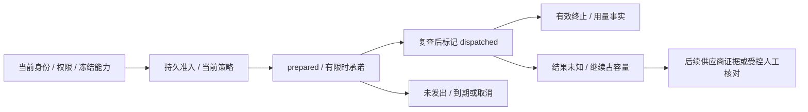

# 持久供应商请求、容量与逐次预算

状态：持久请求基础修复已验证；逐调用预算与完整后台策略管理继续实施。阶段 55 的 531/531 只证明其时的短期凭证、鉴权和协议约束。本册继续修复跨 Worker 请求限额、未知在途及逐次用量事实，随后接入逐调用预算与后台管理；没有关闭原始 102 项综合验收。

## 已确认的缺口

`claim_execution_capacity` 以任务为单位占槽；单个任务可以先后调用多次模型及图片。`AI_MAX_REQUESTS_PER_TURN` 和 loopback 的单请求限制只在一个进程内有效，不能约束其他 Worker 或后台验证。现有 `gateway.request_authorized` 事件不表示实际发出、终止或供应商当前是否仍占容量。任务预留及最终结算也没有为每次付费请求分配预算。

## 请求状态与共同边界

- 所有实际 Worker 文本、图片及后台验证请求在发出前经过持久准入；运行探针与明确标识的测试适配器单独记录范围，不能用它们证明业务调用已接入。
- 准入事务固定原主体、任务/验证、attempt、fencing、模型、能力/定义版本、请求摘要、字节数和策略版本，不保存输入正文、文件路径或凭证。
- 数据库按执行模式串行判断全局、企业、用户/验证人及文字/图片能力的并发和滑动一分钟速率。已准入但尚未发出的请求占用速率承诺，避免多个 Worker 同时通过后集中越限。
- `prepared` 到实际发出前还要复查原身份、权限与当前状态，采用有时限的条件更新。只有从未被标成发出的 `prepared` 可以到期回收；已发出或结果不明的请求不能因租约、进程退出或网络超时自动释放容量。
- 合法完整终止和实际媒体验证确认请求完成，持久化已知用量。错误协议、截断、丢失响应及未知结果保留原请求及容量，不重放。正文消费结束和任务取消均不能代替供应商终止证明。
- 已发出请求失去原任务 attempt、fencing、运行租约或后台验证租约时，维护任务只将其转为 `unknown` 并追加事件。重复维护不再追加相同事件，容量与未知金额继续保留；不能把本地进程结束当作供应商结束。
- SSE 普通帧保持流式传输；有界终止帧等完整 EOF 校验和用量事务成功后才交给 Codex，随后同步结束本次本地响应。这样下一轮不会在上一笔用量落盘期间撞上“忙碌”限制，也不会先接收到一个尚未记账的完成通知。终止后的其他 JSON 事件视为协议错误。
- 用量事实与任务最终账本分开：逐次事实不再次扣费，既有原价结算仍唯一。后续预算分配使用同一请求标识，避免重复预留或记账。

费用事实同时保存 `charge_numerator`，单位为百万分之一 HKD micro。文本为输入 token × 冻结输入单价 + 输出 token × 冻结输出单价，图片为冻结单张价格 × 1,000,000。数据库要求完整用量、成功 HTTP 状态、精确分子和展示用向上取整值相符；未发出取消或拒绝必须是确定零，未知请求不得携带已知费用。最终聚合应累加分子再统一取整，不能逐笔取整后累加，例如两笔各 18/1,000,000 micro 的合计应为 1 micro，逐笔展示值相加却会成为 2 micro。当前没有把逐请求事实再写成扣费账本。

初始共同策略每个执行模式独立：全局/企业/用户并发为 16/4/2，文字/图片/后台验证为 12/4/2；对应每分钟 600/120/60 和 480/120/60。准备中承诺有效 30 秒。策略版本不可改写，发出时重新读取当前版本；新版本收紧限额可以拒绝尚未发出的旧准入。后台发布和管理界面仍是后续实现范围，不能把测试直接插入策略的夹具当作 Admin 管理功能。

## 逐调用预算的要求

文本输入计数采用公司内部地址上的标准 `POST /v1/responses/input_tokens`，包含实际输入、系统指令、工具和输出格式等上下文。精确计数与冻结输入/输出单价、明确输出上限共同形成付费调用的最大承诺；计数不可用时不凭字符数猜测可付费预算。图片使用原能力单价与固定单张规格。后台验证使用独立平台验证预算，不能扣客户账户。

计数、预算分配、重新鉴权与实际发出分别保留事实。分配在任务原预留内原子进行，不增加钱包的重复整项预留。已确认费用、未用分配和未知在途分开；已发出的未知费用不能自动当作零。计数与最终输入量不一致、输出越界或超出分配都阻止下一笔调用并进入核对，不能回写原始费率或静默增加客户预算。

[OpenAI 输入计数指南](https://developers.openai.com/api/docs/guides/token-counting)给出该标准端点及完整上下文计数；[官方 Node SDK 参数](https://github.com/openai/openai-node/blob/master/src/resources/responses/input-tokens.ts)用于核对计数参数。端点仍只指向公司内部服务；用户已授权的当前联调继续使用明确标识的假数据，真实网关支持须另行验证。

## 后台和验收范围

后台须提供当前策略、不可变版本、发布前验证与比较、当前权限/MFA/独立审批、请求与未知容量目录及有证据的核对。容量释放不等于费用归零，人工核对不能伪造供应商完成事实或删除旧记录。普通用户和客服不能修改全局策略，内部成本字段有独立权限。

验收包含真实原生 PostgreSQL、多 Worker 同时争用、滑动速率与准备中承诺、跨企业和能力隔离、撤权及租约/fencing、发出前取消、进程丢失、合法终止、未知持续占用、后台验证及实际用户路径。新迁移从 066 起，SQL001–065 与历史证据保持原字节；两套现有库升级必须独立核对原表和迁移记录。当前实现和运行结果随后按新编号记录，不将设计或单元测试当作全部 TC/NFR/G01–G10 完成。

独立数据库专项已通过 13/13，含四个真实 Node 子进程跨企业争用、已撤权零请求、未知持续占槽和精度反例。扩展回归增加原 Worker/后台验证/实际 Codex 路径、孤立执行恢复及终止帧交接测试。首次 SQL 语法失败、首次扩展回归的交接失败及各次源码前像保存在交付库；不覆盖原始报告。旧共享测试在自己的隔离数据库发布宽松测试策略，保留所有异常请求事实；严格限额由独立专项测试，生产初值保持上文数值。最终来源、通过数字和两库升级结果以本阶段核查回执为准。

## 本阶段执行回执

专项 03 **116/116**，完整回归 01 **546/546**；738 份平台来源在运行前后保持相同，保留阶段 55 全部 531 项命名测试。类型检查、实际构建及夹具实际回收通过。两套现有原生数据库 065→066 升级，各保留 132 张原公共表完整行摘要、SQL001–065 和历史校验值；四张新表强制 RLS，未补造历史调用，SQL066 自此不可改写。自建数据库正常关闭，本轮未打开浏览器或客户端。

详见[来源与范围回执](../quality/provider-control-checkpoint.json)。13/13 和扩展 02 的运行通过是历史源码结果；扩展 02 尚有 ES2022 编译不兼容，已保留原始编译错误，不能作为当前构建证明。当前验证继续使用获准假数据，不关闭逐调用预算、完整后台控制和原始 102 项综合验收。
