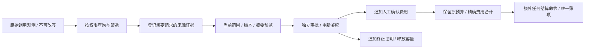

# 调用策略、逐次请求与人工核对后台

状态：本阶段代码、实际后台页面与本地增量升级已验证。专项 158/158 包含于完整回归 588/588，保留原全部 559 项命名测试；最终同一份 753 文件平台来源通过类型检查及构建。实际构建版 Admin 10 项流程、29 份严格响应样本通过。原始 102 项、全部 TC/NFR/G01–G10 与完整产品验收范围不变。两套原生数据库升级各保留 144 张原公共表完整行摘要；SQL001–068 现已不可改写，阶段 58 仅使用增量 068。

## 权限和产品入口

Admin 新增“调用管理”，包含策略版本、逐次请求和核对记录。沿用 CopyPaste 的浅灰背景、墨色文字、品牌字体和蓝色焦点，表格及分栏比较与现有方案/能力面板一致；窄屏改为可阅读的字段组，保留双语、键盘操作和深色主题。

策略读取、草稿、发布，请求元信息、内部费用、证据登记、费用确认、容量释放、任务结算分别登记精确权限。查询和写入复用当前 AdminSession、近期 MFA、显式 deny、范围及审计；后台验证属于平台全局主体，企业或项目授权不得访问。请求正文、用户提示词、文件路径、密钥和执行 nonce 不出现在此面板。

权限目录以增量补充文件登记，不改写原始规范权限。全新安装的超级管理员使用明确的新权限集合；已有角色不得因启动或升级自动获得新增权限。既有安装通过可预览、指定主体和原因的受控运维命令显式启用，撤销旧会话并保留审计。业务写入继续要求另一位当前获权管理员审批。

权限清单以 [增量权限合同](../contracts/provider-admin-permissions.json) 为准。每项查询及变更均审计；“拥有后台入口”不能替代具体权限。

| 精确权限 | 可见范围 | 作用与额外要求 |
| --- | --- | --- |
| `admin.ai.policy.read` | 全局 | 当前策略与不可变版本；范围内 deny 优先 |
| `admin.ai.policy.draft` | 全局 | 建立新草稿，无业务效果；同时需要策略读取 |
| `admin.ai.policy.publish` | 全局 | 当前版本预览、独立审批发布；不能扩大旧任务/旧日预算 |
| `admin.ai.requests.read` | 全局、企业、项目 | 只读逐请求元信息；费用与证据另需费用权限 |
| `admin.ai.cost.read` | 全局、企业、项目 | 内部费用与来源证据；不得跨主体或借筛选推断隐藏费用 |
| `admin.ai.evidence.write` | 全局、企业、项目 | 登记绑定原请求的人工来源，同时需要请求与费用读取 |
| `admin.ai.cost.reconcile` | 全局、企业、项目 | 独立审批追加费用事实；不释放容量、不扣客户钱包 |
| `admin.ai.capacity.release` | 全局、企业、项目 | 独立审批追加终止确认；不确认费用、不减少未知承诺 |
| `admin.ai.tasks.settle` | 全局、企业整体 | 原任务最终结算；项目授权或项目 deny 不能覆盖企业整体结算 |

审批者还需共享审批面板的读取/决定权限，以及与原操作者相同的当前业务权限、作用范围和近期 MFA。请求目录不含原提示词、调用正文、执行 nonce 或 fencing token。后台验证记录只对当前满足全局权限且无适用 deny 的管理员开放。费用权限撤销后，服务端 DTO 移除费用、证据和费用筛选结果；普通任务/作业/审批接口同样重查这些业务范围，不能从通用入口绕过。

## 策略发布

草稿固定并发、滑动速率、准备时限、计数验证与明确价格、后台单次及平台每日预算。发布预览比较当前策略和拟发布策略、当前 UTC 日边界及适用数据模式，不调用模型、不改变任务、钱包或已存在分配。提交与审批都检查原操作者、审批人、当前精确版本、网关标识、策略来源、期限、命令摘要及幂等键。

发布更新受控指针，不改写旧版本。启动配置只初始化尚无后台发布的边界，不覆盖已审批发布。当前任务的原预留、冻结模型和价格均不得扩大或替换；同日提高配置不自动提高旧日边界，降低配置立即限制后续准入。确认价格属于人工协议声明，须关联可检查的证据，不能把声明或模拟检查视作真实模型资格验证。

可编辑的准入字段共十三项：平台、企业、原用户、文字、图片、后台验证各自的同时请求数和每分钟请求数，以及准备超时。并发范围 1–1000，分钟范围 1–100000，准备时间 1–300 秒。费用部分分别填写每次计数费用、每次后台验证预算、每日验证预算、每日平台计数预算；所有金额以 HKD 输入，转换为精确 micro（1 HKD = 1000000 micro），不能用浮点近似值计费。计数“已核对”必须同时具备来源参考、至少十字的条款说明、明确单次费率及已生效日期；零费也须明确声明，不能把缺失值理解为免费。

## 请求目录与核对

目录按任务/后台验证、文本/图片/计数、数据模式、企业、项目、原用户、能力版本、结果和时间筛选，使用绑定当前权限、筛选和稳定排序的分页游标。内部费用有额外字段权限；平台验证与客户任务分别归属。详情区分原始观测、人工确认、预算承诺、计数证明和最终任务结算，逐请求展示值相加不得冒充客户账单。

证据采用不可变、可下载核对的结构化记录，绑定原请求 ID/摘要、公司供应商引用、记录日期、数据模式、终止声明、实际用量或计数结果及原始来源说明。创建、读取、审批与应用均记录操作者和范围。人工声明由独立审批确认，不伪装为网关实际收到的响应；实际联调继续使用明确标识的假数据。

费用确认和容量释放是两个独立命令。前者按原冻结价格及证据中的实际用量计算精确分子，保留原始未知记录，只追加人工费用事实；后者在独立审批后凭终止证据释放共享容量，不改变费用、预算承诺或客户账本。相同请求的重复命令只能返回原结果；不同金额、证据或状态必须冲突，不能覆盖。

客户任务最终结算是额外的受控命令：检查全部相关费用事实已明确、原预留仍存在、无未归属的工具费用及无超预算差额，再合计精确分子统一取整、调用原账务服务一次。不能逐笔重复扣款，不能把未知改为零，不能宣称业务执行成功。超出原批准预算的实际费用继续保留核对状态，需另外明确处理差额。旧的任意金额核账不得绕过有逐次记录的任务。

文本费用分子为 `input_tokens × 原输入单价 + output_tokens × 原输出单价`，分母为 1000000；图片按原每张 micro 单价乘张数计算。计数按平台冻结单次 micro 费用计算。人工费用记录保存精确整数分子，使用 BigInt 计算；任务合计全部生成请求后再向上取整一次，独立排除平台输入计数。手工证据中的账单必须与原冻结价格推导的向上取整值吻合，否则只保留证据、拒绝费用确认。独立终止证据仍可申请释放容量，不能借此把差价当作已解决。

`not_executed` 证据仅接受零实际用量及零费用，不推造成功计数证明；计数结果未知可记录为空。证据时间不得早于实际发送时间或晚于服务器当前时间。额外的客户端 `verified`、`success`、结算额等字段严格拒绝。超出原任务预算的已发生费用会保留下来并记录违约；任务结算须明确确认当前全部不可变违约 ID，且最终状态保持 `failed / PROVIDER_COST_RECONCILED`，不伪造业务产出成功。

## 接口与数据边界

[增量 OpenAPI](../contracts/provider-admin-openapi.json) 和 [严格输入/返回模型](../contracts/provider-admin-schemas.json) 补充原合同，不改写原始 OpenAPI。变更请求使用独立 Admin cookie、CSRF 和幂等键；预览及审批保留各自期限，重复请求必须绑定相同命令及当前有效权限。

| 方法与路径（前缀 `/v1/admin/ai`） | 含义 |
| --- | --- |
| `GET /policy` | 当前已发布边界、网关摘要和当前 UTC 日已冻结预算 |
| `GET /policies` | 不可变草稿及发布历史，带权限/筛选绑定游标 |
| `POST /policies/drafts` | 登记新草稿，返回已完成登记的 AdminOperation |
| `GET /requests` | 按主体、服务、结果、费用、容量、归属及时间筛选 |
| `GET /requests/{channel}/{request_id}` | 原始状态和单独的人工费用/终止事实；费用额外授权 |
| `POST /requests/{channel}/{request_id}/evidence` | 登记不可变来源，不产生费用或容量效果 |
| `GET /evidence/{evidence_id}` | 重新鉴权后读取结构化来源、canonical 文本及 SHA-256 |
| `GET /tasks/{task_id}/settlement` | 原任务版本、原预留和当前违约列表，无扣费 |
| `POST /previews` | 固定策略或核对命令的当前事实；五分钟内、无业务效果 |
| `POST /operations` | 消费精确预览并送独立审批，不能自批 |

审批沿用 `/v1/admin/operations/{operation}/approval` 与 `/v1/admin/approvals/{approval_id}/decisions`；新增命令在共享审批、作业目录和普通操作读取中仍受原业务权限约束。签名游标固定 as-of 时间和排序，权限、筛选或数据模式变化时不可复用。

SQL068 仅增加七张控制表、内部请求视图与相关守卫：草稿、发布、当前指针、来源证据、费用确认、终止确认、任务结算。历史表禁止更新/删除，应用与队列数据库身份不得直接读取或写入。触发器再次绑定原请求、当前数据模式、运行中 AdminOperation、操作者及独立审批人，不能只依赖界面或 HTTP 输入校验。费用事务与审计同进退；并发决定只会产生一个确认及一个任务账项。



## 验证要求

验证必须覆盖真实原生数据库、跨范围和数据模式隔离、额外费用字段权限、游标篡改/筛选变化、审批原操作者及审批人撤权、MFA/期限、指针变化、同日预算边界、启动重载、重复/并发、审计故障回滚、虚假客户端成功标记、费用与容量独立、平台计数不进客户钱包、原始未知事实保留及唯一最终结算。页面需以实际 Admin 登录流程验证双语、深色及窄屏，并保存截图和源码摘要；结束后关闭自建页面与进程。

历史 559/559 保留阶段 57 原来源。本阶段最终专项 03 的 158/158 与全量 01 的 588/588 绑定同一份当前平台来源；原命名测试全部保留。真实构建版 Admin 08 记录 10 项检查、29 份严格响应和 11 张未编辑截图；失败、执行前像与实际夹具回收结果均保留。详见[本阶段完整回执](../quality/provider-admin-checkpoint.json)。模拟数据、人工证据与真实供应商资格分别标识。

## 既有安装的启用与运维

升级 SQL068 不自动扩权。受控运维人员须先通过已有管理员流程准备至少两位已启用、完成 TOTP、具有永久全局超级管理员身份且无适用 deny 的独立主体，随后在 Platform 仓库分别执行：

```powershell
node --env-file=.env --import tsx scripts/admin-enable-provider-control.ts --principal PRINCIPAL_UUID --reason "指定调用管理负责人"
node --env-file=.env --import tsx scripts/admin-enable-provider-control.ts --principal PRINCIPAL_UUID --reason "指定调用管理负责人" --apply --expected-hash PREVIEW_SHA256
```

第一条只预览。第二条必须使用完全相同的主体、原因和刚取得的完整摘要；摘要同时绑定当前数据库身份、原角色/绑定和精确的新权限集合，变化后须重新预览。应用只为该主体建立受控补充绑定、记录系统审计并递增认证版本，不改写既有超级管理员角色，不经公开 HTTP 接口调用，不在服务器启动中执行。旧会话被撤销，目标管理员须重新完成邮箱/TOTP 登录；另一位审批人同样须独立启用。

启用后进入 Admin“调用管理”：先建立策略草稿，明确填写计数来源与价格；预览后送交另一管理员，在“审计与审批”核对来源、边界和原因再发布。未知请求依次登记来源、分别预览费用确认/容量释放，并在完整费用明确后额外申请原任务结算。操作入口定位具体审批 ID，不依赖管理员手工搜索。旧会话、失效预览、被撤权操作者或变化后的事实均不能继续生效；审计失败会回滚整笔事务。

本地测试只使用原生 Windows PostgreSQL。全部失败、执行前像、原始 TAP/日志及实际夹具回收结果分别保存；不重用失败编号，不改写历史成功记录。真实供应商回调尚未接入，当前证据始终标注为人工来源。实际 AI、媒体及支付继续使用用户授权的假数据，不能据此授予实网模型资格或发布验收。
