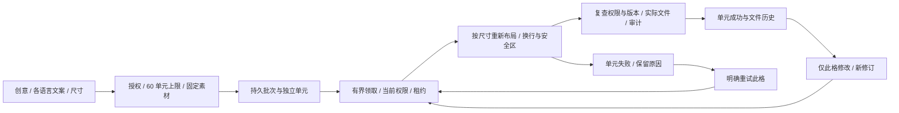
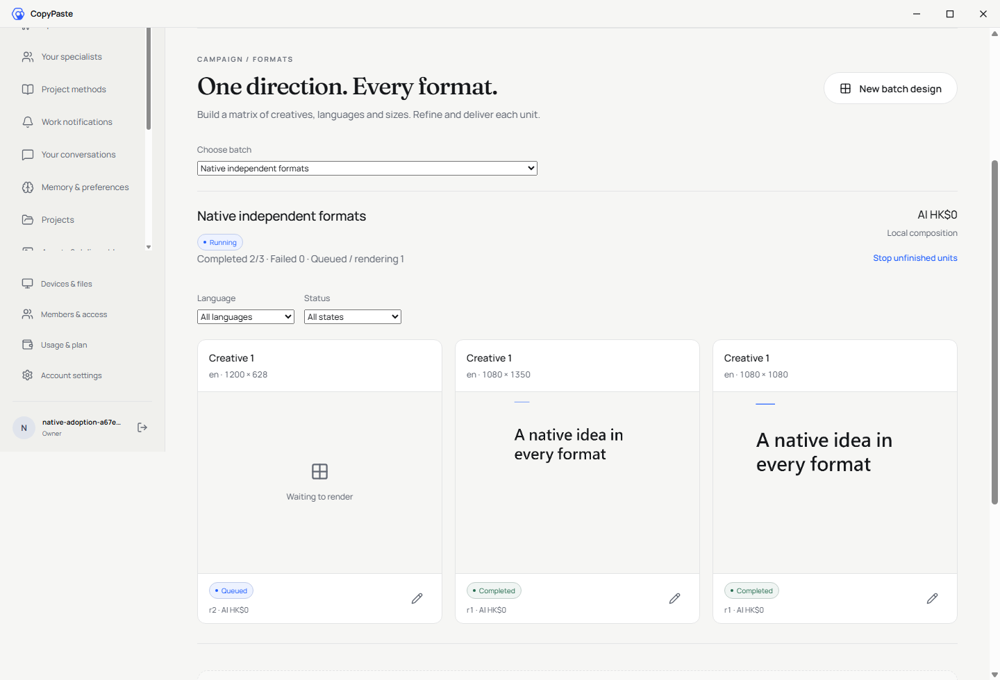
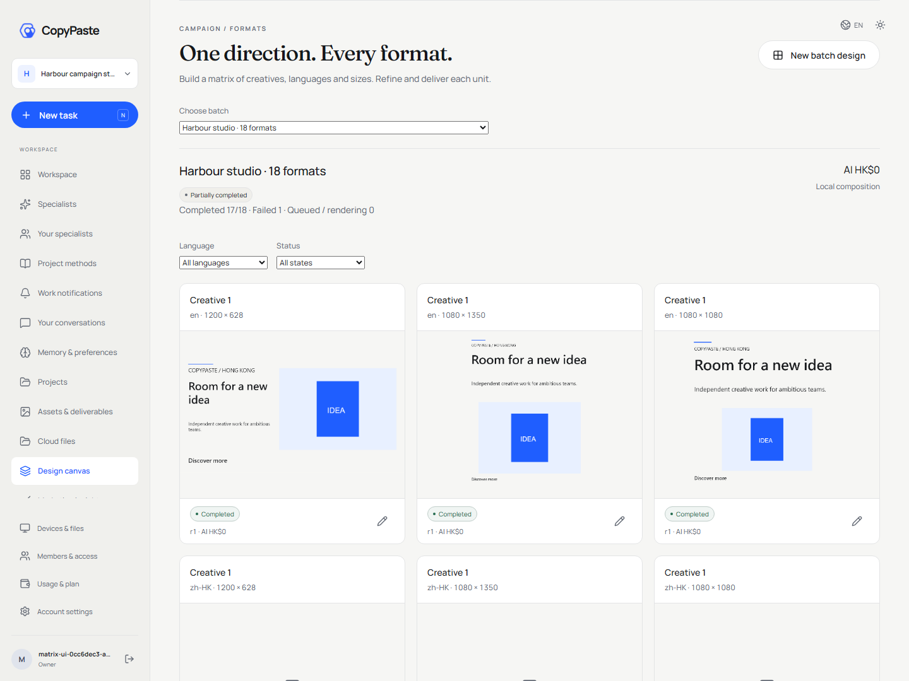

# 营销设计批次与单元独立交付

状态：本地确定性排版子流程已验证；完整产品综合验收继续跟踪。关联原需求 REQ-012、016、017、022、048、049、052；不改变原 TC-017 的 3 创意 × 2 语言 × 3 尺寸及超过 60 单元拒绝条件。

## 产品流程

在设计画布进入批量设计，填写创意方向、每种语言的品牌行、标题、正文及行动文案，选择项目内固定版本的 PNG，确认尺寸与总单元数后创建。纯文字创意也可使用。默认提供方形、直向与横向三种尺寸，实际布局按长宽比重新计算图文区域、换行与安全区，不将整张海报等比缩小。

每个交付单元具有独立身份、输入修订、执行记录、状态、原始费用事实和输出文件。只修改或重试指定单元，其他单元的输入、文件版本、费用和执行次数保持不变。成功、失败和取消均按实际结果展示；一格失败不回滚已完成格。批次取消仅停止尚未完成的格，不删除已经交付的文件。

本能力只执行确定性的本地排版与 PNG 合成，保存 SVG 和可恢复输入描述；不生成或翻译文案、不调用任何 AI。AI 费用明确为零且来源为本地合成，不能表示已有图片生成资格，也不能把已有素材的上游费用重复计入本次渲染。

## 数据与执行约束

批次沿用 `creative_projects` 的项目归属、后台控制、隔离及保留周期，新增专用 kind。单元、输入修订和实际执行分别保存；输入修订追加，已结束执行不重写。所有原 SQL001–068 保留字节，使用增量迁移 069。

单批 1–60 个笛卡尔积单元，重复创意键、语言或尺寸键拒绝。创建在入队前检查数量、字段、尺寸与固定素材授权；客户端传入费用、成功、输出 ID 等字段拒绝。任务接受后依靠持久单元队列，网页关闭不影响执行。

Worker 有界领取，当前用户、企业、项目、数据模式、输入修订及素材状态在领取和最终发布分别复查。渲染使用独立租约；过期执行标记中断，迟到进程不能发布或覆盖新修订。局部重试使用当前操作者权限并保留原失败，不重做成功格。持久写入与审计同事务，文件故障不得发布缺文件的成功记录。

图片仅接受同项目已共享的固定 PNG 版本，服务端保存摘要并验证实际字节；私人会话素材不隐式提升为项目共享。批次或源图隔离/删除后，原派生产物同样不可继续下载。恢复不恢复已删除内容。后台可通过原内容目录查看、隔离、恢复和删除批次；删除须清理全部修订中的正文与请求重放副本。

渲染队列每企业同时一格、平台同时两格；单项目最多 240 个未完成单元。一个单元最多 50 次输入修订、100 次执行记录，超过边界明确要求新建批次。领取租约默认 90 秒，排版超过 85 秒失败；中断执行保留原收据，必须明确重试。局部合成使用独立维护任务，不等待它结束再清理其他队列、邀请或删除记录。

源图删除会为包含其像素的 PNG、SVG 与编辑描述触发原资产删除账本，并登记依赖；嵌套使用已有交付 PNG 的批次同样传播。只有全部子副本完成物理清理后，原删除作业才报告完成。失败与完成事实保留，旧输出不因费用为零或可重新合成而绕过删除与隔离。

## 业务接口

所有接口位于 `/v1/tenants/{tenant}/projects/{project}/creative-batches`，沿用用户身份、CSRF、企业/项目权限和幂等请求键。读权限不包含创建、修改、重试或停止权限。

| 方法与后缀 | 行为 |
| --- | --- |
| `GET /` | 当前项目和数据模式的批次目录，每页 20 项，稳定时间/ID 排序及下一页 |
| `POST /` | 验证全部轴及固定素材，原子创建最多 60 个持久单元，返回批次 ID |
| `GET /{batch}` | 当前输入修订、独立状态、全部执行与实际产物 ID；不返回租约或执行凭证 |
| `POST /{batch}/units/{unit}/edit` | 匹配当前修订后追加新输入，仅重新排版此格；可明确换图或改为纯文字 |
| `POST /{batch}/units/{unit}/retry` | 只重试失败/停止格，保留原输入修订与失败收据，不重复扣费或执行成功格 |
| `POST /{batch}/cancel` | 匹配批次版本后停止未完成格，保留已完成输出及历史 |

输出复用原项目资产的预览和下载接口；每次复查用户、项目、资产、批次和源图状态。PNG、SVG、JSON 编辑描述为三个实际文件；SVG 使用字体引用，PNG 为服务器实际字体渲染，字体文件未嵌入或分发。本阶段不宣称完成自定义字体来源/商用授权、PDF 印刷或其他专业软件工程资格。

本地排版采用 [Canvas 原生库](https://github.com/Brooooooklyn/canvas) 的字体度量、文字绘制和异步 PNG 编码；不在 Worker 启动浏览器。原有单张海报/PDF 渲染保留原入口。

## 页面与交付

页面使用现有 Manrope/Fraunces、浅灰背景、墨色正文和蓝色焦点 token，不新增独立主题。主体为语言/尺寸矩阵与逐格产物，窄屏改为带完整规格的单列卡片。输入修订、输出历史、失败定位、明确重试、取消和下载可用键盘操作；错误保留已填写内容。

Web 与无边框 Desktop 使用相同受控业务视图。原生 Side Panel 保留轻量任务和素材操作，新增固定公司域名的批量设计入口，打开已登录的完整设计工作台；不在窄侧栏嵌入完整画布，也不将网页标签称为原生侧栏。客户端独立仓库保留自身源码快照及双语 README；更新预览包时保留旧安装器与旧侧栏 ZIP，不能用旧的实际 UI 记录证明新源码已验收。

## 验收要求

执行原 TC-017：18 格逐格验证状态、尺寸、文件摘要和费用来源；让一格失败，修改另一格并重试原失败格，证明其他 16 格不重新执行。实际创建 60 格并验证 61 格以上在写库及执行前拒绝。覆盖重复提交、修订冲突、双 Worker 领取、过期租约与迟到完成、取消、撤权、跨企业、隔离、源图删除、正文删除、对象故障与审计回滚。

排版验证繁中/英文、价格、长标题、换行、最小字号及明确溢出错误。实际浏览器验证矩阵、单格编辑/重试、下载与深色窄屏；结束关闭本轮所有自建浏览器和服务。正式字体授权、真实图片模型、其他专业交付及完整 TC/NFR/G01–G10 仍逐项独立验收。

<!-- stage59-creative-matrices -->
## 当前实际执行

专项 22/22、平台 607/607、实际 Web 10 项及新打包原生客户端 13 项通过，类型与既有 Web 8、Desktop 25、Extension 21、Delivery 12 项测试通过。实际复查包括原生无菜单/窗口按钮/PKCE、长页面后的弹窗、单格修改、真实工具栏侧栏及双语。两库升级保留 151 张原表、新三表强制 RLS。全部实际截图、来源绑定与失败记录见[核查回执](../quality/creative-matrix-checkpoint.json)。

Desktop 首次候选的滚动弹窗问题已保留在失败记录，修复仅位于原生 preload，未修改已通过 607 项的后端/Web 来源。修复后单独重建 `release/matrices-59-02/` 并重新执行原生流程，旧 `matrices-59/` 与 `adoption-54/` 包保持原字节。

当前阶段 59 包的只读复核：在项目根目录执行 `node docs/tools/verify_creative_matrix_clients.mjs NN`，使用未占用的两位报告编号。它核对实际运行包、源码、内嵌代码及扩展 ZIP 内容，保留旧包，不启动浏览器或应用。
