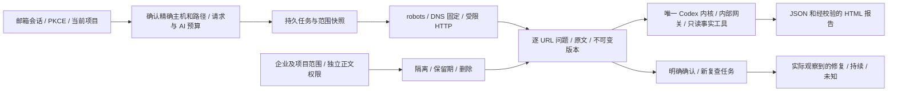

# 有范围约束的 SEO 诊断与复查

阶段 62。关联 REQ-029、004、008、010、012、024、039、043、090–096；原 TC、NFR 和 G01–G10 保留。阶段 61 的已提交回执继续只证明当时的营销连接与原生客户端，不证明本阶段新增能力。GEO 的固定观测与样本比较属于后续独立执行链，不由 HTML 检查代替。本文区分当前实现与完整业务仍需完成的内容。

## 改动前的差距

改动前的 `seo/audit` 接口仅接收用户粘贴的 HTML，正则检查标题、描述、H1、canonical 和 JSON-LD。它没有实际受限站点抓取、robots、重定向/IP 校验、断链/重复标题、逐 URL 证据、持久恢复或版本复查。原界面的「SEO / GEO」名称过度表达能力。本阶段将用户入口改为实际的「网站诊断与复查」，历史接口不作为完整 SEO 或 GEO 的验收证据。

## 完整业务流程与当前实现

用户在现有营销工作台确认起始 URL、精确主机、路径前缀及页数预算 → 保存不可变规格与任务 → 持久抓取并显示范围、限制、失败和剩余 URL → 查看按 URL 分类的问题、原始文本证据及建议 → 导出和创建修改任务 → 对相同范围明确发起复查，保留旧报告及问题变化。检查不会提交表单、登录网站或写回 CMS。

当前代码已提供确认、抓取、证据、Codex 解释、下载和不可变复查。**将选定问题保存成有来源治理的后续修改任务仍未实现**；普通下载、复制建议或复查按钮不能代替这一环节。因此本阶段只能增加 REQ-029 的局部证据，不关闭完整 UC-05/TC-029。

新增能力复用现有身份、项目访问、任务预算、Codex、内部 AI 网关及资产治理。抓取和规则诊断是确定性工具；AI 解释经当前 Codex 和公司网关执行，不能拓宽用户确认的网络范围。抓取准备完成前不启动模型调用。取消、暂停、权限撤销、内容隔离与删除需要在请求前后重新校验。

## 接口及数据模型

补充契约为 [scoped-seo-openapi.json](../contracts/scoped-seo-openapi.json)，包含 8 个操作和 14 个严格结构，并绑定实际模型、路由源码和响应样本。原规范 [openapi.json](../contracts/openapi.json) 不改写；补充接口不表示完整规范 `POST /v1/tasks` 和 TaskDTO 已经对齐。

| 方法与路径 | 当前行为 |
| --- | --- |
| `GET /v1/seo/audits` | 当前项目内用户自己的诊断记录 |
| `POST /v1/seo/audits` | 严格校验范围，保存私有诊断及普通任务、预算预留和执行快照；幂等提交 |
| `GET /v1/seo/audits/{run}` | 范围摘要、请求/字节预算、任务费用、剩余范围和限制 |
| `GET /v1/seo/audits/{run}/findings` | 分页问题、原文位置及有条件的版本比较 |
| `GET /v1/seo/audits/{run}/pages` | 分页实际页面、跳转、状态及未访问原因 |
| `GET /v1/seo/audits/{run}/documents/{document}` | 授权后读取原文证据、版本、字符编码、摘要和缓存来源 |
| `POST /v1/seo/audits/{run}/recheck` | 明确的新请求创建同范围新任务，保留旧版本；新请求校验版本，同一已成功请求可重试 |
| `GET /v1/seo/audits/{run}/download` | 带当前租户认证的真实 JSON/HTML 附件，验证版本及内容摘要，禁止共享缓存 |

所有接口要求当前用户会话与 `X-Tenant-ID`，同时校验当前项目访问。前端缓存键包含租户；切换项目、退出或请求返回前权限变化，不能继续展示旧来源。公开 HTML 诊断明确拒绝 `connection_id`；Search Console 的连接指标继续使用已有连接同步流程，不伪装成本站点抓取已包含的能力。

SQL078 新增 `seo_runs`、`seo_documents`、`seo_origin_slots`，均启用 FORCE RLS；SQL079 修正绑定触发器的别名歧义。001–077 保持原字节，078/079 首次成功应用后也不可重写。正文作为私有资产版本保留，运行规格、任务绑定、缓存祖先及版本链不可任意修改；跨用户或跨租户不能用 UUID 绕过访问控制。

Worker 使用持久租约与租户范围队列，在每次网络请求之前提交请求意图及预算。当前全局最多两个、单租户最多一个抓取租约，同源请求按持久时间槽限速。正常关闭中断在途 HTTP，保留已消耗的尝试，恢复后不把结果未知的请求当成已成功。存储容量不足或来源/权限失效时停止抓取，取消尚未启动的 AI 任务并释放未使用预留，不能无限重试已知失败。

复查提交的幂等结果先于首次提交的版本约束判断，但每次重试仍重新验证当前用户、项目、原来源和结果来源。原任务稍后完成 AI 报告而增加版本号，不会把已成功的同一请求误判成新请求；同键改预算仍冲突，新键带旧版本仍要求刷新。抓取授权先验证来源，再读取受 RLS 约束的租约行；因此祖先来源隔离会取消未执行的复查并释放预留，不会把隐藏行误认为可无限重试的租约丢失而拖住后续任务。

## 抓取与证据约束

- 仅公开 HTTP/HTTPS、标准端口、明确获准的精确主机与路径；每次 DNS 解析及每个重定向重新检查范围和 IP。传输连接固定到已检查的地址，同时保留原 Host/TLS 校验；不转发 Cookie、Authorization、代理或用户提供的任意请求头。
- 私网、环回、链路本地、元数据和其他保留地址拒绝；混合公私地址回答也拒绝。开发夹具只能在非生产模拟环境通过私有配置启用，界面和产物明确标记合成网站。
- robots 保存抓取时间、原始来源和规则决定；服务器错误/不可达时停止该范围抓取。最多五跳并在每跳执行范围与 IP 校验。读取预算至少覆盖 RFC 9309 的 500 KiB 最低解析边界。访问限制、登录页面和 robots 阻止属于覆盖说明。
- 页面、请求尝试、重定向、响应字节、发现队列和作业时间均有持久上限。崩溃后的只读重试保留尝试记录，不能绕过预算。达到上限显示剩余范围；分页/队列结束不承诺全站覆盖。
- 使用 HTML 解析器及源位置，不执行脚本。标题、描述、H1、canonical、索引指令、结构化数据和链接分别记录。断链只针对实际检查的目标；重复标题只针对本次可读取的成功页面。未检查页面不自动通过。
- 证据保留不可变源资产版本、UTF-8 SHA、URL、时间、HTTP 状态以及明确单位的文本位置和摘录。原始 HTML 作为文本保存，不直接作为应用页面执行。
- 复查创建新任务及报告；相同规格下只对实际重新检查的 URL 判断修复/新增/持续，未复查、访问受限或失败的对象保持未知。旧来源失效时不能继续读取旧正文或比较出假结论。

原始响应字节、解码后的 UTF-8 文本和容器分别记录 SHA-256；引用位置明确采用 UTF-16 code units，不能误称字节偏移。HTTP 304 保存本次响应摘要和原始内容来源；源容器被隔离、到期或删除时，304 派生证据与复查历史同样停止提供正文。缓存只在允许的有效期内复用，`no-store` 和不确定的 `Vary` 不复用。

AI 仅能读取冻结事实工具，输出引用必须来自实际读取的证据，数字须可追溯。HTML 由服务端转义和渲染，客户站点脚本及模型 HTML 不进入应用执行。该校验约束证据和数值来源，不表示自然语言分析的全部语义已自动证明正确。

Admin 继续区分企业/项目范围、元数据权限、正文读取权限和内容操作权限。只有元数据权限的管理员不能打开客户源正文；具有正文权限后才能审阅文本。隔离来源会阻止客户读取派生报告；删除通过现有删除任务、物理存储回收和追踪日志传播到派生证据及主动发布副本。

## 三端表现

Web 沿用 CopyPaste 品牌、繁中/英文、浅深主题和既有营销工作台。创建范围及复查都要求用户明确确认；来源显示 URL、HTTP、抓取时间、编码和内容摘要。窄屏采用单列布局，长 URL 不撑破页面。

Desktop 使用同步的工作台 renderer 和明确的 SEO 路由/方法白名单，下载通过当前租户认证桥和原生保存窗口。无系统边框、无 Electron 应用菜单、无 Alt 菜单，40px 自绘拖动区与最小化/最大化/关闭按钮不被弹窗覆盖。长表单在标题栏下的受限可见区域滚动；滚动后整个表单的离屏坐标不作为越界证据。固定公司浏览器授权结束后，原生 QA 激活其自有 Desktop 再发送真实输入事件。

扩展工具栏按钮打开/收起真正的 Chrome 原生 Side Panel，未定义 action popup；默认右侧并遵循浏览器位置设置。「网站诊断与复查」由用户主动点击，打开固定的公司工作台路径，未知目标回到固定首页，不接受任意外部 URL。原生 QA 的临时页面、扩展 profile、浏览器和 Desktop 在结束后关闭。细则见[原生窗口与侧栏](30-native-window-and-browser-sidepanel.md)。

## 验收计划

真实原生回环 HTTP 夹具覆盖断链、重复标题、robots、登录/访问限制、跨域与私网重定向、响应过大、超时、限流、重复 URL、页数/时间上限、中断恢复、取消及复查。对实际 DNS 固定传输另验证混合地址、IPv4/IPv6 特殊地址和重新解析边界。随后执行租户/私人范围、当前权限、资产隔离/过期/删除、Admin 正文权限、实际 Web、无边框 Desktop 和原生 Side Panel 流程。

测试通过后才填写实际结果，保留失败输出与源码前像。完整 SEO、全部规范任务类型、GEO、专业角色和生产验收仍逐项保留，不能仅以 HTML 单元测试关闭 TC-029。

阶段 61 的进度、验收和入口文档原始字节保存在[归档清单](../quality/history/stage61-before-scoped-seo/manifest.json)。入口 Markdown 以 `.md.snapshot` 保存，记录原链接根目录 `docs/`，作为当时源码数据；当前可导航入口仍为主目录的 README 和 DELIVERY。归档不重写原文，也不放宽现行链接检查器。

## 回归中实际修复的边界

- 原生 HTTP 超大响应的首个大小错误，不能被随后的中断事件覆盖成普通取消；在途关闭保留未知请求预算。
- 资产读取锁定父资产，避免对只追加的版本表扩大 UPDATE 权限；来源在存储读取后失效，响应不能继续携带旧正文。
- SQL078 绑定触发器的记录变量歧义以 SQL079 前向修复，保留已经成功应用的历史迁移。
- 真正的 SQL 存储限额错误必须终止无模型调用的抓取并释放预留；测试通过独立管理员审核、发布和授予仅测试企业使用的固定计划验证，未修改既有计划版本。
- 同一复查请求在原报告完成后仍返回原结果，改预算及新键旧版本分别冲突。隔离祖先来源会取消尚未执行的复查，后续企业任务继续获得队列机会。
- Web 窄屏长 URL 和面板网格不再撑破视口；Desktop 验收显式恢复外部授权后的原生窗口焦点，并检查长弹窗被标题栏下的区域正确裁切和滚动。

专项测试保留原始 TAP、所绑定源文件的前像和验证器；UI/原生尝试保留日志、实际采集的截图、来源摘要及验证器。失败尝试独立保存，不将旧失败回执重新标记通过。数据库单元流程使用受约束的 Runtime 替身；Web 和原生流程另外启动真实锁定版本 Codex，通过内部模拟网关执行，二者的证明范围分别记录。

## 当前实际结果与交付范围

以下结果绑定同一最终源码及 `scoped-seo-62-02` 客户端产物。执行时间、原始输出、来源摘要、失败历史及清理证明见[当前检查点](../quality/scoped-seo-checkpoint.json)。

| 验证 | 实际结果与证据 |
| --- | --- |
| 专项核心、数据库与迁移 | `integration-10`，45/45，通过真实存储限额、复查幂等及来源隔离后的队列继续执行等边界 |
| 完整平台回归 | `regression-01`，716/716；原 674 项命名测试全部保留，无跳过或取消 |
| 实际 Web/Admin | `ui-05`，13 项流程，11 个实际 HTTP 响应通过补充契约校验，包含繁中窄屏及分离的管理员正文权限 |
| 当前包原生执行 | `native-04`，20 项；实际运行无边框 Desktop、自绘窗口控制、无 Electron/Alt 菜单、PKCE、原生保存及工具栏开关原生 Side Panel |
| 各端编译与逻辑 | `clients-01`，13 个构建、类型检查及测试作业全部通过 |
| 本地原生数据库升级 | `upgrade-01`，两个数据库 SQL077→079；原 164 张表全部行摘要和 SQL001–077 不变，三张新表为空且 FORCE RLS；自建数据库服务已退出 |
| 包与源码再次核对 | [只读复核](../quality/scoped-seo-client-recheck-01.json)，20 项原生记录绑定 3 个产物、31 个 ASAR 内嵌文件及 20 个扩展 ZIP 条目，保留以往产物原摘要；没有再次启动应用或浏览器 |

当前 [Desktop 截图](../design/implementation/scoped-seo-62/seo-native-04-seo-findings-en.png)显示 40px 自绘标题栏和客户工作台；[原生侧栏截图](../design/implementation/scoped-seo-62/seo-native-04-sidepanel-en.png)来自实际扩展 Side Panel。截图保持采集原字节；原生交互断言另保留在执行回执中。

可使用的本地预览为 Desktop `dev/copypaste-desktop/release/scoped-seo-62-02/` 下的 Setup、Portable 和 unpacked 应用，以及 Extension `dev/copypaste-extension/release/scoped-seo-62-02/CopyPaste-0.5.0-sidepanel.zip`；摘要见[产物清单](../quality/scoped-seo-artifacts.json)。实际执行的是 unpacked Desktop 和 Chrome 原生侧栏。安装程序未签名，安装、商店发布、正式服务和真实 AI 质量尚未验收。业务及模型数据继续使用已获授权的模拟数据。

原 102 项需求、102 个完整 TC、NFR 和 G01–G10 均保留。本阶段仅将 REQ-029 增加为局部验证，当前为 81 项有局部证据、21 项未证明完成、0 项完整验收，真实合格专业角色仍为 0。后续需完成有来源治理的修改任务、规范任务契约、独立 GEO 观测、正式 DNS/TLS 站点及原全部业务验收。

## 技术依据

- [RFC 9309](https://www.rfc-editor.org/rfc/rfc9309.html)：robots 匹配、重定向、不可达、缓存及解析边界。
- [Node HTTPS](https://nodejs.org/api/https.html)：显式请求选项、TLS 与受控连接。
- [ipaddr.js](https://github.com/whitequark/ipaddr.js)：IPv4/IPv6 解析及特殊范围分类。
