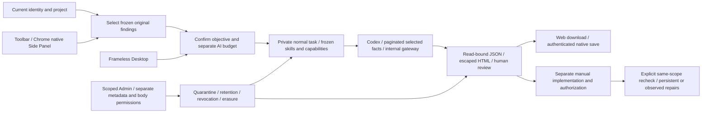
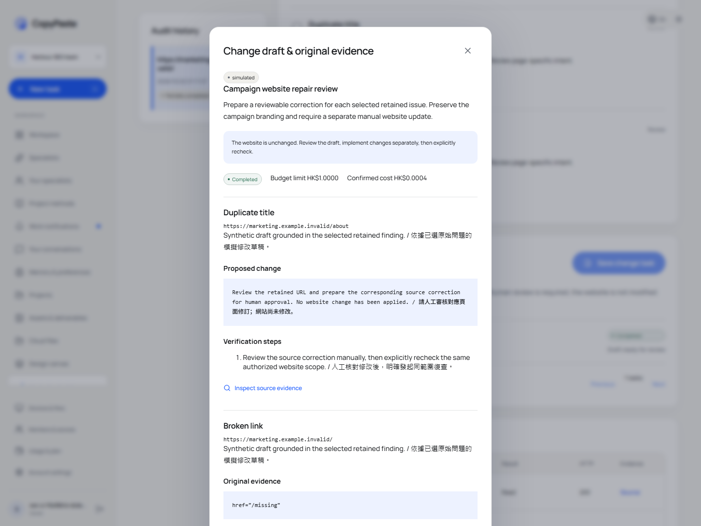
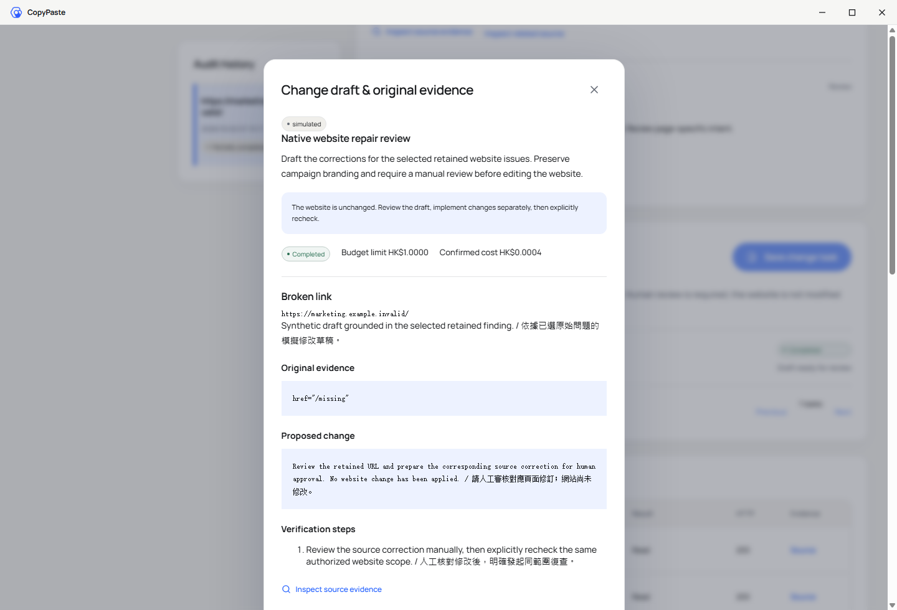

# 网站修改任务与来源治理

<!-- stage63-source-governed-website-changes:start -->
## 当前执行与交付

完整平台 **734/734**，前阶段全部 **716 项**命名测试保留；实际 Web/Admin **18 项**、当前新包原生 **23 项**，六仓库 13 项检查通过。两库 SQL079→080 保留原 167 张公共表全部行摘要，新增表为空且强制 RLS。失败执行和旧源码回执保留，不作为当前包的通过证明。

见[当前绑定回执](../quality/seo-change-checkpoint.json)、[包及 SHA 清单](../quality/seo-change-artifacts.json)和[四操作补充契约](../contracts/seo-change-tasks-openapi.json)。本阶段验证采用已授权的模拟 AI/业务数据；实际运行当前 unpacked Desktop 与 Chrome 原生侧栏。Setup/Portable 安装、签名、商店及正式环境仍待完成。完整 102 项需求、TC/NFR/G01–G10 不缩减。

<!-- stage63-source-governed-website-changes:end -->

阶段 63，所列本地模拟子流程已完成并绑定当前源码与包。关联 REQ-029、010、012、039、043、090–096 及 UC05。原 102 项需求、完整 TC、NFR、G01–G10 和正式环境验收保持原范围；上一阶段的绑定结果仅证明当时的源码和包。

## 已核实的差距

阶段 62 已提供受限网站抓取、不可变原文、逐 URL 问题、Codex 报告及复查，但缺少 UC05「保存修改任务」。下载报告或手动复制建议无法形成可管理、可追溯的后续任务。

## 交付目标

用户从当前诊断选择问题 → 查看已选 URL 与证据版本 → 输入修改目标，确认草稿范围和独立 AI 预算 → 保存为普通私有任务 → Codex 读取选定的冻结事实 → 生成带原始证据、修改建议和验证步骤的不可变草稿 → 查看或下载 → 用户另行实施修改后明确发起同范围复查。

草稿状态不代表修改已实施、CMS 已写回或网站已发布。修改任务不获得网站写入、登录、浏览器、连接器或任意文件工具；后续实际写回必须使用独立的明确授权流程。AI 通过唯一 Codex 内核和公司内部 OpenAI 兼容网关，继续使用已获授权的模拟数据。

## 实现约束

- 保存时绑定原诊断、规格摘要、不可变结果版本、所选问题 ID、Agent/skill/能力版本、目标和预算；只接受原结果中存在且不重复的问题，最多 20 个。新提交携带 `source_result_version_id`，核对当前不可变结果版本；后台 AI 报告完成只更新诊断进度，不使用户已选问题或同一成功请求重试失效。
- 不复制网页证据进普通任务 prompt。模型通过专用分页事实工具读取原始问题、原文位置及来源摘要；网页文字始终作为不可信数据。仅服务器可生成交付资产。
- 草稿必须逐一覆盖所选问题，引用已实际读取的证据；漏项、额外问题及未读引用不能发布。输出采用经验证的 JSON 和服务端转义的 HTML，所有修改仍标明需人工审核。
- 任务执行、暂停/恢复、事实读取、结果生成、结果读取和下载均验证当前身份、项目及原始来源。源资产、缓存祖先、旧版复查历史被隔离、过期或删除时，派生内容停止提供。
- 输出及主动发布的项目副本保留原诊断与修改任务来源，不允许通过发布洗掉隔离或删除规则。删除传播至任务、草稿和项目副本，并使用现有物理回收与删除依赖机制。
- 创建使用现有普通任务与计费预留；权限/来源失效在模型开始前取消并释放未使用预算。新业务只使用前向迁移，SQL001–079 保持原字节。
- Web 和独立 Desktop renderer 使用同一完整流程；Desktop 继续无边框、无 Electron/Alt 菜单并通过受限桥下载。扩展继续以真实 Chrome Side Panel 进入固定公司工作台。

## 验证要求

验证实际原生 HTTP 生成的冻结问题与源版本、严格输入和幂等、跨用户/租户/项目、无写回工具、未读/伪造/遗漏引用、执行前后隔离或撤权、缓存及比较祖先、过期、删除与物理回收、预算和取消、双语/窄屏 Web、实际 Codex 模拟网关、当前打包 Desktop 与原生侧栏。保留失败执行、原始输出和源码摘要；通过后再填写结果。

完整规范 TaskDTO/POST /v1/tasks、Search Console 在诊断内的连接指标、独立 GEO 观测、正式网站/DNS/TLS、全部专业角色和安装/生产验收继续独立跟踪。此功能的局部完成不能代替整体验收。

通用任务详情、事件和 SSE 在本阶段显式加入的来源校验，针对携带 `seo_change_task_id` 的新修改任务。静态复核中，原诊断及其他分析类型的历史模型事件仍需补做隔离、到期后的运行时核查；不能由新修改任务的通过结果推定这些历史入口已全部覆盖。规范任务创建及完整 Task DTO 也继续作为独立差距保留。

## API 与数据绑定

新增独立补充[接口契约](../contracts/seo-change-tasks-openapi.json)，共四个操作：

| 操作 | 用途 | 强制边界 |
| --- | --- | --- |
| `POST /v1/seo/audits/{run}/change-tasks` | 确认后保存私有修改任务 | 当前身份、企业/项目写权限、原诊断所有者、不可变结果版本、唯一问题 ID、幂等键、能力/skill 版本、正数 HKD 微额预算 |
| `GET /v1/seo/audits/{run}/change-tasks` | 分页查看该诊断的修改任务 | 私有来源及保留期仍有效，每页最多 25 项 |
| `GET /v1/seo/audits/{run}/change-tasks/{change}` | 当前任务状态、费用和草稿 | 读取实际不可变文件并核对 SHA；存储读取后再次验证身份和来源 |
| `GET /v1/seo/audits/{run}/change-tasks/{change}/download` | 下载 `format=json` 或 `html` | 当前租户、所有者和来源；私有禁缓存响应与文件摘要；HTML 由服务器转义 |

`seo_change_tasks` 以复合外键绑定企业、项目和原诊断，唯一绑定普通任务；保存原结果版本、规范化规格摘要、选定问题、目标及成对 JSON/HTML 版本。执行过程通过普通任务冻结角色、skill、能力、费率和授权版本；原结果、创建规格和已生成的输出版本不能替换。SQL080 对新增表启用强制 RLS，并保留原已应用 SQL001–079 字节；SQL080 自 integration-02 成功应用后同样不可重写。

来源检查覆盖当前诊断、复查历史及条件缓存祖先。当前任务的短事务与心跳/事件更新串行执行，源任务和资产另行检查；隔离、删除和并发变更不能作为可用原文继续读取。普通任务详情、列表、事件和 SSE 入口也执行相同来源约束，不能绕过专用页面读取派生内容。

来源任务行的共享锁等待短暂的控制/心跳事务，并在取得锁后重新查询来源可用性；普通版本、租约或取消更新不能直接被当成原文撤销。实际来源资产仍使用现有的即时并发隔离保护。并发回归通过原生 PostgreSQL 保持任务行锁，同时请求诊断和草稿接口：普通更新提交后应正常返回，隔离提交后必须拒绝。

任务最终结算前停止心跳定时器，并等待已经开始的心跳事务结束；异常退出和 `run()` 返回前同样等待。只清除定时器不能结束已运行的事务：晚到的心跳可能重写完成任务的租约，或使随后的原文读取遇到未释放的任务锁。本阶段完整回归首次执行发现并保留了该问题，修复后重新验证完成任务无残留租约及来源访问。

## Admin、费用与删除

新增草稿仍是现有内容体系中的私有交付资产，适用企业/项目范围和明确的正文读取权限。只有元数据权限的 Admin 可查记录但不能打开正文；具备正文权限的 Admin 以文本查看 HTML。内容操作独立授权并保留原因和审计，隔离原始证据会关闭客户已打开的草稿并阻止后续下载。

保存任务使用独立于原诊断的预算预留。只能暂停/恢复尚未首次执行的任务；来源失效会取消未开始的队列任务并释放未用预留。已确认的实际调用继续按既有回执结算，取消不是已接受调用免费的证明。不确定调用进入现有核对流程。

草稿 JSON/HTML 及主动发布到项目的副本均保留原诊断与修改任务标识。隔离或到期任一草稿组件，也会阻止另一组件及相关副本继续提供。删除来源会清除任务内容与修改规格、标记所有派生资产，并由现有删除依赖和物理回收机制删除实际对象。物理回收与数据库不可读分别验证。
