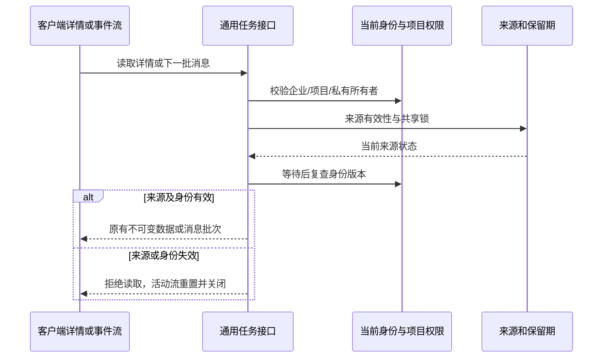

# 任务详情、历史消息与来源访问边界

<!-- stage65-current-history-source-lineage:start -->
后续[阶段 65](65-conversation-content-source-lineage.md)补充实际文件/云引用/数据集读取、历史结果和计划来源检查，以及显式发布的独立输入快照；状态与费用元数据保留。见[当前后台回执](../quality/history-source-checkpoint.json)。本文原阶段源码和执行回执保持其历史范围；已付费原生步骤的业务续接及完整验收继续跟踪。
<!-- stage65-current-history-source-lineage:end -->

<!-- stage64-current-report-task-source-fences:start -->
## 当前已执行的范围

平台完整 **746/746**，保留前阶段全部 **734 项**命名测试；本阶段定向 **12/12**、六仓库 **13 项**检查通过。两库原生 SQL080→081 核查通过，原 168 张公共表全部行摘要、表所有者/RLS、旧迁移及其记录保留，仅两个报告访问函数变化。本次夹具已回收，自建数据库已关闭。

见[当前绑定回执](../quality/task-source-checkpoint.json)、[当前原生客户端只读核对](../quality/task-source-client-recheck-01.json)和[历史预览包清单](../quality/seo-change-artifacts.json)。阶段 63 的浏览器/原生旅程和补充 API 契约保留原源码绑定；本阶段未新增后台界面旅程验收。
<!-- stage64-current-report-task-source-fences:end -->

阶段 64。继续核对原 102 项需求及全部 TC/NFR/G01–G10，不将局部验证视为完整产品验收；完成状态和确切执行编号以绑定回执为准。

## 已实际复现的差距

阶段 63 已保护新增网站修改任务的通用详情、JSON 事件和 SSE。未修改生产源码的首次执行 `task-source-integration-01` 运行 7 项、失败 7 项：原始网站诊断与营销分析任务在来源被隔离后，专用报告已经拒绝读取，通用详情、JSON 历史、规范 SSE、项目 SSE 别名仍返回 200，任务列表仍包含该项。已打开的事件流还实际发送了来源失效后插入的新模型正文。分析数据集到期亦不能立即阻止专用报告读取，须等待清理才失效。

真实 Codex 的消息增量以 `message.delta` 保存。测试中的 Worker 使用同一事件回调保存模型消息；另一个用例确实启动版本锁定 Codex，经公司内部模拟网关和实际事实工具完成模型执行。因此，不能仅保护报告文件下载而遗漏通用任务消息。

## 实现规则

| 读取入口 | 当前行为 |
| --- | --- |
| `GET /v1/tenants/:tenant/projects/:project/tasks` | 对分析、原始诊断与修改任务检查实际报告绑定及当前来源，在排序和取前 100 项之前过滤不可用项。 |
| `GET /v1/tenants/:tenant/projects/:project/tasks/:task` | 共享来源检查，等待来源锁后再次核对当前身份与项目权限。 |
| `GET /v1/tenants/:tenant/projects/:project/tasks/:task/events` | 读取 JSON 历史消息前执行同一来源与身份检查。 |
| `GET /v1/tasks/:task_id/events` | 规范 SSE 在连接和每一批消息前执行检查；来源失效后重置并关闭。 |
| `GET /v1/tenants/:tenant/projects/:project/tasks/:task/events/stream` | 项目 SSE 别名遵守与规范 SSE 相同的逐批检查。 |

- 通用详情、JSON 历史与两种 SSE 共用 `assertReportSources`，同时覆盖分析、原始诊断和网站修改任务；项目列表在排序与限制条数前按实际报告/任务绑定和来源可用性过滤。
- 每批 SSE 都重查当前身份和来源。来源不可用时返回或发送既有错误/重置语义并关闭，不再发送新增正文；不删除或改写原有历史消息来伪造治理效果。
- 读取诊断来源时使用共享锁等待普通任务更新，避免把心跳、控制事务当成来源撤销。等待后再次核对当前用户权限版本；并发撤权时即使来源恢复可读也不得返回数据。
- 分析来源按稳定 ID 顺序先锁文件资产、再锁数据集，与文件处置先资产后数据集的顺序一致；占用中的来源以受控错误拒绝读取，事务使用保存点处理锁冲突。
- 分析数据集必须内容与来源均有效且尚未到期。关联原始 CSV 必须为同企业、同项目的有效共享资产，固定版本摘要一致且未擦除、资产未到期；私有报告产物也须同范围、同私有所有者且有效未到期。
- 终态分析任务本身的保留期也参与报告可用性；所有到期判断直接使用数据库时钟，在清理 Worker 尚未运行时生效。
- 创建或预览分析使用相同输入限制。过期输入在创建任务、分析快照和资金预留前拒绝；有效的无关普通任务与其他私有报告继续可用。
- 所有检查保留当前企业、项目、私有所有者、连接器与原有缓存祖先约束，不因恢复来源而扩大访问权。

## 数据库迁移和回归证据

新增 SQL081 仅替换 `analysis_report_owned(uuid)` 和 `analysis_report_available(uuid)`。函数仍由 `cp_control` 持有、启用 `SECURITY DEFINER` 与 `row_security=on`；PUBLIC 与队列角色不能执行，应用角色可执行，运行角色没有超级用户或绕过 RLS 权限。原表强制 RLS 不变。

SQL001–080 保持原字节。SQL081 首次成功应用于 `task-source-integration-02` 后保持不可变；后续更改只能追加前向迁移。持久库升级前后逐表比较 168 张原公共表的完整行摘要、所有者/RLS、原迁移记录和所有公共函数定义，仅允许上述两个函数变化，不补造历史。

定向检查还验证原始 CSV 到期、报告产物隔离/到期、分析任务到期、当前企业与所有者、无关任务可读、活动流不再发送新增正文，以及等待正常更新后并发撤权。预修复失败和中间执行原始回执完整保留。第三次执行中新增的 Google Ads 测试 CSV 缺少 `entity_id`，接口按规则拒绝导入；修正测试数据后重跑，未放宽生产导入校验。

完整回归必须保留阶段 63 全部 734 项命名测试，加上本阶段 12 项，至少 746 项全部通过；另运行六仓库 13 项类型、编译及客户端测试。所有执行记录绑定实际源码、原始 TAP、验证器快照与本次夹具回收证明。

## 客户端与仍待完成的范围

本阶段没有修改客户端源码。Web 与 Desktop 既有轮询在访问拒绝后清空数据；事件处理在来源重置、401、403 或 404 后清空消息。Desktop 保持无边框、自绘拖动与窗口按钮、无 Electron/Alt 菜单。Extension 工具栏切换 Chrome 真正原生 Side Panel，默认右侧并遵循浏览器位置偏好。

已有真实界面截图、阶段 63 的原生 23 项检查、ASAR、扩展 ZIP 和预览包保留原始来源范围，并另做当前字节只读核对。本阶段没有把旧浏览器或原生旅程重标为新后台验收。Setup/Portable 安装、签名、商店、正式模型和部署仍待完成。

完整规范 TaskDTO/POST `/v1/tasks`、续接与其他原始任务类别的来源链审查、GEO、Search Console 在诊断中的连接指标和全部原始验收条件继续跟踪。102 项需求、TC/NFR/G01–G10 不缩减，完整通过数仍为 0。

本阶段沿用用户授权的模拟 AI/业务数据，不调用 Docker/WSL，不改变 Desktop 无边框与 Chrome 原生侧栏要求；仅关闭本次创建的服务和连接。
