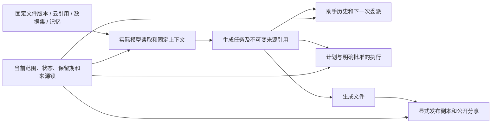

# 会话历史、实际读取与产物来源链

<!-- stage65-current-history-source-lineage:start -->
当前执行：平台 **765/765**，保留原全部 **746 项**命名测试；定向 **51/51**，六仓库 **13 项**检查通过。两库 SQL081→087、原 168 张公共表行摘要、旧迁移和原函数核查通过，新增来源表为空。[绑定回执](../quality/history-source-checkpoint.json)列出源码、原始报告、验证器和回收记录。仅当前后台及已授权模拟数据得到所列局部验证；既有原生包只做字节核对。
<!-- stage65-current-history-source-lineage:end -->

阶段 65。继续保留原 102 项需求及全部 TC/NFR/G01–G10，完整产品验收数仍为 0。本页描述本阶段实现和测试范围；具体通过状态、执行编号及源码摘要以[绑定回执](../quality/history-source-checkpoint.json)为准。AI、媒体和业务数据继续按用户授权模拟。

## 已复现的缺口

修复前的 `history-source-integration-02` 六项均失败：已选择和未选择但被模型工具实际读取的文件隔离后，会话仍显示复制出的内容，生成文件仍可下载；过期来源仍可创建并预留新的付费委派；已经排队的续接将原文送入后续模型；使用历史内容形成的计划仍能读取及批准；临时读取后发生的来源撤销不能阻止新的模型事件和产物保存。

首次执行 `01` 因测试夹具使用不存在的余额字段失败，不作为产品漏洞证据。修正夹具后使用真实登录、资金预留、Worker、文件读取工具和产物下载路径复现；正常下载是撤销测试的对照。所有中间失败记录及迁移字节保留，不以改写历史响应代替权限修复。

首轮全量回归 763 项中 761 项通过，2 项失败：已发布网站副本的擦除元数据未完成；输入失效计划的新来源提示覆盖了原 PLAN_STALE，普通任务列表也不应因此丢失状态与费用记录。后续使用 SQL087 明确缺省擦除标记不得授权修改，并在受控删除中设置标记；任务列表保留安全元数据，计划及首次输入补选保留原有语义。既有 SEO 擦除和计划依赖测试保持原代码，失败报告完整保留。新增定向测试验证缺省/空/false 标记拒绝改写，以及受控删除后实际对象消失、正文与来源元数据清空。

## 固定来源与当前授权

`task_source_reads` 记录模型工具实际消费的来源，不保存正文或凭据。文件记录不可变版本 ID 和 SHA-256；云文件引用另记录节点 ID；营销事实工具记录不可变数据集 ID。读取完成后，在工具事务内登记来源、锁定来源所有者并重新检查，再向模型返回内容。普通界面预览及直接辅助函数调用不冒充模型读取。

同一来源记录不能更新或删除，重放保留首次事实。应用角色仅可在当前用户获准执行的运行任务中插入记录；队列角色不能读取来源记录，应用角色不能直接调用遍历私有元数据的内部辅助函数。所有新增函数使用受限搜索路径、`SECURITY DEFINER`、`row_security=on`，由无超级用户及无 BYPASSRLS 的 `cp_control` 持有；PUBLIC 无执行权限。

来源遍历检查以下当前状态，不重新拼接或替换旧正文：

| 来源 | 检查规则 |
| --- | --- |
| 已完成工作及实际消费过的文件依赖 | 原企业、项目、私有所有者；原版本未擦除，所属资产有效且未到期。新版本不会替换已消费的固定旧版本。 |
| 实际文件读取 | 上述范围、原版本与摘要；继续追踪该版本的生成任务；显式发布副本使用冻结的已确认输入快照。 |
| 云文件引用 | 原节点及固定版本、节点和工作区状态、项目或原私有会话范围；名称移动不代替版本引用。 |
| 营销事实读取 | 固定数据集、内容及来源状态、保留期；有关联原始文件时继续检查该文件及既有连接器约束。 |
| 固定记忆和品牌 | 原作用域、私有所有者、固定记忆版本与内容有效性、到期和隔离状态；不因某条记忆不再属于当前列表而绕过历史检查。 |
| 历史助手结果 | 固定消息所在的原会话及其生成任务的来源链；不将失效历史送入下一次模型上下文。 |
| 批准的计划 | 保存生成该计划的任务引用；批准、已排队执行以及后续重试继续检查计划实际使用的来源。 |

遍历使用已访问集合处理重复来源及任务读取自身产物，避免权限策略递归；超过 4096 个工作和版本节点时拒绝使用，保留原 80 条会话历史和 50 条记忆限制。对于接入记录之前没有任何固定引用的实际读取，不补造来源事实，也不声称已经补齐这些旧记录。

受控擦除事务只有在确认目标已删除、执行已关闭后才设置擦除标记，允许清除已删除产物的来源元数据和任务的计划引用；后续仍核对实际对象删除与正文清空。缺省、空值或 false 标记均不授权改写不可变来源。来源恢复与物理擦除是不同的流程，不通过放宽普通更新权限来完成删除。

## 用户可见及执行边界

会话读取对来源失效的助手消息返回不可用提示和 `source_unavailable`，保留消息顺序、原存储正文及独立用户笔记。来源恢复后仍要通过当前企业、项目、登录身份、私有所有者及完整来源检查，才能显示原结果。

新付费委派在创建任务和预留资金前检查固定历史。已排队任务在模型接收前重查；运行中的工具、心跳、模型事件写入和最终保存继续检查。失效来源不能继续写入新的模型正文、交付文件或批准的计划。已有费用事实与资金结算仍按实际接收及用量保留，不删除账单来模拟撤销。

普通任务详情、任务列表、JSON 历史和两个实际 HTTP SSE 入口执行同一来源检查。普通任务列表保留状态和费用元数据，来源失效时隐藏 acceptance 并标记 source_unavailable；保留分析报告及 SEO 专用流程已有的列表访问规则。普通任务详情仍返回状态和费用元数据；来源失效时清空响应中的 prompt、output、input_context 并标记 source_unavailable，避免取消任务后无法查看状态。已经打开的 SSE 在下一批读取时重查，来源失效后发送既有重置语义并关闭。来源不可用不扩大读取者权限，也不破坏首次模型调用前的输入补选流程。计划批准保留 PLAN_STALE；已批准但尚未开始执行的计划输入改变时，保留 PLAN_INPUT_CHANGED、零次模型调用和未使用预留释放的语义。

资产及资产版本增加来源限制策略。公开分享在准备响应和存储读取后均明确检查来源，避免控制身份绕过应用 RLS。新建显式发布副本保存不可替换的 `publication_origin_version_id` 和 `publication_sources`：追溯原生成链，冻结已确认的文件版本、数据集、固定记忆、品牌、连接器和云引用；再次发布派生结果时合并、去重并稳定排序这些输入。显式发布创建独立对象，原私有会话删除后副本仍可使用；真实上游输入失效后派生副本和分享仍受约束。旧的 `publication_source_version_id` 指针继续兼容；没有可验证来源记录的历史副本不虚构关联。

## 迁移、交付与验证范围

新增迁移采用 SQL082–087，保持 SQL001–081 及已应用迁移字节不可变；追加变更保留初次执行回执。持久库升级逐表核对原 168 张公共表的全部行摘要、旧迁移记录、原有函数和 RLS 所有者/启用标志。新增来源表为空，不伪造历史消费；新增策略、触发器和函数单独列出。

完整回归必须保留阶段 64 的全部 746 项命名测试，加上本阶段实际新增测试；另核查六仓库的类型、构建及既有客户端测试。定向覆盖实际工具、历史消息、计划、资金预留、下载、发布、分享及真实 HTTP 事件流。原生包字节核查仅证明与原旅程使用的包一致，不把历史截图或原生旅程重标为当前后台验收。

Desktop 继续无边框、自绘拖动和窗口按钮、无 Electron 默认菜单及 Alt 菜单。Extension 工具栏切换 Chrome 原生 Side Panel，默认右侧并遵循浏览器偏好。代码和开发脚本仅位于指定 D 盘根目录的 `dev/`，主文档位于 `docs/`；不使用 Docker、WSL 或其他虚拟化。

交付仓库中的 `scripts/run-history-source-checks.mjs` 接收未占用的两位执行编号，追加 `--full` 执行全量回归；`scripts/run-history-source-client-checks.mjs` 核查六仓库。两者均拒绝覆盖已有报告，绑定执行源码及原始输出。平台测试只使用本次受管的原生 PostgreSQL 和隔离夹具，结束后核对夹具回收及自有数据库关闭；不调度其他数据库实例。

两库升级前后回执属于 SQL081→087 的一次性迁移证据。升级后的库通过保存的逐表摘要、迁移摘要和函数清单复核，不降级数据库或改写旧迁移来重新制造升级前状态。根目录 `docs/tools/verify_history_source_clients.mjs` 仅核对既有客户端和交付包的当前字节，不启动浏览器或应用，不增加原生 UI 验收次数。

暂存字节校验另外发现五份新增验证脚本使用 CRLF，Git 会转为 LF。交付将这些验证器统一为 LF，保留[原始脚本字节及摘要](../quality/history/stage65-before-lf-tools/manifest.json)，并重新绑定客户端、只读包核对及配置凭据扫描。已执行的平台与客户端运行源码保持原回归范围；旧验证报告仍对应旧验证器字节。暂存文件须与当前已验证文件逐字节一致，原始执行证据按其摘要保留。

SQL082–085 首次应用时已使用 CRLF，继续按原迁移字节保存。空白核查逐份比对首次应用摘要、当前文件和暂存内容，允许这四份既有 SQL 的行尾 CR，仍拒绝真正的尾随空格及额外 EOF 空行；其他产品源码按正常规则检查。原始 TAP/日志中的空白只在配置扫描及 SHA 摘要一致时保留，不改写执行证据。

完整规范 TaskDTO、规范任务创建接口、已付费 Codex 原生步骤的业务续接、未记录的历史来源、全部来源类别的跨端界面验收、正式 API 和计费、签名安装与商店发布、GEO 和完整原始 TC/NFR/G01–G10 仍继续跟踪，不将上述局部实现认作完整产品验收。
