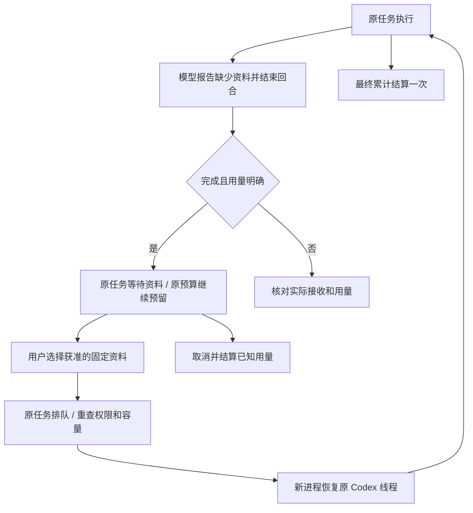

# 付费用量、补充资料与原任务续接

<!-- stage66-current-paid-inputs:start -->
当前回归：平台 **782/782**，保留原全部 **765 项**命名测试；定向 **34/34**，六仓库 **13 项**检查和原生旅程 **32 项**通过。Web、Desktop 与真正 Side Panel 的补资料 UI 使用明确模拟回合，实际 Codex 子进程另以模拟 Responses API 验证。两库 SQL087→091 保留原 169 张表旧字段摘要，新增列零/空值、执行事实表为空。见[绑定回执](../quality/paid-input-checkpoint.json)和[客户端产物](../quality/paid-input-artifacts.json)。
<!-- stage66-current-paid-inputs:end -->

阶段 66。本阶段把已经完成且用量明确的 Codex 回合接入用户补资料流程。完整范围仍为原 102 项需求及全部 TC/NFR/G01–G10；本文不代替完整产品验收。AI、媒体及业务数据继续按用户授权模拟。

## 同一任务的完整流程

Codex 在实际处理后发现必须由用户提供的文件或营销连接时，调用 `request_input` 描述资料需求并结束当前回合。模型不能提交资源 ID、代选文件、要求密钥或扩大角色已有的文件及连接权限。请求资料之后不再接受新的业务工具操作；已经发出且获得接收的媒体请求仍需收尾并记录实际用量。

后台只有在原生回合完成、线程和回合一致、用量明确、原预算仍有效且不存在待核对操作时，才建立可恢复检查点。任务保留原 ID、原会话、原预算预留和累计用量，进入 `needs_input`。这一状态与首次调用模型前等待资料的状态共享入口，但界面明确区分已发生用量和未调用模型。

用户只能从自己当前获准使用的原企业、项目及私有范围中选择资料。文件冻结为明确的版本及摘要；连接必须符合声明的服务提供方和现有权限。所有需求解决后同一任务重新排队，再次检查角色、技能、方案、资金、固定上下文和实际来源。容量不足时保持原队列和原预留，不增加尝试次数或发出模型请求。

新 Worker 以新的 fencing token 获得容量后，消费上次检查点并调用 Codex `thread/resume`。沿用原生历史及动态工具，继续同一项业务任务。每项任务最多八轮补资料、累计三十二项依赖，不通过新建任务绕过原预算。

## 已完成操作及资金

已成功的事务工具保存不可改写的完成回执，包含任务、尝试、fencing token、工具名称、输入摘要、结果及实际输出版本。下一回合重复同一已完成操作时，先重新检查当前授权、输出状态、保留期及来源，再复用结果。代码包还绑定当前源文件清单及摘要，修改源文件后不得误用旧包。普通读取重新读取当前获准的来源。

媒体操作保存尝试标识，只有同一任务、相同输入和已确认成功的操作可复用；编辑图片还绑定原图片版本和摘要。结果不明的媒体或设备操作进入核对，不自动再次付费调用。

`accrued_micros` 表示尚未最终结算的累计已知用量，`charged_micros` 表示实际结算。原生线程恢复时提供增量用量，后台按任务累加；实际网关计费回执存在时以完整回执为准。等待期间取消、方案撤销或管理操作不得以零费用覆盖已发生的用量。未知用量不被当成免费，也不生成可自动续接的检查点。

| 触发条件 | 任务与资金行为 | 用户端表现 |
| --- | --- | --- |
| 首次调用前缺少资料 | 尚无执行尝试，保留原预留 | 说明尚未调用模型 |
| 已完成且用量明确的回合请求资料 | 原任务进入 `needs_input`，保存累计用量与原生检查点，继续保留原预留 | 提示补资料后继续，分别展示记录用量和结算费用 |
| 用户解决全部资料请求 | 原任务重新排队，当前授权与容量检查通过后才增加尝试并恢复原线程 | 显示排队或容量等待，维持原任务链接 |
| 已选择资料随后被撤销 | 不再发出下一轮模型请求；能确认既有用量时取消并结算 | 显示实际停止状态与已发生费用 |
| 检查点与费用、原生线程或实际结果不一致 | 进入 `reconciling` 并保留核对中的预留，不自动重放 | 事件与任务状态一致显示待核对 |
| 等待期间用户取消，随后删除私有会话 | 会话有未结束任务时先拒绝删除；用户明确取消并结算可确认的既有用量后，受控擦除清理请求、工具结果与私有产物，保留必要账目 | 提示先处理未结束工作；不将已发生用量显示为免费，删除内容不再可读 |

事务工具复用与媒体复用均限制在同一任务后续尝试中。文件读取仍需重新授权，文件版本、实际来源或输出保留期不符合要求时拒绝续用；不能仅凭相同文件名或模型提交的资源 ID 认为操作可安全复用。用户选择发生在登录后的资料选择界面，不把内部模型密钥或服务器配置放入用户操作流程。

同一任务的自动刷新保留尚未提交的明确资料选择，避免事件轮询卸载表单。Web 和 Desktop 只对该任务详情显式启用这一行为；切换任务、企业或项目，以及读取失败时仍清空先前内容。Side Panel 按资料需求版本保留表单，并在当前任务读取失败时移除旧输出及输入控件。实际验收分别等待三端至少两次任务刷新响应，随后确认选择；另对受控任务撤销读取权限，检查旧内容消失。首轮发现 Desktop 表单被刷新重建的原生失败记录及当时包保留，新包使用独立目录。

第二轮原生旅程在网站复查等待期间出现桌面页提前关闭，原失败记录和包继续保留，未推定退出原因。后续旅程增加进程退出码、是否预期关闭以及 renderer crash 事件记录；实际结论以对应源码及后续执行回执为准。费用时间线分别显示记录用量、最终确认结算和待核对，不把中间回合的已知用量显示为已结算。

## 存储、迁移和交付边界

新增迁移 SQL088–091。已应用迁移保持首次执行字节；后续修正追加迁移。`task_input_checkpoints` 和 `task_tool_receipts` 使用强制 RLS；队列身份不能读取，应用身份只在明确任务及用户范围下写入。普通更新不能改写线程、输入、完成结果和已知费用。受控擦除仅在任务确实删除且显式擦除标记有效时清理内容。

持久库首次升级后的核对脚本把新增加且为空的 `task_dependencies.checkpoint_id` 计入旧字段摘要，因而报告差异。原 SQL087 升级前快照、首次失败及日志原样保留；后续独立只读核对沿用该真实快照，只从旧字段投影中排除已声明的新列，并另外要求所有既有依赖的该列仍为空。两个库均核对全部 169 张原表旧字段摘要，新增累计费用为零、尝试标识和依赖检查点为空；未改写、回放迁移或修改历史行。

Desktop 保持无边框、自绘窗口按钮和拖动区域，无 Electron 默认菜单及 Alt 菜单。Extension 工具栏点击打开 Chrome 原生 Side Panel；默认位于右侧，遵循 Chrome 侧栏位置偏好。所有开发位于指定 D 盘 `dev/`；主文档位于 `docs/`，使用原生 PostgreSQL，不使用 Docker、WSL 或其他虚拟化。

本阶段验证器保存修复前失败、各轮中间结果、执行源码、原始 TAP 及夹具和自有进程清理回执。实际执行及完整绑定见[当前回执](../quality/paid-input-checkpoint.json)。本功能仅允许已完成且明确计量的回合边界续接；任意执行中暂停、未知外部操作恢复、完整规范 TaskDTO/任务创建接口及全部原始验收条件继续跟踪。
