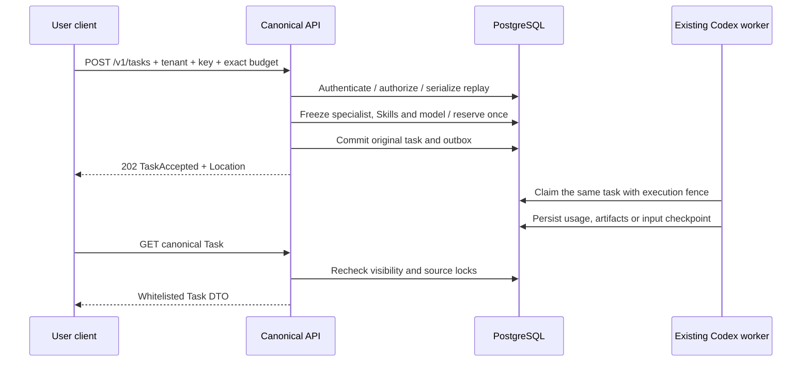

# 统一任务接口与原任务输入事务 / Canonical task APIs and input transactions

本轮将原始 OpenAPI 的任务创建、列表、详情、输入与控制形态接入现有任务执行域。核查范围仍为原始全部需求、测试条件和发布门禁；本文描述其中的任务基础接口增量，不能作为完整产品或全部角色验收结论。

## 原合同及实现范围

原始 [OpenAPI](../contracts/openapi.json) 保持原字节及 SHA-256 `51dd90f26137798dd23c4e881b7f9f0b20f99ad4b9fee0cce98686e11873aab4`。通过 `docs/tools/export_task_contract.py` 递归复制二十个相关 schema 到 backend 的 `contracts/task-schemas.json`。运行时 AJV 2020 校验原 schema：不转换类型、不删除额外字段、不填默认值，不另写宽松版本覆盖原条件。

| 接口 | 当前执行语义 |
| --- | --- |
| `POST /v1/tasks` | 指定实际专家的 `delegation`，支持 execute / ask / plan、显式预算、私有会话、文件版本及文件／连接前置条件；202 返回原 TaskAccepted，Location 指向规范详情 |
| `GET /v1/tasks` | 当前企业内、当前用户可读项目及私人边界内、保留真实专家身份的任务；签名游标分页 |
| `GET /v1/tasks/{task_id}` | 按原 Task schema 输出白名单字段，并重新验证当前来源权限 |
| `POST /v1/tasks/{task_id}/inputs` | 按当前 pending_input_fields 原子选择文件／连接；保留原任务和预算，适用首次执行前或已完成计量的 Codex 输入检查点 |
| `POST /v1/tasks/{task_id}/controls` | cancel，以及首次领取前的 pause / resume；当前版本校验及幂等事务 |

规范创建尚未接入 creative_image、creative_video、analysis、seo、geo、workflow、local_file 的专用输入编排。原 schema 的合法专用请求返回明确的 `TASK_CONTRACT_CAPABILITY_UNAVAILABLE`，不会丢弃参数后创建普通任务。agent_group_id、device_id、source_artifact_id、source_cell_ids、workspace_id、confirmed_plan_id、project_config_version_id 同样不能在此路径静默忽略。现有专用业务接口保留各自实际能力与限制。

当前统一 retry 返回 `TASK_RETRY_CHECKPOINT_UNAVAILABLE`。任意运行中暂停、未知外部动作核对后恢复、完整逐步骤重试仍待实现。不能将拒绝危险重放本身表述为已完成重试功能。

## 用户、预算与持久性

所有接口验证当前用户身份、`X-Tenant-ID`、企业与项目授权；写接口同时执行既有 Web CSRF / 原生凭证规则，必须携带 Idempotency-Key。当前统一创建使用现有默认付款账户；显式付款头仍被拒绝，避免表面接受后实际从其他账户扣费。

Money 的 HKD amount_micros 必须为十进制整数字符串。先按原 schema 检查，再通过 BigInt 检查正数及现有单任务上限 `1000000000000`，仅在已确认安全范围后转换为内部整数。浮点数、负数、指数格式、前导零及超范围值不能进入预留事务。

创建调用同一 `enqueueTask`，复用当前企业数据模式、专家版本、Skill、Codex、模型与费率绑定、套餐、资金预留、依赖和 outbox。新接口不另起执行器或账本。规范类型与用户原始输入保留在已有 input_context 内，随原任务内容清理；没有新增绕过删除流程的请求正文表。

创建回执只存 task_id / status / version / location。重放前后检查当前访问范围，任务被隔离或删除后不得借旧回执返回其地址。输入和控制回执只保留任务身份，响应重新读取当前 Task；因此旧 pause 回执在任务已取消后会返回当前 cancelled，不把旧 paused 快照当作当前状态。

会话任务锁定原私有会话，检查所属项目、专家身份、存档状态和未结束工作；保留会话指定的专家版本。原任务、用户消息、会话版本和预留在同一事务提交。不同请求键并发委派不能绕过会话 busy 检查。



## 输入答案及原子性

当前已实现的输入是文件或连接选择。answers 使用 Task.pending_input_fields 中的实际 step_key：

```json
{
  "expected_version": 3,
  "answers": {
    "input-1": { "resource_ids": ["11111111-1111-4111-8111-111111111111"] }
  },
  "asset_version_ids": ["11111111-1111-4111-8111-111111111111"]
}
```

示例 UUID 仅展示格式。resource_ids 必须来自用户在当前任务内实际获准的候选资源。asset_version_ids 可省略；提供时必须准确等于本次文件答案的版本集合。自由文本答案、未知字段、额外指令、重复资源、其他项目资源不被解释为继续执行授权。

任务行锁、任务版本、完整答案及每个资源的验证处于同一事务。所有答案验证成功后才修改依赖。部分答案可保留 needs_input；全部完成后复查已选输入，只有有效检查点才能将原任务重新入队。继续使用原预留，不能另开预算、重复释放预留或绕过已付费检查点。两种接口共用 `resolveInputSelections`；旧单项选择的成功重试也重新检查资源当前可用性。

## Task DTO、费用和来源

规范响应不返回原始数据库行，排除运行目录、模型密钥、原生 thread / turn、租约、fencing_token、内部权限版本及完整 input_context。attempt_id 来源于真实执行 fence 或首个待执行身份，last_seq 来源于原持久事件序号。交付物 ID 查询实际已保存且当前可用的任务资产。

confirmed_cost 使用已结算 charged_micros 和已计量 accrued_micros 的已知累计值，并保留整数字符串。尚未结束为 estimated；已结算／已释放为 confirmed；不确定消费为 reconciling，不因取消请求改成零费用。

原 TaskStatus 不含内部 reconciling。当前将其投影为 paused，cost_state 保留 reconciling，execution step 标为 unknown / RESULT_UNKNOWN；取消仍未结束时投影为 cancelling。这是合同兼容的阻塞状态表达，不代表存在可恢复按钮。awaiting_approval 映射为 waiting_approval。

每次详情、列表和成功重放都重新检查正文来源。来源撤销或变更中时，隐藏 input、交付物及输入字段，通过 execution step 的错误码表达不可用；不会从旧回执重新暴露正文。专用报告仍执行其独立来源权限检查。

已有历史任务如保留实际 agent_id，可按普通 delegation 投影；未保留专家身份的旧任务详情返回 `LEGACY_TASK_CONTEXT_REQUIRED`，统一列表不包含这些条目，原项目任务接口继续可读。没有替历史执行补造专家或 Skill 绑定。历史无身份任务、专用 DTO 及全面迁移仍需单独修复，不能称为全量历史任务统一查询已完成。

## 分页与核查

列表按 created_at、id 降序，游标保存 PostgreSQL 的六位小数时间精度，绑定当前用户、企业及 project_id 筛选，并以独立用途前缀 HMAC 签名。翻页继续验证当前权限；游标不授予访问权。拒绝篡改、跨账号／企业／筛选复用及超范围 limit。

核查脚本为 delivery 的 `scripts/run-canonical-task-checks.mjs`。每次使用新编号保存原始 TAP、源文件摘要、修改文件字节、校验器、数据库关闭及隔离文件清理结果。使用原生 PostgreSQL 自有 55432，禁止 Docker / WSL；不访问其他数据库实例。原 SQL001–091 保持已发布字节。本轮先完成集中验证，再据失败证据修复并运行完整回归；结果以实际报告为准。

失败记录保留在原编号：首次任务专项暴露新增测试误用 Worker 方法、bigint 断言类型、缺少测试套餐，以及新输入共用函数改变原有状态／版本错误优先顺序；随后修复实现及测试，未改写原有验收断言。第二次专项定位测试误读扁平资产对象及过期的实际路由清单。原生 07 在授权跳转超时，但缺少浏览器回调证据，不能认定产品根因；08 为新增诊断对相对 href 使用绝对 URL 构造器的验证错误。诊断改为按实际页面 URL 解析，键盘触发并确认真实 localhost 回调；原生客户端产品代码和包未因此改变。每次自建实例均按原清理流程关闭。后续通过报告不覆盖这些历史失败。

## English implementation notes

2026-10-22 完成当前源码验证：完整回归 802/802、任务专项 52/52、六仓库 13 项类型/构建/客户端测试、原生客户端旅程 32 项均通过；见 [统一任务检查点](../quality/canonical-task-checkpoint.json)。完整回归保留原 782 项命名测试。原生 10 使用新的未签名候选包，四端实际录屏和十一张截图见 [媒体回执](../quality/workmate-media-10.json)，全部视频/GIF 经完整解码；画面仍是现有云端/文件桥接流程。独立 [本机 supervisor](70-desktop-native-codex-supervisor.md) 的 9 项原生测试单独记录，不以旧界面证明 CLIENT01 已完整实现。

实际路由导出为 415 个 method/path；原始 225 项规范操作仍有 105 项路径未匹配，路径匹配也不代表全部 schema、语义及权限通过。该差异继续保留于 [102 项进度](../quality/requirements-alignment-progress.json)。没有将本次委派子集扩写为全部任务、全部历史或完整产品验收。

The canonical routes use the original Task schemas and the existing execution, permission and billing domains. Creation currently supports explicit specialist delegations with precise HKD budgets, work modes, private conversations and selected prerequisites. Dedicated task types and unsupported context fields fail explicitly before any reservation. This is an incremental repair of the original full requirements, not a replacement acceptance baseline.

Task responses contain only normative public fields. Access and source availability are rechecked even after an idempotent operation. Input selections share one transaction with the existing dependency route, validate the complete batch before mutation and resume the original task with its original hold. Unknown costs remain under reconciliation; unsupported retry does not dispatch another model turn.

Pagination uses a signed account/tenant/filter-bound keyset with full PostgreSQL timestamp precision. Historical rows without a retained specialist identity remain accessible through their existing project route; no identity is invented. Simulated AI/business fixtures are authorized for local verification. Production qualification and the remaining full product acceptance conditions remain open.
