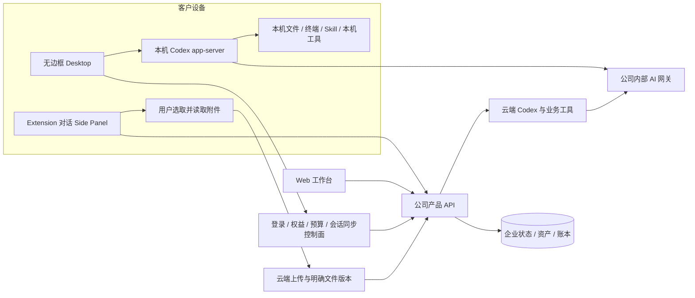

# Desktop 本机 Codex 与 Extension 方向检查

2026-10-22。状态：**已确认方向偏差，已修订设计约束，相关运行能力待实现。** 权威需求见 [CLIENT01](../requirements/03-client-execution-amendment.md)，机器核查见 [方向审计](../quality/client-direction-audit.json)。

后续实现进度：独立本机 Codex supervisor 已通过 9 项真实原生进程测试，见 [内核增量](70-desktop-native-codex-supervisor.md) 和 [检查点](../quality/local-codex-supervisor-checkpoint.json)。Electron 的用户授权/费用接入仍待完成；Extension 的对话/附件主线已接入并完成限定旅程验证，见 [扩展实现](71-extension-cloud-conversations.md)。下表保留本次初始检查的原范围，机器审计及源码前像未重写为新产品通过。

## 1. 检查结论

| 范围 | 代码与旧文档实际情况 | 与最新要求的差异 |
| --- | --- | --- |
| Desktop 内核 | `src/main.ts` 登录并请求云端 API，轮询设备命令；本机执行器仅提供文件桥接。实际 Codex 由 Backend `src/runtime.ts` 启动 | 缺少客户机本地 Codex 运行、会话及工具生命周期，是执行架构偏差 |
| Desktop 权限 | `src/main.ts` 的目录选择只授予一小时读取/新建；`src/files.ts` 限于指定 root，不能覆盖现有文件 | 没有用户可选的完整本机权限，不足以对标 Codex Desktop |
| 云端 Codex 配置 | Backend 固定 read-only、关闭 shell/原生图像、浏览器及 computer-use，使用登记的业务工具 | 适用于现有云端工具模式，不能原样用作 Desktop 的完整本机模式 |
| Extension 出现方式 | MV3 原生 Side Panel，工具栏点击打开 | 方向一致，保留右侧栏 |
| Extension 主界面 | `public/sidepanel.html` 以企业、项目、工作名、目标、预算和任务表单为主，展示任务结果 | 要调整为 ChatGPT 式消息流、底部输入和附件；业务表单退为按需补充 |
| Extension 文件 | `src/panel.ts` 读取选中的 File，当前以 base64 发给 background，再上传项目 assets；另有可选 Native Host 文件操作 | 已有基础读取/上传。仍需明确附件与消息/版本绑定及错误恢复；Host 不是基础流程前置 |
| 原有文档 | PRD、架构、运行时、三端模块和 A01 把 Desktop 定义为云端复用，并把本地内核列为以后增加 | 已被 CLIENT01 覆盖，不能继续据此排期或认定 Desktop 完成 |

本次只做源代码及文档方向核查，没有执行新的本机完整权限 Agent 验收。已有源码、安装包、真实录屏保留原身份；画面中的旧任务工作台不能冒充调整后的产品。

## 2. 调整后的架构



共享身份、角色定义、Skill 版本、云资产引用和计费规则，不等于共享同一个云端执行进程。Desktop 主任务在本机运行；Extension/Web 的任务在云端运行。模型推理位置与 Agent 执行位置分开描述。

## 3. Desktop 产品与执行设计

### 3.1 使用流程

安装无边框客户端 → 系统浏览器完成公司登录 → 选择企业/项目 → 选择本机工作目录及角色 → 在本机确认权限模式 → 本机 Codex 加载对应 Skill → 输入工作目标 → 流式查看消息、终端、文件变更及产物 → 本机保存或主动发布到云项目。

目录选择是工作上下文，不是 full permission 模式下唯一可访问的根目录。普通本机文件默认在本机处理；进入远端推理上下文的内容仍发送公司内部服务。将整个文件保存为云资产是独立、明确的上传动作，不宣称“本机 Agent”意味着资料永不离机。

### 3.2 进程及本机状态

Desktop main process 负责固定 Codex 包的发现、版本/摘要校验、启动和关闭；通过本机 stdio 连接 app-server，renderer 只用类型明确的 IPC。不能把任意 shell 字符串暴露给任意网页或 content script，也不公开原生控制端口。

会话映射保存公司账号、企业/项目、本机设备、本机 thread、工作目录、模板/Skill 版本及当前权限模式。主进程管理 initialize、thread/start、turn/start、流事件、审批请求、interrupt 及 resume；实际字段以锁定版本 schema 为准。不能直接拷贝云端“只读且禁 shell”的配置作为完整模式。

本机运行必须有单一执行所有者，避免 UI 重连、重复提交或云端队列再执行同一任务。关闭窗口、退出应用、系统重启分别处理；没有实际后台服务时，退出后不得宣称本机任务继续运行。设备离线不把本机任务转派到云端。

### 3.3 用户可授予完整权限

产品提供受限模式及 **Full local access / 完整本机权限**。默认受限属于设计默认；完整模式不可删去或只保留一个无效开关。

完整授权在本机由客户明确选择，记录授权主体、设备、适用会话/范围、策略版本及撤回状态。锁定版本已保存的 `ThreadStartParams` schema 支持 `danger-full-access` 与 `approvalPolicy: never`；这是完整模式的配置候选，正式实现须验证线程与 turn 没有被后续参数重新限制。授权范围内连续执行，不另加逐命令审批作为强制默认。

用户能够撤回/降级。撤回后先阻止新本机操作，处理中步骤按实际进程状态停止或结束，再落检查点；不能声称撤回会逆转已发生的文件修改。只回收本任务创建的进程和浏览器页面。完整模式仍使用当前 OS 用户身份，不自动提权，不启动 Docker/WSL。

平台用户冻结、企业权限、VIP 和费用影响公司服务的使用权，不等于平台 Admin 可以替客户操作电脑。Extension 的 Host 文件授权与 Desktop 的本机 Agent 完整授权是不同入口，不能相互继承。

### 3.4 模型、Skill 与网络

本机 Codex 的 provider 固定公司内部 OpenAI 兼容服务，使用短期、可撤销且有任务归属的产品凭证；供应商主密钥不下发客户端。模型版本、推理参数、费率和媒体工具遵守当前发布版本。18 个角色复用同一预设定义，需分别校验本机技能及工具可用性。

产品管理的 AI 调用统一内部路由。完整本机 shell 与“阻断电脑上任何任意程序的一切外部 AI 网络请求”不是同一项能力；后者若被承诺，须依赖单独部署的系统网络策略及验收。不能通过禁用本机 shell 来伪装已实现用户要求的完整操作能力。

### 3.5 后端改造边界

现有任务/API、预算及设备机制可复用身份和账本；必须补充明确的执行位置、本机设备能力、本机执行所有者及可恢复事件协议。`execution_location` 等是**待设计落地的产品字段**，不是当前已上线接口。

当前新增的 `/v1/tasks` 规范接口仍只实现云端 delegation 子集，包含 `device_id` 的请求明确拒绝；这不是本机 Agent 启动入口。本机任务不得进入旧云端 Worker 再启动另一个 Codex。先完成版本化契约、幂等/接管/费用归属设计与客户端集成，再开放本机任务。

## 4. Extension 产品与文件设计

### 4.1 页面结构

```text
CopyPaste                 新会话 / 历史 / 账号
当前企业与项目            角色摘要（可展开）
──────────────────────────────────────
用户消息 + 本次附件
助手流式回复 / 工具进度 / 成果卡
用户继续提问
──────────────────────────────────────
附件卡：待上传 / 上传中 / 已就绪 / 失败
[＋ 文件 / 当前页]  输入消息…       [发送/停止]
```

消息区占主体，输入区固定底部；角色、项目、预算有默认值并可展开调整。普通消息不强制填写独立工作名。连接器、设计/视频等完整业务页面通过成果卡或更多入口进入 Web，不在侧栏首屏堆放完整管理面板。

### 4.2 使用及数据流程

工具栏打开原生侧栏 → 公司登录 → 选择/继承可访问项目和角色 → 输入消息或选取附件 → 浏览器读取获选文件 → 上传公司云端并取得明确文件版本 → 将成功上传的版本绑定本次消息 → 云端 Codex 读取、执行并流式回复 → 用户连续追问/下载成果。

基础 File 选择无需 Desktop。目录能力如需 Native Host 则单独提示、安装和授权；浏览器不能凭扩展身份自由扫描整台电脑。网页上下文由用户主动添加，不能替代文件上传主线。

### 4.3 附件状态与一致性

每个附件至少保存本地选择标识、名称/大小/类型、上传状态、当前企业/项目、云端资产与版本、内容摘要和错误。发送时重新核验成功版本、项目和当前权限；同一消息的重试复用幂等键，不能重复上传/扣费或悄悄引用整个项目的所有文件。

切企业/项目、退出、来源撤销或附件变化时重新校验，旧请求迟到不能把前一工作区附件带入当前消息。失败/取消保留可重试的本地选择状态；页面重载后文件句柄失效应要求重新选择。成功上传但未发送的孤立对象按真实状态和保留规则处理。

当前代码只有单文件 5 MiB picker/base64 路径，本次不把它改称已完成多文件、断点或大文件传输。后续采用现有可恢复上传能力时仍须实际接入扩展并验证。错误、文件类型和大小限制在附件处显示。

Side Panel/Service Worker 不承载长期 Agent 进程；云端任务独立持续。重新打开按会话 ID 和事件游标恢复。浏览器回收扩展 worker 不应重放一次新的计费请求。

## 5. 开发顺序与验收

1. **方向先锁定**：将 CLIENT01 接入 SRS、PRD、架构、原生权限和双语 README；历史通过记录保留原范围。
2. **Desktop 本机内核**：固定版本打包、main-process app-server supervisor、本机会话/IPC、真实本机文件与终端工具；同步设计本机任务契约和费用通道。
3. **Desktop 完整权限**：本机授权界面、实际 Codex 配置、撤回/降级、停止恢复、退出与账号隔离；验证编辑已有文件和工作目录外的获准本机操作。
4. **Extension 对话重排**：会话历史、消息流、底部输入；附件读取、云端上传、版本绑定、连续追问和失败恢复；保留原生右侧栏与可选 Host。
5. **实际交付证据**：在打包 Desktop 中记录本机 Codex 进程、命令输出、文件前后摘要及撤回效果；在真实原生侧栏记录上传请求/版本、同一会话追问和跨项目拒绝。更新中英 README、截图、GIF 与对应分支。

逐项执行 DESK-L01–L08、EXT-C01–C06；已有 G01/G06/G07 与 TC-036–044 按原范围保留，并增加上述明确补充条件。实际完成前，Desktop 的本机内核/full permission、Extension 的完整对话附件体验均保持待实现/待验收，不因文档已更新变为通过。

## 6. 集成依据

已检查本仓库锁定的 Codex schema 和 Backend app-server 集成。OpenAI 官方说明 app-server 可连接本机 Codex 进程，管理持续会话、流式事件、工作中断和授权请求：[Codex as a platform](https://developers.openai.com/blog/codex-as-a-platform)。这是集成能力依据，不是本产品 Desktop 已实现的证明，也不替代锁定版本的真实验证。
