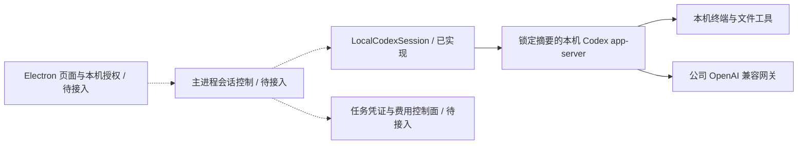

# Desktop 本机 Codex supervisor：实现、验证与剩余接入

**阶段 74 当前增量：** 本机 Codex 的追问、选择/自填回答、同任务回合继续、等待时停止及撤权已接通；当前 Desktop 有 47 项客户端、17 项真实原生和 12 项实际打包旅程检查。后端源码未变，沿用阶段 73 的 818 项完整回归范围。详见 [方案与限定证据](74-desktop-native-user-input.md)。18 角色/29 Skill 及全部原始验收范围保留，以下较早记录保持各自原始源码边界。

**阶段 73 历史基线：** Desktop 保持本机 Codex，接通公司图片/设计/资料工具和私有成果下载；16 个角色的本机协议可准入。真实原生 14 项、平台完整回归 818 项、打包 Electron 9 项旅程通过，供应商/系统对话框决定明确为假数据夹具。全 18 角色/29 Skill 和完整产品验收仍保留。见 [本机公司工具](73-desktop-native-company-tools.md)。下列阶段 72 及更早记录只证明原始源码范围。

**历史实现（阶段 72）：** Desktop 已接入本机 Codex、客户授权、主进程 IPC、公司网关费用及实际打包旅程。原文保留其初始/历史范围，当前方案与证据见 [本机执行及控制面](72-desktop-local-execution-and-control-plane.md)。下列旧回执不自动认定为新源码通过。

2026-10-22。当前阶段：**独立本机内核模块已实现并通过原生集成测试；Electron 用户流程尚未接入。** 本文承接 [CLIENT01](../requirements/03-client-execution-amendment.md) 和 [方向检查](69-desktop-local-codex-and-extension-direction.md)，不将内核模块测试算作完整 Desktop 验收。

## 已落地的执行链

Desktop 仓库新增 `src/local-codex.ts`。`LocalCodexSession` 直接启动 Windows 原生 Codex app-server，通过 stdio 管理初始化、线程、回合、消息/命令/文件事件、审批、中断及关闭；任务不提交云端 Worker。调用者必须是持有当前账号权限的可信主进程。

真实验证使用 Codex `0.163.0-alpha.11`，Windows x64 原生二进制 SHA-256 为 `00c0f1e4099246fddcd67ec620ca8ed50827c7d70e113b7224f7a2933cf2d67c`。独立 `contracts/local-codex-runtime.json` 记录候选版本、摘要、协议及未完成资格；没有以此全局替换云端发布配置。通过该实际二进制生成并保存五份相关 JSON schema 及摘要。

生产发现必须使用产品配置的绝对路径，校验二进制摘要和 `--version`，不回落到 PATH 中任意 Codex。当前候选构建含 supervisor 库，但尚未包含可用的本机 Agent 页面，也未完成 Codex 二进制随包交付。

## 权限与公司推理

| 模式 | 实际 Codex 策略 | 当前验证范围 |
| --- | --- | --- |
| 只读 | `read-only` / `never`，回合传 `readOnly` | 从完整模式降级后，真实终端尝试修改工作目录外文件，文件保持原值 |
| 工作目录 | `workspace-write` / `on-request`，回合传 `workspaceWrite` | 已有配置映射及审批接口；完整原生行为仍需专门验证 |
| 完整本机权限 | `danger-full-access` / `never`，回合传 `dangerFullAccess` | 真实原生终端成功修改已有、位于工作目录外的自有测试文件，未逐命令重复确认 |

授权包含本人账号、会话授权 ID、模式、递增版本及有效期。每个新回合和审批前复查当前账号权限；空闲时切换权限，下一回合显式传入新策略，检查点持久化授权版本，重启后拒绝旧版本恢复。运行中降级需要主进程先阻止新输入并停止当前工作，再取得新的本机授权；不能由 renderer 或 Admin 直接写入一个模式值就视为客户同意。

网关 origin 与 `/v1` 路径固定；只接收短期推理凭证，凭证不写入 TOML，且从原生终端子进程环境移除。CLI 覆盖公司 provider、模型及权限配置。测试验证了请求的模型、推理参数、授权头和原生 shell 中凭证缺席；模拟网关的 token 不作为产品费用凭证。完整权限仍是当前 OS 用户身份，不自动提权。

Windows 使用原生 `unelevated` sandbox，关闭 MXC 偏好；本轮没有调用 Docker、WSL 或其他虚拟化。原生插件、apps、multi-agent、原生图像和自动 Skill MCP 依赖安装暂关闭；媒体等业务工具必须在后续公司工具通道实际接入后逐角色验证。不能据此宣称已对齐 Codex Desktop 的全部浏览器和应用操作。

## 本机状态与恢复规则

每个产品会话持有独占文件锁及独立 CODEX_HOME，检查点绑定账号、企业、项目、工作目录、模型/网关、Codex 摘要和 Skill 摘要。Skill 放在本机 Codex 实际发现的 `home/skills/<key>/SKILL.md`，每回合重检；先检查既有会话归属，再写 Skill，避免拒绝跨账号请求时提前改动原会话内容。

首次创建但未执行回合的原生线程没有 rollout。重启这种空会话时可分配新原生线程，且不发推理；已执行的正常检查点继续同一原生线程。运行中进程突然丢失会保存 uncertain，拒绝盲目重放。陈旧锁不会因时间较久就被自动删除；尚需实现面向用户的进程核对、未知动作对账及恢复操作。

停止先请求实际回合中断，再关闭 stdio，必要时只对自有 Codex PID 执行有界进程树终止并确认退出。撤回会保存 revoked，凭证/授权到期停止会话；不会宣称已经发生的文件修改被回滚。当前没有 Windows Job Object，也未证明能回收独立脱离的第三方程序或所有浏览器页面。

## 实测与失败保留

最新可核对记录见 [本机内核检查点](../quality/local-codex-supervisor-checkpoint.json)。完整测试直接运行实际 Codex，使用授权的模拟公司 Responses/SSE 网关，真实调用终端和磁盘；覆盖完整权限、只读降级、线程继续、Skill 加载/篡改拒绝、版本/归属校验、中断/撤回和未知状态拒绝重放。源码前后摘要、原始 TAP、校验器和源码前像均保留。

历史失败不是产品通过证据：01 发现 Skill 注册路径错误；03/04 发现对未落盘空线程调用 resume；07 证明跨账号拒绝发生前可能覆盖 Skill。实现已按这些失败修复，失败编号及原始字节保留。随后通过的记录只覆盖其绑定版本；既有云端/文件桥接截图不证明本机 Agent 页面已经完成。

在 Desktop 仓库设置任务专用 `COPYPASTE_LOCAL_CODEX_TEST_BIN` 为锁定二进制绝对路径后运行 `npm run test:local`。Delivery 的 `node scripts/run-local-codex-checks.mjs NN` 使用未存在的两位编号保存独立证据；缺少二进制或摘要不匹配时失败，不跳过。测试只改动自己的 D 盘隔离目录，并关闭自有原生进程和 HTTP 实例。

## 下一层必须接入的产品约束

1. **主进程与本人授权**：打包发现/更新 Codex、本机工作目录选择、三种权限的清楚说明和本机确认、撤回/降级、类型严格的 IPC。远程网页、Extension、Admin 均不能代替本机用户授予完整权限。
2. **本机执行契约**：公司身份、企业/项目、设备、本机执行所有者、角色/Skill/费率版本、请求幂等和事件游标有明确绑定。产品本机执行不得进入云 Worker 再运行一次；当前 `/v1/tasks` 的云端子集仍不是此入口。
3. **费用与凭证**：后端复查账号/权益/当前来源，原子预留预算并签发作用域明确、短期且可撤销的本机推理凭证。公司网关逐请求复查和计量，以服务端回执结算；本机 tokenUsage 只作观测。失联、超时、未知消费进入核对，不能由客户端上报零消耗来释放未确定费用。
4. **工作体验**：持续消息、实际终端输出、文件变更、输入等待、停止和可恢复检查点；费用区分预留、已确认和未知。完成状态来自真实终端结果及公司计量，不由 UI 计时或模拟流结束推断。
5. **交付资格**：安装包内实际启动本机 Codex，真实本人授权及账号切换，媒体/开发/设计工具与 18 角色逐项验证；再录制对应界面、截图和 GIF。签名、自动更新、生产模型和全量工具资格仍需独立验收。

Extension 的 ChatGPT 式对话、底部输入和明确文件版本附件已在后续接入，见 [限定实现与实测](71-extension-cloud-conversations.md)；扩展继续在云端执行。原 102 项需求、102 项 TC、全部 NFR/G01–G10 与 DESK-L01–L08、EXT-C01–C06 均保留，未因模块及限定旅程测试改为完整通过。
