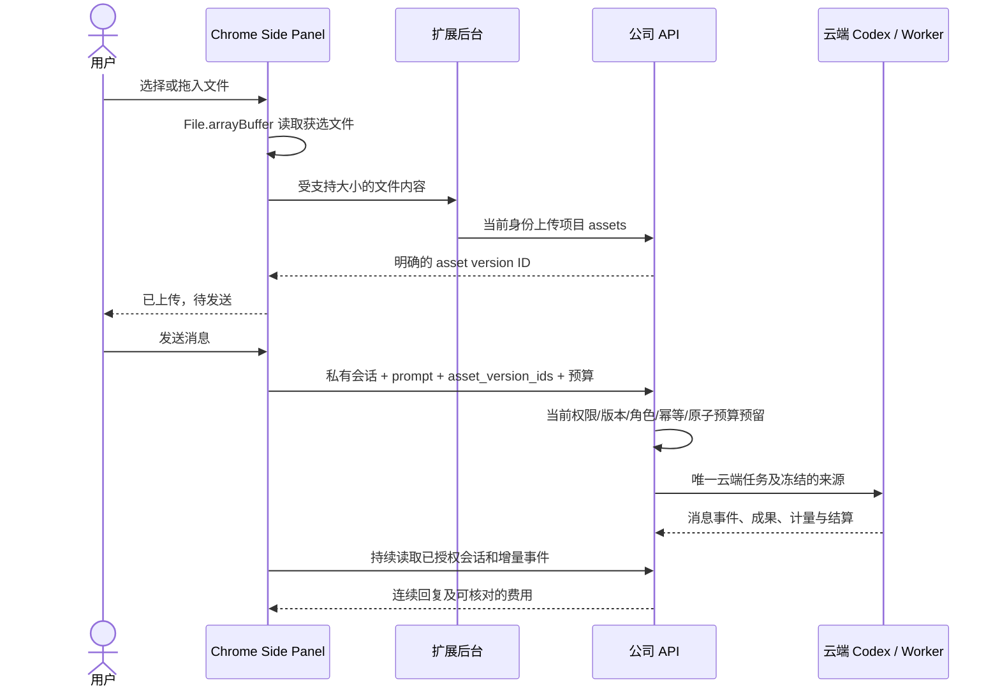

# Extension 云端对话与消息附件

**阶段 73 当前增量：** Desktop 保持本机 Codex，接通公司图片/设计/资料工具和私有成果下载；16 个角色的本机协议可准入。真实原生 14 项、平台完整回归 818 项、打包 Electron 9 项旅程通过，供应商/系统对话框决定明确为假数据夹具。全 18 角色/29 Skill 和完整产品验收仍保留。见 [本机公司工具](73-desktop-native-company-tools.md)。下列阶段 72 及更早记录只证明原始源码范围。

2026-10-22。承接 [CLIENT01](../requirements/03-client-execution-amendment.md)。Extension 的产品主线是原生右侧栏中的连续对话；浏览器读取用户选定的文件并上传公司云端，由云端 Codex 执行。Desktop 的本机 Agent 接入继续按 [本机内核说明](70-desktop-native-codex-supervisor.md) 跟踪。

## 产品与操作

工具栏打开 Chrome 原生右侧 Side Panel → 公司网页邮箱验证及 PKCE 授权 → 选择企业/项目 → 新会话或恢复历史 → 输入消息，可选择或拖入附件 → 确认每条消息预算 → 查看云端回复与成果 → 在同一会话追问。

界面使用 CopyPaste 已有字体、蓝色、明暗色系和素材。主视图是消息流、底部输入框、附件、发送与停止；角色和预算在折叠设置中。通知、权益、资金、独立业务工作台和原任务表单移入折叠的工作/账户区域。恢复历史后定位最新消息，用户向上阅读时不强制抢回滚动位置。

默认助手由服务器创建并绑定项目的当前已确认版本；已有专业角色来自项目 `/agents`。会话创建时固定角色版本，扩展不能直接把一个角色名称当作已加载 Skill。新增角色或升级版本继续从完整工作台进行审核。

## 文件与云端执行边界

基础选择/拖入文件、读取、上传和云端对话不依赖 Desktop 或 Native Host。当前限每条消息 20 个附件、每个非空文件最多 5 MiB，仍受服务端文件类型、额度及保留策略约束。失败或尚未完成的上传阻止发送，用户可移除后重选；只使用上传回执中的不可变版本 ID，不使用文件名猜测来源。

文件明确上传到当前公司云端项目。附件“已上传”和消息“已接收”是两个状态。上传成功但未发送的文件仍保存在项目中；普通未发送附件不跨侧栏关闭恢复，用户可从完整工作台管理这些文件。已经进入待确认消息的版本引用随该消息回执恢复。切换企业/项目或账号清空当前草稿、附件和旧视图；迟到的读取/上传响应不能写回新范围。

用户主动添加“目前网页”时，扩展按既有规则提取页面文字，形成用户可移除的文本附件并上传；不会因为网页展示了内容就自动发送。持续目录读取仍是可选增强，不提供任意终端命令，也不能授予 Desktop 完整本机权限。

## 会话、发送与恢复

`src/conversation.ts` 管理独立状态；`src/chat-panel.ts` 管理原生侧栏内的视图，`src/panel.ts` 连接现有身份和账户功能。所有内容以 DOM `textContent` 呈现，不执行消息中的 HTML。

新会话使用 `/v1/tenants/:tenant/projects/:project/conversations`，每条付费消息使用已有 `/v1/tasks` 的 delegation 子集，并携带实际 `agent_id`、`conversation_id`、`input.prompt`、`input.asset_version_ids` 和精确的 HKD 微额字符串。后端沿用当前角色/Skill/能力冻结、文件来源、私有历史和预算预留，不新增第二套计费。常规输入不要求另填工作名称。

新会话创建与消息发送各有独立幂等键。开始网络写入前，把范围明确的回执存入仅可信扩展上下文可访问的 session storage，键包含用户、企业和项目。遇到网络/5xx 不确定响应，保留原内容、版本、预算及编号；重试和侧栏恢复继续同一请求。收到明确的事务拒绝后允许用户修改；后台保留 HTTP 状态及服务端错误码，不能把断网伪装成确定拒绝。

发送进行中阻止重复提交；有未完成云端任务时阻止新的付费回合，但待确认回执可以重放同一请求。关闭侧栏不会取消云端任务；重新打开可恢复。停止按钮请求云端取消，最终结果和费用仍以服务端状态为准，不宣称操作或费用已经回滚。

当前以 1.8 秒间隔读取会话、最后任务和有游标的增量事件，后台页面隐藏时暂停本次界面轮询；不以本地定时器伪造 token 流。服务器拒绝来源读取、标记 source_unavailable 或任务内容隔离时，清空旧消息/输出并禁止继续发送，重新读取成功后恢复。HKD 上限用整数转换；展示累计用量时比较已结算与已累计的整数值。

## 验证和剩余范围

最终采用 [源码绑定检查点](../quality/extension-chat-checkpoint.json) 指定的当前原生记录，而非旧任务表单素材。32 项扩展测试包含 11 项新增对话边界检查；真实右侧栏覆盖工具栏打开、邮箱/PKCE、获选文件实际上传、接收响应丢失及侧栏重载幂等、同一私有会话两次问答、真实 Worker/成果/每回合一次账本结算，以及来源失效清屏。模型回合使用已授权的模拟实现；这些测试不能替代真实供应商或原生 Codex 内核资格。

早期记录继续保留：01 未连接到侧栏目标；02 在来源隔离检查失败；03 通过其绑定代码的功能检查，但截图复核发现恢复界面仍在隐藏状态时过早拍摄；04 完成可见性复核后又发现恢复滚动位置需改善。最终记录增加真实可见性、输入/费用区域边界和最新回复滚动检查，媒体全量解码并人工查看。失败与旧素材不用于认定当前 UI 完成。

完整扩展验收仍需覆盖长时间休眠/失联、全部文件类型与大文件上传、所有角色/媒体工具、完整成果预览/下载、键盘/缩放/各宽度和生产商店环境。原 102 项需求、102 项 TC、全部 NFR/G01–G10 以及 Desktop 完整本机权限产品接入均继续保留。
