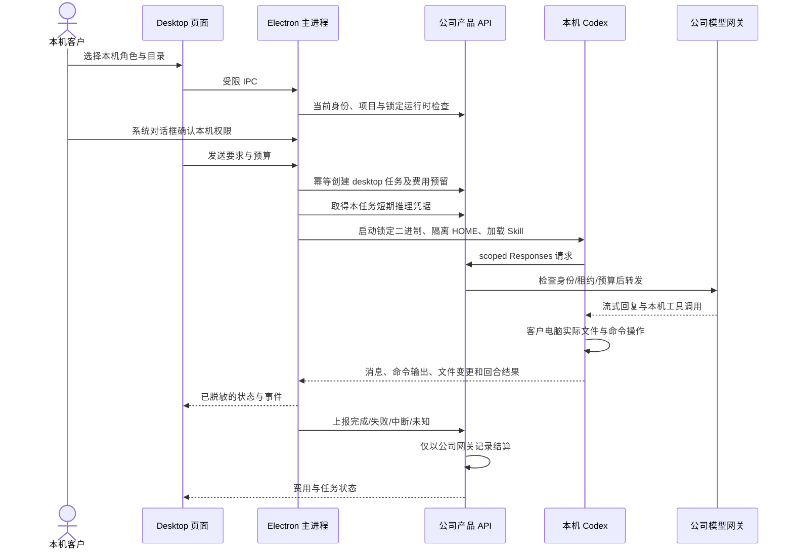

# Desktop 本机执行、客户授权与公司控制面

**阶段 74 当前增量：** 本机 Codex 的追问、选择/自填回答、同任务回合继续、等待时停止及撤权已接通；当前 Desktop 有 47 项客户端、17 项真实原生和 12 项实际打包旅程检查。后端源码未变，沿用阶段 73 的 818 项完整回归范围。详见 [方案与限定证据](74-desktop-native-user-input.md)。18 角色/29 Skill 及全部原始验收范围保留，以下较早记录保持各自原始源码边界。

**阶段 73 历史基线：** Desktop 保持本机 Codex，接通公司图片/设计/资料工具和私有成果下载；16 个角色的本机协议可准入。真实原生 14 项、平台完整回归 818 项、打包 Electron 9 项旅程通过，供应商/系统对话框决定明确为假数据夹具。全 18 角色/29 Skill 和完整产品验收仍保留。见 [本机公司工具](73-desktop-native-company-tools.md)。下列阶段 72 及更早记录只证明原始源码范围。

本次落实 [CLIENT01](../requirements/03-client-execution-amendment.md)。Desktop 的主入口调整为本机 Agent：Codex 进程、会话循环、文件和命令工具运行在客户电脑。公司平台管理身份、项目、角色、模型网关、预算与账本。Extension 保持 [右侧栏云端对话和文件上传](71-extension-cloud-conversations.md)。唯一 Agent 内核为 Codex。

本文描述当前增量的代码契约。完整 Codex Desktop 能力仍按 DESK-L01–L08 逐项验收，不能把本机软件开发工具通过等同于所有设计、媒体、浏览器和系统应用工具已支持。验证结果与对应源码见 [本次检查点](../quality/desktop-local-execution-checkpoint.json)。

## 1. 产品入口与分工

| 项目 | Desktop | Extension |
| --- | --- | --- |
| 主界面 | 无边框本机工作台；目录、角色、权限、消息、操作记录、停止和费用 | Chrome 原生右侧 Side Panel；消息、附件、连续追问及历史 |
| 执行者 | Electron 主进程拥有的 Windows 原生 Codex app-server | 公司云端 Codex Worker |
| 文件 | Codex 在本机直接读写及执行命令；完整权限覆盖当前 OS 用户可访问资源 | 浏览器读取用户主动选择的文件，上传后绑定明确文件版本 |
| 模型 | 公司内部 OpenAI 兼容 Responses 网关 | 同一公司模型体系 |
| 权限来源 | 本机客户确认；Admin 不能代授本机完整权限 | 浏览器授权及公司项目权限；无本机任意命令接口 |
| 文件桥 | 原有 Chrome Native Messaging 桥接属于独立可选能力 | 基础上传与对话不要求安装 Desktop |

原云端能力通过明确的“云端工作台”入口在浏览器打开 Web。服务端也拒绝 Desktop 原生登录从旧接口入队云端 Agent；本机尚未支持的角色不会自动变成云端执行。

## 2. 实际调用链

`src/local-agent.ts` 是主进程协调器；`src/local-codex.ts` 是原生进程监督器；渲染页面不能提交二进制路径、推理地址、凭据、原始授权对象或任意 IPC 通道。通用产品 API 桥明确拒绝 `desktop-executions` 及 `desktop-inference` 路由。

## 3. 本机权限

新选目录本身不授予执行权限。客户在本机选择以下模式，并在系统对话框确认；完整权限对话框默认“取消”。

| 模式 | 原生配置 | 用户含义 |
| --- | --- | --- |
| 唯读 | `read-only`、`never` | 读取授权模式允许的资料；拒绝写入 |
| 目录内读写 | `workspace-write`、`on-request` | 在工作目录内工作；需要审批的原生操作由主进程展示审批 |
| 完整本机权限 | `danger-full-access`、`never` | 当前 OS 用户权限下跨目录文件读写、终端和网络；授权范围内不逐命令重复确认 |

完整权限不自动提升 Windows 管理员权限。授权不受旧文件桥的一小时和仅新建文件限制；本机会话授权持续至客户撤销、退出账号或身份失效。空闲时可切换权限并提高授权版本，不能用旧版本回滚。运行时先停止再改权限。撤权立即阻断后续动作并关闭本任务拥有的进程；费用结果仍可单独同步。

Admin 的 VIP、余额、项目、角色和任务控制只影响平台服务权限，不会产生本机 OS 授权。没有本机确认，即使已有 VIP/费用权限，也不能开始本机工具执行。

停止和撤权属于本机权限收回：主进程以加密存储中的当前登录 epoch 匹配本机会话，先中断/关闭自有运行时，再同步公司结果；不等待公司身份接口可用。此本地检查不能授予新权限、启动新回合或代替服务端计费准入。断网时保留结果同步状态；恢复连接后只同步原始回执，不重跑本机动作。

## 4. 服务端执行位置与接口

新增迁移 `092-desktop-execution-ownership.sql`；001–091 保留原始字节。`tasks.execution_location` 创建后不可更改，默认 `cloud`，本机任务为 `desktop`。本机任务必须绑定创建者、设备、原生登录 family、本机会话、企业/项目、目录摘要和运行时摘要，并具有对应 `desktop_executions` 行。

本机任务不写 `task.run` outbox；数据库触发器、云端容量入口、Worker 及恢复逻辑均拒绝将其交给云端执行。本机与云端使用同一真实容量和账本规则，避免同一任务在两处启动。目录只向平台提交摘要；模型上下文仍会按工作需要经公司网关发送获准内容。

项目接口前缀：`/v1/tenants/:tenant/projects/:project/desktop-executions`。

| 接口 | 职责 |
| --- | --- |
| `GET /runtime` | 项目写权限、Desktop 原生身份、运行时锁和可用本机角色 |
| `POST /` | 幂等创建任务和原始预算预留；严格拒绝客户端费用或完整权限字段 |
| `GET /:execution` | 当前创建者及登录 family 读取公开状态；不返回模型凭据 |
| `POST /:execution/start` | 幂等认领一次执行、容量及租约，返回短期任务级推理凭据 |
| `POST /:execution/heartbeat` | 重验平台资格并续租；过期租约不能复活 |
| `POST /:execution/cancel` | 请求停止并关闭公司侧上游；客户主进程负责实际本机停止 |
| `POST /:execution/finish` | 幂等上报本机结果，隔离推理入口，按公司事实结算 |
| `POST /v1/desktop-inference/v1/responses` | 仅接受当前任务级凭据；拒绝 cookie/浏览器 Origin，固定公司模型与工具协议 |

每次推理计数、准入和转发都重新校验原始账号、登录 family、认证版本、企业/项目、权益、角色/Skill 版本、内容来源、任务尝试、fencing token、租约和预算。原生工具声明采用独立白名单，不沿用云端业务工具清单，也不任意放开未知托管工具或命名空间。

## 5. 费用与失败处理

服务端先预留，再按公司推理网关的输入计数、请求准入和最终 usage 结算。客户端原生 token 用于观察，不接受客户端自报 tokens、金额或“零消耗”替代公司记录。主凭据保留在服务器；任务级凭据只进入可信主进程和受控原生进程环境，不持久化于公开状态、不传渲染页面，也不继承到工具 shell。

创建、开始、结算各有稳定幂等键。开始请求响应丢失可以重取同一授权；已提交本机回合后不能靠重发操作恢复。结果请求响应丢失只重传原始结果，不再次执行命令或预留。服务端先持久化停止状态，再关闭上游，然后结算，避免关闭与新请求同时发生。

| 情况 | 处理 |
| --- | --- |
| 未开始即取消 | 释放原预留，不产生模型费用 |
| 已知完成/失败/中断 | 按公司观测费用结算一次 |
| 本机进程丢失、租约过期或上游 usage 未知 | 保留 `reconciling` 预留；不能以客户端成功/零金额自动释放 |
| Desktop 崩溃时回合已提交 | 保存未知结果，恢复时仅同步结果；不盲目重跑本机动作 |
| 客户停止/撤权 | 先中断本机；远程失败不阻止本地停止，费用同步可继续待确认 |
| 账号切换/退出 | 身份 generation 失效、撤销本机授权、停止本任务进程，隐藏旧账号会话 |

本机结果标记 `desktop_client_report`。这表示客户设备上报的操作结果，不声称公司服务器独立目击了客户机器上的每个文件变化；费用来源与操作结果来源分别记录。

## 6. 角色、分发及剩余范围

首批本机准入角色为 fullstack、frontend、backend-api、software-qa、landing-page。对应已固定的角色与 Skill 从公司控制面取得后校验摘要，实际写入隔离 Codex HOME 并由原生回合加载。其余设计/图片/视频/营销工具的本机协议尚须分别接入和验证；平台的 18 个角色与 29 个 Skill 目标不因首批本机工具范围缩减。

运行时固定为 `0.163.0-alpha.11` Windows x64；主二进制 SHA-256 为 `00c0f1e4099246fddcd67ec620ca8ed50827c7d70e113b7224f7a2933cf2d67c`。不使用 PATH、不回退其他内核、不启动 Docker/WSL。开发模式的原生路径必须显式配置或由准备脚本写入忽略的 `.data/runtime/`；发布构建携带对应原生资源。签名、生产 HTTPS 配置和全角色/全应用验收仍独立跟踪。

独立监督器的历史 9 项测试和旧客户端媒体保留其当时范围。本次真实原生进程、公司控制面、Electron 用户旅程和新增录屏以新检查点为准。模型响应为已获用户授权的模拟数据；原 102 REQ、102 TC、NFR 和 G01–G10 的完整验收不自动升级。

发布清单同时校验已提交组件和验收时的原始工作文件。Desktop 的 `tests/local-agent.test.ts` 在 Git 声明的 `text=auto eol=lf` 下仅发生 CRLF 到 LF 转换；清单分别记录验收原文件和提交 blob 的摘要、字节数及转换次数。原始验收文件和报告保持原字节，不能将这项换行转换声称为字节完全相同。

## 7. 方向检查与验收边界

| 要求 | 本次交付内容 | 仍须独立验证 |
| --- | --- | --- |
| DESK-L01 本机内核 | 独立打包候选携带锁定 Codex；由主进程在客户电脑启动和关闭 | 正式签名安装、升级及全 OS 兼容矩阵 |
| DESK-L02 本机操作 | 实际终端修改工作目录外的已有文件；只读模式实际拒绝写入 | 完整设计、媒体、浏览器及系统应用工具 |
| DESK-L03/L04 完整权限 | 本机对话框默认取消；确认后 full-access；空闲降级及随时撤权 | 人工系统对话框点击验收；自动化决定明确使用夹具 |
| DESK-L05 工作体验 | 持续消息、原生事件、同线程追问、停止与费用记录 | 更完整的工具交互、输入等待和长时间恢复矩阵 |
| DESK-L06 角色与 Skill | 五个本机角色准入；实际 Skill 写入和加载，并验证摘要 | 全部 18 个角色、29 个 Skill 及其真实工具链 |
| DESK-L07 平台与费用 | PKCE、企业/项目、不可变执行归属、公司网关及服务端账本 | 生产身份/模型服务和真实费率资格 |
| DESK-L08 恢复与隔离 | 已保存回合不盲目重跑；停止、撤权、登出与自有进程释放 | 更新中断、多设备及更广泛的崩溃恢复矩阵 |
| EXT-C01–C06 云端侧栏 | 保留原生右侧栏、对话和明确版本附件；基础上传不依赖 Desktop | 历史侧栏证据只约束当时后端；完整生产及长时恢复继续验证 |

方向判定是“本机内核与云端附件入口已经分开落实，限定能力有证据”，不等同完整 Codex Desktop 功能对齐。后续新增工具或角色必须扩展本机集成与验收，不得删除客户本机运行要求，也不得悄悄切回云端执行。
