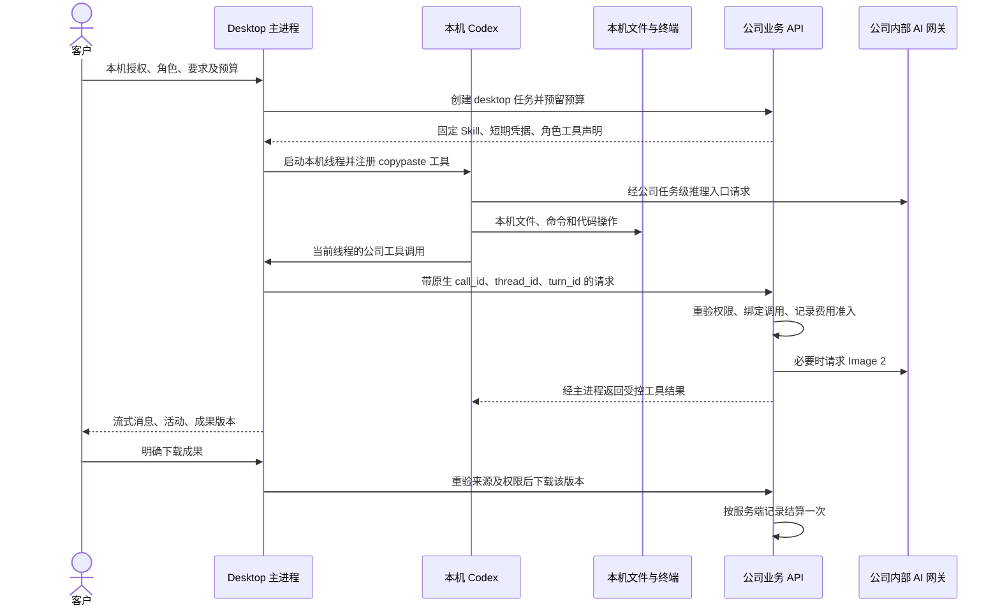

# Desktop 本机 Codex 与公司业务工具

**阶段 76 当前增量：** Desktop 流程由本机父子 Codex 执行，新增不可变私有版本、独立子费用确认、人工审批、真实成果下载、Stop/撤权与来源治理；平台 848 项、重叠定向 75 项、真实父子流程 3 项、原生内核 17 项、客户端 56 项、实际打包旅程 19 项通过。18 个本机角色协议准入不代表完整专业验收；102 REQ/102 TC、NFR、G01–G10 和 81/21/0 保留。Extension 继续原生右侧栏获选文件上传与云端 Agent，本轮按相同产品及验证器字节复核，未增加其 UI 计数。见 [实现与证据](76-desktop-native-workflows.md)。

**阶段 75 历史基线：** Desktop 保持本机 Codex，视频角色接通七项公司工具、私有工程、真实合成、播放/保存、版本修改及停止/撤权控制。平台 830 项、重叠定向 58 项、原生 17 项、客户端 47 项和实际打包旅程 18 项通过；当前 17 个本机角色准入不等于全专业验收。见 [实现与源码证据](75-desktop-private-video.md)。原 102 REQ/102 TC、NFR、G01–G10 和 81/21/0 状态保留；较早记录沿用其原始源码范围。

**阶段 74 历史基线：** 本机 Codex 的追问、选择/自填回答、同任务回合继续、等待时停止及撤权已接通；当前 Desktop 有 47 项客户端、17 项真实原生和 12 项实际打包旅程检查。后端源码未变，沿用阶段 73 的 818 项完整回归范围。详见 [方案与限定证据](74-desktop-native-user-input.md)。18 角色/29 Skill 及全部原始验收范围保留，以下较早记录保持各自原始源码边界。

本次延续 [CLIENT01](../requirements/03-client-execution-amendment.md) 和 [本机控制面](72-desktop-local-execution-and-control-plane.md)。Desktop 的 Codex 进程、会话、文件与终端继续运行在客户电脑；公司服务器提供模型、媒体、项目资料与账本服务。调用公司生图服务不会创建云端 Agent，也不会把 Desktop 会话迁往云端。Extension 继续使用 [原生侧栏云端对话及附件](71-extension-cloud-conversations.md)。

## 1. 用户流程

1. 在无边框 Desktop 完成公司登录、企业及项目选择，选专业角色和本机目录。
2. 客户选择并确认本机权限。完整本机权限对应当前系统用户可访问的资源；管理员不能通过 VIP 或额度设置代授。
3. 客户输入工作要求和预算。本机 Codex 加载固定版本的角色 Skill，在客户电脑规划、调用工具和持续对话。
4. 文件、终端和代码改动由本机原生工具处理。需要图片、字体、营销数据或项目成果时，Codex 调用当前角色获准的公司工具。
5. 公司产物留在受权限控制的项目中；Desktop 展示名称和明确版本。客户点击下载后，通过系统保存窗口选择本机目标。
6. 后续要求沿用本机线程，取得新的单回合预算及凭据。停止、撤权和退出会中断本任务拥有的进程与请求；未知的付费结果保留核对，不盲目重做。



图中模型请求通过公司受限推理入口转发；本机 Codex 不取得供应商主密钥。公司 API 执行业务操作，不接管本机 Agent 循环。

## 2. 本机专业角色范围

本次接通 16 个角色的本机协议与公司工具声明。这里的“接通”表示能够准入、校验 Skill 并注册相应工具，不表示 16 个角色的所有专业业务已经完整验收。

| 范围 | 角色 key |
| --- | --- |
| 软件与页面 | fullstack、frontend、backend-api、software-qa、landing-page |
| 设计与创作 | ui-ux、designer、brand-visual、ad-creative、ecommerce、social-content、illustration-ip、typography-layout、presentation、information-design |
| 数据分析 | marketing-analyst |

`video-motion` 和 `workflow-consultant` 的本机专用工具仍须接入。平台原有 18 个预设、29 个 Skill 与完整设计/开发业务目标继续有效。当前不支持的本机角色不会自动切换为云端任务。

## 3. 原生工具协议

原生运行时锁定 `0.163.0-alpha.11`，协议从同一已验证二进制导出，保存在 Desktop 的 `contracts/codex/`。本次使用 `thread/start` 的 `dynamicTools` 注册 `copypaste` namespace，内部条目明确为 `type: function`。`thread/resume` 沿用已持久化的工具注册；不向不支持该字段的恢复协议注入新声明。

原生请求 `item/tool/call` 必须满足：本机运行时仍活动、线程和回合准确匹配、namespace 为 `copypaste`、工具已注册、参数为对象、当前客户授权有效。主进程只接受这些已注册调用。Responses 的工具调用使用独立 `namespace` 和 `name` 字段；网关按两者组合验证，协议字段参见 [OpenAI Responses API](https://developers.openai.com/api/reference/resources/responses/methods/create)。

锁定原生运行时只序列化其支持的 JSON Schema 结构，会省略 `$schema`、长度、数值范围、格式等验证注记，并把 `const` 表示为单值 `enum`。服务端因此从可信原始声明生成明确的原生协议投影，再对收到的声明做严格比较；不会先规范化客户声明后放行。原始 Zod 验证仍在每次业务效果前执行，包括图片规格、版面尺寸和文件限制；工具名称、属性、必填项和枚举不因投影而可任意改变。新增未支持的结构关键字会拒绝准入，须先验证该版本原生协议。

新建本机会话记录 `companyToolsVersion: 1`，其固定绑定包含公司工具清单。旧会话没有该标记时维持原绑定，不静默改变旧线程的工具集合。增加、删除或改变工具 schema 需要新的受支持绑定，不能借恢复过程放宽权限。

主进程返回给页面的完成事件仅包含有限产物元数据：`id`、`name`、`version`、`asset_version_id`。完整工具输出用于原生模型上下文，不作为任意页面可执行内容。凭据、二进制路径、原始授权和任意 URL 均不经公开 IPC 下放。

## 4. 公司工具与本机工具的职责

下列公司工具按当前角色白名单提供，不保证每个角色具有全部工具。

| 工具 | 用途 |
| --- | --- |
| project_assets、asset_text_read | 列举当前获准项目资料、读取受控文本 |
| cloud_files、cloud_file_read | 查询和读取已获准的云文件 |
| deliver_text | 保存有版本与来源的文本成果 |
| marketing_metrics | 使用当前获准营销数据计算指标 |
| design_render、font_catalog | 受控版式渲染、字体目录 |
| image2_generate、image2_edit | 经公司网关生成图片、读取获准原图后编辑 |

公司 `code_read/code_write/code_package` 不加入本机工具注册；客户电脑代码工作由原生文件/终端工具执行。云端输入等待工具和模板视频队列也不因本次接通而自动对 Desktop 开放。

唯读模式除原生沙箱限制外，还在本机回调入口拒绝公司写入工具，包括生图、编辑和保存成果。只读查询须继续符合公司项目及资料权限。完整权限允许实际本机操作，但不会越过公司租户、项目和内容来源控制。

## 5. 服务端绑定、复用和费用

新增接口 `POST /v1/tenants/:tenant/projects/:project/desktop-executions/:execution/tools`，仅允许当前 Desktop 原生登录 family、任务创建者和原项目写权限使用。Web、Extension 或另一原生登录 family 不能替该本机会话调用。

请求必须提供 `tool`、`arguments`、`call_id`、`thread_id`、`turn_id` 及 HTTP 幂等键。服务端先提交原生调用绑定，再执行实际效果；绑定范围为当前任务及 `call_id`，覆盖全部请求字段。更换 HTTP 幂等键不能把同一个原生调用改成其他工具、参数或回合。

云端 Worker 与 Desktop 公司工具共用 `TaskBusinessTools` 业务实现，分别注入云端或本机任务的授权和请求准入。共享的是图片、资料、成果、费用和来源规则；执行位置及 Agent 主循环仍分开。每次效果和推理准入重验身份、权益、角色/Skill、内容来源、尝试、fencing token、租约和预算。

业务工具事务同时绑定租户和当前用户，确保本机任务所有者及私有产物的数据库行级权限在读取、保存、编辑和重试时一致生效；不靠提升数据库账号或关闭 RLS 解决访问问题。

已接受的生成、编辑等操作沿用现有 `tool_operations`、provider 请求记录和 replay 机制。重复调用只恢复同一结果，不产生第二张图片或第二笔费用。结算根据公司服务端观测的文本及媒体费用，不接受客户端金额或 token 自报。

本次不新增 SQL 迁移，已发布的 001–092 保持原始字节。

## 6. 停止、取消及未知结果

| 情况 | 行为 |
| --- | --- |
| 参数在效果前被拒绝 | 返回已知输入错误，允许模型修正参数 |
| 本机唯读拒绝写入 | 不发公司请求，返回明确拒绝 |
| 相同原生调用重试 | 校验完整绑定，恢复原业务操作结果 |
| 同一 call_id 改参数/工具/回合 | 冲突拒绝，不产生新效果 |
| 公司接受媒体请求后结果未知 | 持久化取消屏障、停止原生回合，保留原预留待核对 |
| 客户停止、撤权或运行时关闭 | 取消本次拥有的业务请求和推理，再关闭自有进程 |
| 权限撤回时产物恰好完成 | 保留真实计量与持久产物，返回前重验权限，不能继续披露 |

主进程请求结合回合取消信号、运行时退出信号和超时；媒体请求允许较长执行时间，但不延长原任务凭据。服务端在停止、结算、租约恢复和退出时中断并等待本实例拥有的业务调用；跨实例仍以持久化屏障和 provider 回执控制费用。失败不能改写为零费用成功，也不能让模型换一个调用 ID 自动重做未知的付费操作。

## 7. 产物与来源

产物仍按原任务、项目和个人所有权保存，版本不可变。Desktop 活动中只展示可识别的产物版本，去重依据为 `asset_version_id`。下载沿用有认证和当前来源重验的项目下载接口；明确指定版本并由系统保存窗口取得本机目标，不让公司工具任意决定客户电脑的文件路径。

本机文件操作可以直接形成客户电脑上的文件；公司产物下载是额外的明确操作，两者在界面文案中分别说明。

本机工作区按窗口高度分配消息区，输入框、预算、开始/停止和费用留在工作区内。长对话在消息区滚动；800×600 最小窗口收窄会话列、压缩工具栏与输入区，并让产物栏横向滚动。检查同时验证视口和各级滚动/裁切容器，包含输入框、预算、发送按钮、费用记录及首个下载按钮，消息区保留至少 64px。紧凑产物栏单独设置按钮高度，不能继承通用按钮高度而发生纵向裁切。不能仅凭元素位于视口坐标中就认定用户能够看见和操作。

## 8. 验证边界

本次需同时验证原生协议、实际服务端和账本、独立打包 Electron 交互。原生测试使用锁定的真实 Codex；模型文字和 Image 2 图片响应采用用户授权的模拟数据。图片夹具是确定性生成的 PNG，不能作为真实模型创作质量证明。系统目录、保存和授权决定在自动化中明确注入；客户实际人工点击、真实供应商资格、签名安装、全部角色业务及完整 DESK-L01–L08 继续独立验收。

阶段 72 的原始报告、截图和源码保留其历史范围。阶段 73 的通过报告必须绑定本次源码、实际产物与录制，不得复用旧截图声称新增工具已经通过。UI06 通过当时的业务检查，但截图发现输入区被长对话挤出；UI07 通过当时的视口坐标检查，截图仍发现最小窗口中的父容器裁切；UI08 的输入和费用检查通过，但截图发现紧凑产物栏继承通用按钮高度后出现额外纵向滚动。原始记录均保留，最新检查补上祖先容器、消息区及产物按钮边界，不能以旧报告替代新增布局验证。

完整回归还暴露两项旧升级测试把最新迁移固定为 91，而已发布版本为 92。修正的是测试断言，保持严格的版本相等检查；单独重跑摘要校验及有历史财务/审批数据的升级检查，再运行完整平台回归。001–092 的 SQL 没有改写。单独升级检查与完整回归重叠，不相加为额外产品覆盖。

完整回归第 12、13 轮分别在已观察到 242、568 项通过后中断，最终 TAP、源码及清理回执均未生成。通过实际进程和端口清单确认运行已停止；部分日志保留为中断记录，不计入完整通过。独立隐藏进程也未解决会话中断，因此改用下述固定清单的可恢复完整回归。

验证启动器 `run-desktop-platform-resumable.mjs` 在运行前固定全部 63 个顶层测试文件、三仓库覆盖源码摘要、锁定原生 Codex 摘要和自身字节；每四个文件一批，共 16 批，保留原测试隔离与单文件并发方式。先执行平台类型检查及六项恢复/覆盖规则单元测试；每批只在端口空闲时启动自有原生数据库，运行完整的计划文件，核对独立 TAP、夹具清理和数据库正常关闭，再保存不可覆盖的回执。中断批次没有覆盖贡献，只能在所有者已退出且端口空闲后重跑该批；已通过批次不重复执行。

最终检查必须覆盖原始清单的每一个文件且全部通过，同时核对所有批次和清理摘要、六项本机公司工具关键场景及源码未变化。独立 TAP 不拼造为一份单次运行报告，测试数按完整文件覆盖的集合汇总。任一失败、遗漏、跳过、源码变化或清理不明都会拒绝完成；失败后须复查并使用新资格编号。

在 `dev/copypaste-delivery/` 设置指向锁定 Codex 的 `COPYPASTE_LOCAL_CODEX_TEST_BIN`，以未使用的两位编号执行：

```powershell
node scripts/run-desktop-platform-resumable.mjs NN --init
# 每次执行一个尚未通过的批次；固定清单共 16 批
node scripts/run-desktop-platform-resumable.mjs NN --next
node scripts/run-desktop-platform-resumable.mjs NN --finish
```

全部覆盖源码在该编号完成前冻结。输出包括计划、开始记录、逐批 TAP/清理回执和最终索引；文档检查工具再次从原始文件独立复核，不仅信任汇总状态。

原 102 项需求、102 项 TC、NFR 和 G01–G10 的完整验收状态不因增加角色准入数而升级。

本机等待输入界面、完整浏览器与系统应用自动化仍是 Codex Desktop 对标范围中的待完成项；本次不以文件、终端或图片工具通过替代这些能力的实现和验收。
