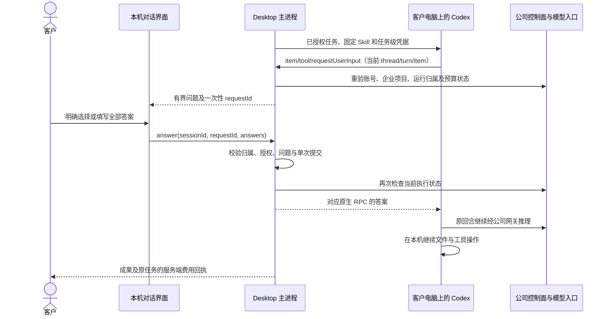

# Desktop 本机 Codex 的用户追问与继续执行

**阶段 75 当前增量：** Desktop 保持本机 Codex，视频角色接通七项公司工具、私有工程、真实合成、播放/保存、版本修改及停止/撤权控制。平台 830 项、重叠定向 58 项、原生 17 项、客户端 47 项和实际打包旅程 18 项通过；当前 17 个本机角色准入不等于全专业验收。见 [实现与源码证据](75-desktop-private-video.md)。原 102 REQ/102 TC、NFR、G01–G10 和 81/21/0 状态保留；较早记录沿用其原始源码范围。

本增量落实 [CLIENT01 的 DESK-L05](../requirements/03-client-execution-amendment.md)：本机 Codex 需要客户补充信息时，Desktop 在当前对话内显示问题，让客户明确回答后继续当前工作。Desktop 的文件、终端、线程及 Agent 循环继续运行在客户电脑；Extension 保持 Chrome 原生右侧栏中的云端对话和获选文件上传。沿用 [阶段 73 的公司工具、角色和费用职责](73-desktop-native-company-tools.md)。

## 用户流程与界面

1. 客户照常登录、选项目、专业角色、本机目录及权限，输入工作要求和预算。
2. 本机 Codex 请求补充信息时，对话中出现“需要你的意见”卡片。每次展示 1–3 道题；选项没有默认选中，允许原生问题明确提供的自填答案。
3. 客户回答全部问题，点击“回答并继续”。回答交回原生调用，继续当前任务、线程与回合；不新建任务、不再次预留预算。
4. 等待期间可使用卡片内“停止工作”、底部“停止”或顶部撤权。停止、撤权、登出和关闭会清除当前问题，旧回答不能再提交。
5. 同一登录下刷新页面会重新取得仍在主进程等待的问题。关闭整个应用或本机进程丢失后，不重播问题或本机动作，沿用未知结果核对规则。

卡片沿用 CopyPaste 的色板、Manrope/Fraunces 字体和边框。选项、自由输入、错误及回答按钮位于消息滚动区；任务停止、预算及费用仍在既有操作区。提供键盘操作、可见焦点、fieldset/legend 和明确的表单名称。最小窗口 800×600 通过消息区滚动访问完整问题。

## 固定原生协议

继续锁定 `0.163.0-alpha.11` 和现有二进制 SHA-256。显式开启 `features.default_mode_request_user_input=true`，不切换内核，也不把普通执行改为只能规划的模式。按同一二进制导出的 `ToolRequestUserInputParams` / `ToolRequestUserInputResponse` 处理请求；不将问题伪装成公司业务工具。

该版本的实际模型工具要求每题包含非空选项；实际传给客户端的请求包含 `isOther:true`、`isSecret:false` 和 `isBlocking:false`。原生返回的选项和自填能力按其字段展示。客户端协议也能有界解析纯文本题和保密输入，但后两者目前只有解析器/控制器测试，不声称已由该版本默认模型工具端到端发出。

`isBlocking:false` 不表示客户端可以自行回答或超时选择。实际原生测试验证答案通过对应 RPC 返回后，工具结果才进入后续模型上下文，原线程及回合继续。上游处理逻辑可参考 [OpenAI Codex request_user_input handler](https://github.com/openai/codex/blob/main/codex-rs/core/src/tools/handlers/request_user_input.rs)；产品兼容性仍由固定二进制及本次实际测试确定，不能用主分支源码替代版本验收。

## 归属、限制与生命周期

- 原生层必须匹配活动 thread、turn、item 和未使用 RPC id；每回合最多 64 次请求、同时最多 4 组问题。未知、重复或错绑请求不生成默认回答。
- 每组 1–3 题；问题 id 唯一，禁止原型属性名；每题最多 8 个不重复选项。标题、问题、选项、请求总量及答案均有明确长度限制。
- 主进程为每组问题生成随机 UUID。页面不能用原生 call id 猜测或构造一次性回答入口。允许的 IPC 操作只有固定字段 `id / requestId / answers`，仍检查可信主 frame。
- 回答必须恰好对应全部问题，每题一个明确的非空答案；没有自填权限的选项题只接受已声明选项。主进程重验账号、登录 epoch、本机会话、当前操作、授予权限及公司执行状态，提交期间不可重复占用同一问题。
- 等待人工回答的 Promise 不占用原生事件串行队列。停止和终态消息仍能处理；即使界面回调不配合取消，原生自有进程也必须能关闭。撤权、登出、关闭及过期通过既有所有权和中断链路终止等待。
- 问题及回答保存在主进程的临时状态，回答字段不写入 CopyPaste 加密会话日志、活动列表或费用请求。保密题使用密码输入。回答仍会交给本机 Codex 和公司模型；Codex 自身的本机线程记录、模型上下文和可能复述答案的成果不属于“从不存储秘密”的保证。
- 回答不会调用任务创建、任务开始或新预算准入。后续推理和业务工具仍使用原执行凭据与公司账本，未知使用量继续保留核对，不以取消追问为由清零。

## 代码位置

| 文件（Desktop 仓库） | 职责 |
| --- | --- |
| `src/local-input.ts` | 有界协议投影、问题和答案校验 |
| `src/local-codex.ts` | 原生请求绑定、独立等待与响应、中断清理 |
| `src/local-agent.ts` | 主进程临时问题、一次性回答、身份与公司执行重验 |
| `src/main.ts` | 可信页面的固定 answer IPC |
| `renderer/src/local-agent.tsx`、`local-agent.css` | 双语问题卡片、选择、自填、停止、键盘及滚动 |
| `tests/local-input.test.ts`、`local-agent.test.ts` | 无效输入、归属、重复提交、取消及临时状态测试 |
| `tests/integration/local-codex.native.test.ts` | 固定真实 Codex 的回答继续、中断、撤权及既有原生回归 |

## 验证与边界

本次的源码、实际打包候选、原生与 UI 回执、PNG、GIF、MP4 和失败尝试解释统一见 [阶段 74 检查点](../quality/desktop-native-input-checkpoint.json)。阶段 73 的 818 项平台完整回归保留其原始源码范围；本增量复核其后端源码未变化，另对当前 Desktop 进行原生及打包验收，不把旧 Desktop 测试冒充新源码测试。

验收后另刷新了未随程序打包的 `renderer-source.json`，使其中 65 项摘要对应实际原生界面。其余 1,243 项 UI 资格源码及实际 ASAR 均未变化，旧索引字节保留；[独立元数据核对](../quality/desktop-native-input-renderer-manifest-01.json) 明确记录唯一差异。它不是新增原生/UI 测试，也不改变已验证的运行逻辑。

仍使用获授权的假模型/图片响应和系统窗口决定；实际运行公司身份流程、数据库、账本、Electron、固定本机 Codex、文件和沙箱。视频及流程顾问的本机工具、完整浏览器/系统应用自动化、真实供应商、签名安装、全 18 角色/29 Skill 的专业效果及完整生产矩阵继续验收。原 102 REQ、102 TC、NFR、G01–G10 不缩减，仍为 81 部分、21 未证明、0 项完整通过。
