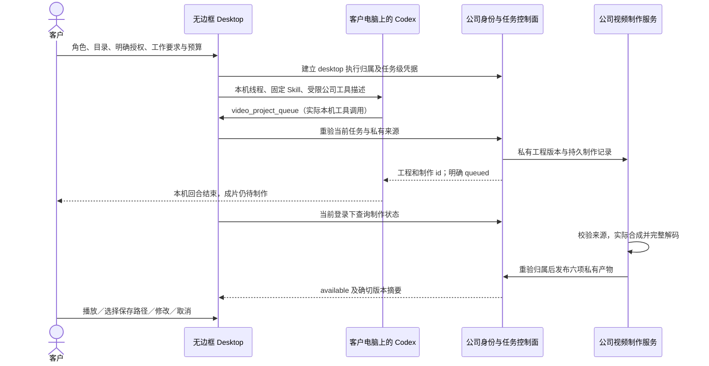

# Desktop 本机视频角色与私有制作流程

本增量继续执行 [CLIENT01](../requirements/03-client-execution-amendment.md)：Desktop 的 Codex 进程、Agent 循环、线程、文件和终端在客户电脑运行；推理与公司媒体服务通过公司服务器访问。Web 和 Extension 的 Agent 在云端，Extension 保持原生右侧栏的对话、附件及获选文件上传。实际运行、源码与媒体见 [当前检查点](../quality/desktop-video-checkpoint.json)。

此前本机入口开放 16 个角色，视频角色只有云端制作工具，不能在 Desktop 中完成相同业务。本次把 `video-motion` 接入本机 Codex，并为它提供七项公司视频工具。流程顾问仍未开放本机专属工具。17 个角色能够加载既定 Skill 和工具描述，不代表 18 个角色、29 个 Skill 的全部专业效果已经通过验收。

## 客户流程

1. 客户完成公司登录、企业及项目选择，在 Desktop 选择“影片与动效设计师”和本机目录，再明确授予只读、目录写入或完整本机权限。完整权限仍由客户在本机系统窗口确认，Admin 无法代授。
2. 客户描述脚本、品牌、画幅、镜头与字幕，或要求使用已有获准设计素材。本机 Codex 读取固定 Skill，调用公司工具取得允许使用的确切素材版本。
3. Codex 提交有界的工程定义。公司服务器校验当前本机任务、角色、预算、企业项目、来源版本及私有归属，创建私有工程和持久制作记录。本机任务不会进入云端 Agent 队列。
4. 本机回合可以明确报告“已排队”。消息中的视频卡片继续显示“等候制作／制作中”，此时没有下载按钮。公司服务负责实际 FFmpeg 合成；不以“任务完成”冒充“成片已交付”。
5. 合成完成、当前权限与全部来源仍有效时，卡片提供播放及六项固定版本下载：MP4、可编辑时间线、脚本、分镜、VTT 字幕和媒体检查 JSON。播放先校验实际字节长度及 SHA-256；下载通过当前登录鉴权，并由客户在原生保存窗口选择路径。
6. 客户可在同一本机线程要求修改。修改基于 `expected_version` 建立新版本并排队，旧版本及其产物保持不变。明确重做与取消分别绑定工程版本和制作记录的修订号；刷新状态不会自动重做。

卡片位于对话滚动区，沿用公司色板、字体及按钮样式。待制作、制作失败、取消和来源不可用均有独立文案。正常待制作状态每三秒查询一次，隐藏页面暂停自动查询；终态停止轮询，客户仍可明确刷新。卸载卡片后清除定时器和预览 Blob URL。默认展示最近三次制作，可展开较早记录。

800×600 下收起视频会话的大标题，预览高度依据消息区可用高度限制；输入框、预算、费用和停止按钮留在操作区。实际检查要求整个播放画面可见，不能仅凭“下载按钮能点到”作为预览验收。

## 七项本机公司工具

| 工具 | 输入与结果 | 约束 |
| --- | --- | --- |
| `video_projects` | 最多 20 个当前可见工程及游标 | 可见共享工程或本人私有工程；不枚举其他成员私有记录 |
| `video_project_read` | 工程定义、固定来源、最多 50 个版本及 100 次制作 | 当前项目权限、留存及私有归属检查 |
| `video_project_queue` | 名称和完整定义，返回私有工程及 queued 制作 | 仅视频角色可在本机创建；来源不隐式共享 |
| `video_project_status` | 工程 id、制作 id；返回有界状态及产物摘要 | 六项均可用才披露产物；不返回存储路径、任意 URL 或二进制 |
| `video_project_edit` | 工程 id、`expected_version`、名称和完整新定义 | 仅本人私有工程；修改和排队在同一事务，失败全部回滚 |
| `video_project_render` | 工程 id、`expected_version` | 明确新制作，不自动重试；已有制作中记录时拒绝重复 |
| `video_project_cancel` | 工程 id、制作 id、`expected_revision` | 仅取消明确版本的未完成制作，不删除旧成片 |

前三项读取类工具及状态查询可在本机只读模式使用；制作、修改和取消类 Agent 工具仍需本机写入授权。客户直接点击视频卡片取消公司制作时，由当前公司登录及项目写权限判定，不依赖已经撤回的本机 OS 授权。

七项描述只增加到此前尚未开放的 `video-motion` 角色。其他 16 个角色的公司工具集合保持原样，不在旧线程中静默增加媒体能力。所有 Agent 工具调用仍经过本机主进程和原任务凭据，检查真实 thread、turn、call id、完整参数、当前角色及原预算。

## 私有数据与访问控制

新增 SQL093；已发布的 SQL001–092 保持原始字节。`creative_projects` 的私有视频必须同时具有 `private_owner` 和 `origin_task_id`，创建人必须等于私有归属。工程隐私与最初归属不可修改。定义、版本、固定来源和制作表均使用限制性 RLS，防止同项目其他成员通过直查子表绕开父工程隐私。

本机私有素材可作为本人私有工程来源；共享工程继续只接收共享素材，不能把本机私有设计转换成团队可见的时间线。新版本继续使用本人私有工程，不能借本机修改工具覆盖共享工程。客户可读取已获授权的共享定义，再明确创建自己的私有副本。

每次制作单独绑定当前本机任务，六项输出沿用其私有归属和来源链。存储版本、字节长度、SHA-256、MIME、留存、删除、隔离及递归来源可用性继续校验。任何来源过期或不可用时，状态接口撤下整组交付；已有成片不能绕过来源权限下载，也不会自动生成替代结果。

状态查询为 `GET /v1/tenants/:tenant/projects/:project/video-projects/:video/renders/:render/status`，响应 `no-store`，由运行时严格 schema 限制。与工程创建、修改、排队、取消及预览一起收录于 [8 项视频操作契约](../contracts/template-video-openapi.json)。原始主 OpenAPI 不改写。

## 任务停止、撤权与异步制作

| 事件 | 本机 Agent | 已受理公司制作 |
| --- | --- | --- |
| 本机回合正常完成 | 保存原线程与费用，结束本回合 | 允许明确 queued 的制作继续；仍检查原生登录家族及当前权限 |
| 活动本机任务停止、失败、结果待核对或内容撤下 | 结束本任务拥有的运行 | 原任务的 queued/rendering 制作被取消；其他任务和共享制作不受影响 |
| 活动本机任务等待问题时撤回 OS 权限 | 清除问题并退出自有 Codex 进程 | 同一活动任务的制作被取消；旧回答拒绝 |
| 回合已正常完成后撤回 OS 权限 | 禁止继续本机执行 | 已受理、不再读取本机的公司制作可以继续；客户仍可点击卡片取消 |
| 原生登录家族撤销、退出或权限失效 | 撤销本机身份与任务能力 | 下一次认领、心跳或发布检查拒绝制作；不发布迟到产物 |
| 客户点击取消制作 | 不自动中断其他本机工作 | 精确取消一个制作 revision；不自动重做 |

制作服务按“用户权限 → 原任务 → 本机执行 → 工程 → 制作”的顺序加锁，与任务停止的更新序列一致。认领、续租和最终发布前检查当前本机归属；取消会递增制作 revision，已经完成编码但尚未发布的旧执行不能继续写入六项输出。过期或撤销的队列记录进入明确终态，避免占住队列使后续有效共享制作无法前进。

本机回合完成不等于视频一定制作成功，撤回 OS 权限也不等于撤销公司账户。上述两种权限分别展示并由对应边界执行。

## 幂等、恢复和费用

同一个真实 call id、HTTP 请求键及相同参数返回原回执，不新增工程或制作；换参数复用被拒绝。修改版本冲突、已有制作中记录和排队失败均回滚同一事务。重试读取已完成工具回执时，查询实际 `creative_projects` 与 `video_renders`，检查确切版本及当前可用性；修复了旧恢复分支误查不存在的 `video_projects` 表的问题。

本增量使用已有原生 FFmpeg 模板合成，`ai_cost_micros` 为 `0`，费用来源明确为 `local_composition_no_ai`。这不是把推理费用清零，也不是永久免费视频套餐声明。本机 Codex 的推理仍按公司服务器观察到的真实使用量和原任务预算结算；用量未知的预留仍进入核对。测试中的模型文本、Image 2 PNG 和系统窗口决定明确为获授权夹具；身份、数据库、原生进程、文件、编码、解码、播放、下载和账本实际运行。

渲染器升级到 `copypaste-campaign-cuts-2`，修复最小横版画幅 CTA 区域不足。时间线 schema 仍为 `copypaste-video-1`；旧 renderer 1 工程可以读取，既有交付保持不变。不能使用新布局静默重新制作已冻结的 renderer 1 版本；需明确保存新版本，记录新的 renderer profile。最小 456×256 实际编码和完整解码覆盖该边界。

## 代码与证据

| 仓库路径 | 职责 |
| --- | --- |
| backend `migrations/093-desktop-video-origin.sql` | 私有工程与子表 RLS、来源范围、原任务绑定和停止触发器 |
| backend `src/desktop-video-origin.ts` | 当前原生执行及登录家族检查，统一加锁顺序 |
| backend `src/video-projects.ts`、`video-project-model.ts` | 共享业务函数、严格状态协议、持久制作及发布 |
| backend `src/task-business-tools.ts`、`task-tool-reuse.ts` | 七项有界本机工具和已完成回执恢复 |
| Desktop `src/local-codex.ts` | 实际原生公司工具调用及安全视频事件投影 |
| Desktop `renderer/src/local-video.tsx`、`local-agent.*` | 实际状态卡片、显式取消、双语交互及最小窗口 |
| backend `tests/desktop-video.test.ts`、`video-render.test.ts` | 跨成员隔离、真实六项交付、停止竞态、来源失效、横版及冻结 profile |
| delivery `scripts/qa-desktop-video.ts`、`qa-desktop-local.ts` | 实际打包 Electron、固定 Codex、工具结果回传、播放、原生保存和撤权 |

[当前检查点](../quality/desktop-video-checkpoint.json)绑定每份报告、当前源码、实际打包 ASAR、固定 Codex、原始 TAP、隔离数据库清理、PNG/GIF/MP4 及失败尝试。完整回归按实际全部测试文件分批执行，不能拼造一份单次 TAP。较早 818 项用例保留，角色准入测试名称由 sixteen 改为 seventeen；既有 102 REQ、102 TC、NFR、G01–G10 和 81 部分／21 未证明／0 完整验收的状态不缩减。

实际媒体来自打包程序。供应商与原生窗口决定为明确夹具。真实供应商效果、流程顾问本机工具、完整浏览器／系统应用自动化、全专业角色效果、签名安装、商店发布和完整生产矩阵继续验收。

当前限定验证：平台 **830/830**（64 个测试文件、16 个固定批次），视频定向 **58/58**（与全量重叠），固定真实 Codex **17/17**，客户端 **47/47**，实际打包 Electron **18/18**。后端和本机主进程的全量检查之后有五项明确的界面/QA 源码调整，已由新的实际打包流程覆盖；旧全量报告未改写，其余平台及本机源码逐项未变。17 张截图及实际 GIF/MP4 按摘要与源码绑定。
