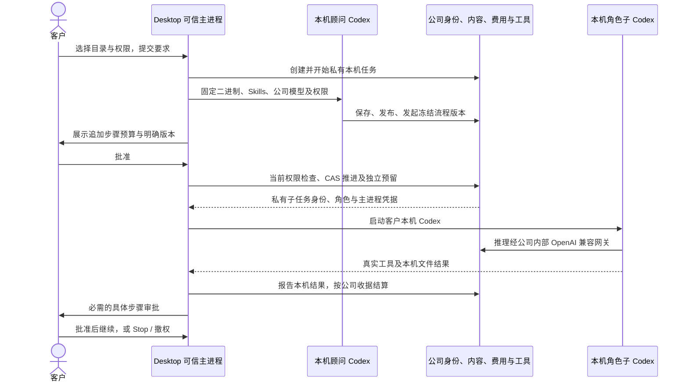

# Desktop 本机流程执行 / Native Desktop workflows

**阶段 77 当前增量：** Desktop 新会话接入十二项客户本机浏览器工具，真实操作/上传/截图/下载经本机 Codex 与公司网关；Stop/撤权回收页面。Desktop 取消旧进度条约束，保留真实进度，隐藏滚动条并重排成果/代码/表格，验证三种实际窗口、滚轮/键盘及双语浅深主题。平台 851、客户端 68、内核 17、独立浏览器 10、打包旅程 25 项分别通过；SQL001–094、428 条接口、102 REQ/102 TC 与 81/21/0 保留。Extension 仍为原生右侧栏获准文件上传与云端 Codex，无新 UI 计数。见 [当前方案与限定证据](77-desktop-native-browser.md)。

状态：已验证有界本机流程子集；18 个角色通过本机协议准入，完整专业交付仍待验收。平台 848 项、重叠定向 75 项、真实父子流程 3 项、本机内核 17 项、客户端 56 项和实际打包旅程 19 项分别通过。权威源码及媒体范围见 [检查点](../quality/desktop-workflow-checkpoint.json)。SQL001–093 保留。

Desktop 的流程中，Codex 步骤必须由客户本机的可信主进程启动。公司服务负责流程版本、当前身份及项目权限、预算、计量、工具和结果留存，云端 Worker 不执行这些 Codex 步骤。Extension 继续独立运行云端 Agent，通过原生右侧 Side Panel 选择、读取并上传获准文件。

## 执行约束

- 使用不可变的发布版本及角色摘要；编辑生成新版本，既有运行保留原定义。首次支持有界顺序流程：Codex、人工审批、广告数据汇总，最多八步。任意脚本、跨客户数据和无界递归均不开放。
- 本机流程与运行按创建人私有；完整 OS 权限不扩大公司的租户、项目、角色、预算或内容权限。普通成员不得通过列表、版本历史、运行状态或云端 API 读写他人私有流程。
- 子步骤使用对应角色的真实 Skills、公司工具、模型配置及独立费用凭据。可信主进程沿用客户明确授予的当前工作目录及 OS 权限，模型无法自行提权。各步骤预算及其总额在执行前展示并确认。
- 人工审批由可信主进程展示明确的具体步骤和操作；模型没有批准工具。每次推进须匹配运行版本及游标，重复请求不得创建第二个收费任务。
- Stop、撤权、退出、账号切换、身份失效、公司内容停用会阻止后续步骤，并终止仍活动的本机子进程。失联或未知执行不自动重放；已发生的费用按公司收据结算或留待对账。
- 视频异步合成须等待真实可用交付后才完成该步骤；仅完成本机 Codex 对话不能证明视频已完成。停止流程还须取消仍待处理的关联合成。
- 不允许 Desktop 调用云端流程执行入口或定时调度来绕过本机执行。云端既有流程保留独立生命周期。

## 核查计划

先建立 SQL094 的私有范围、不可变版本和父子关联，再接通可信主进程执行器及可见进度。验证覆盖真实本机 Codex 子步骤、本机文件结果、公司推理收据、角色与权限变更、人工审批、并发/重试、Stop/撤权、进程退出和云端禁止接管。模型响应可以使用已获授权的假数据，但真实二进制、文件、身份、计量和生命周期检查不得替换为模拟成功。

发布前更新双语 README、实际截图与交互录制、来源绑定的核查结果，并提交到对应分支。现有 102 项原始需求及验收标准不作降级；更广泛的 OS/浏览器自动化和专业交付仍须单独证明。

## English

The bounded native workflow subset is verified with explicit synthetic Responses and customer-dialog decisions; full professional and production acceptance remains pending. Native Codex steps run on the customer's computer through the trusted Desktop main process. The company service retains immutable definitions, live authorization, budgets, usage receipts and governed business tools. The cloud Worker must never take over a native workflow. Child steps inherit the customer's current explicit OS grant without expanding company access. Human approval, cancellation, uncertain outcomes and asynchronous media delivery require explicit lifecycle checks; a completed conversation is not proof of completed delivery.

## 客户操作与可信边界

客户选择「流程顾问」、本机工作目录及本机权限后开始对话。顾问通过八项公司工具查询、读取、校验、保存、发布、发起、查看及取消私有流程。保存会产生新的不可变版本；发布保留该版本的定义摘要和角色摘要。工作目录、权限模式和子任务推理凭据均由主进程确定，模型与渲染页面不能替换。

发起流程只创建尚未授权的运行记录。主进程展示全部步骤、具体版本及摘要、每个 Codex 步骤预算和追加预算合计；这是当前顾问对话预算之外的额度。客户明确批准后才逐步预留子任务费用，并启动本机 Codex。中途的 `approval` 步骤另行展示具体事项，客户批准前不会启动下一角色。拒绝或取消不抹除已发生费用。

完整权限是当前 OS 用户能够授予的本机访问能力，不会自动提升为系统管理员，也不改变公司租户、项目、内容与预算控制。共享 Skills 中关于云端 Worker 的终端限制保持适用于云端；本机可信上下文明示本机文件与终端受客户当前授权控制。Skill 中的能力标识不是可自行猜测的函数名，模型必须使用该会话实际暴露的工具名称和输入结构。

## 状态、费用与恢复

流程按 `running → awaiting_approval → running → succeeded` 推进，也可终结为 `cancelled` 或 `failed`。每次决策与推进校验运行修订号；不同版本、陈旧游标、重复子身份及跨设备会话均不能启动新收费步骤。同一游标的重试只返回原子任务；本机已受理但结果未知的步骤不会自动重放或继续下一步。

父顾问与每个子角色分别占用任务预算、使用自身的 Skills、公司工具和推理凭据。进度卡的「已完成步骤费用」仅汇总已完成步骤收据；顾问对话及未完成步骤的费用另见公司用量记录。图片/视频等异步交付遵守其真实任务与费用状态；对话完成不会自动变成媒体交付完成。

Stop、撤权及关闭应用首先终止本机父子进程，不依赖公司 API 恢复才执行本地中断。应用关闭后控制器不再接受任务；连正在等待本机日志落盘的请求也不能稍后启动。网络或执行状态未知时保留核对所需的身份、结果状态和费用，不在日志保存子推理凭据或客户回答正文。重新打开应用不得把未知步骤当成新任务继续收费。

## 公司 API 与数据库

本机工具共用当前任务的 `POST /desktop-executions/:execution/tools` 桥接，八项名称为 `workflow_list`、`workflow_read`、`workflow_validate`、`workflow_save`、`workflow_publish`、`workflow_run`、`workflow_status`、`workflow_cancel`。这里没有模型可以调用的批准工具。

可信主进程专用路径位于 `/v1/tenants/:tenant/projects/:project/desktop-executions/:execution/workflow-runs/:run`：`GET` 读取状态，`POST /decision` 提交当前修订号、定义摘要、`launch`/`step` 及客户决定，`POST /advance` 提交当前修订号。公司验证当前原生登录家族、创建人、项目权限、父任务与运行状态；批准另需项目审批权限。通用渲染 API不转发上述执行或凭据入口。

SQL094 新增私有工作流来源、不可变版本、源读取账本、运行修订和父子身份约束；不改写 SQL001–093。数据库按父任务、运行、子任务顺序取得锁。取消传播到仍排队或执行的子任务及关联合成；公司服务不向云端 `task.run` 队列投递本机步骤。既有云端流程、调度和 Worker 入口明确排除 `execution_location=desktop`。

流程定义、历史版本、运行记录和结果按公司权限控制。管理员受权限、MFA、原因及审计约束查看留存内容；删除使用受控擦除路径清理版本正文。流程停用或隔离后，已缓存的读取、后续推理/工具、本机子任务启动和下游私有交付必须失效。明确发布为项目成果的 SOP 同样保留其真实工作流版本来源，不能通过发布切断停用控制。

每个不可变版本另存 `source_refs`，由数据库从本机顾问实际读取账本计算，客户和模型不能自行填写。复用旧流程时合并旧版本冻结的文件、数据集、记忆、品牌、连接、云端引用及流程版本来源；新会话、派生版本和发布的 SOP 均继续受这些来源约束。读取账本写入后必须再次锁定并校验来源，首次读取失效版本也不能返回正文或留下半成功账本。来源遍历去重并设置上限，超限内容拒绝使用。

复用流程不会把旧创建任务或旧私有对话作为永久存活条件；旧任务删除或留存到期后，只要冻结的外部来源、所有者及当前项目权限仍有效，流程可继续使用。原始文件隔离后，即使新会话从未直接读取该文件，缓存工具结果、后续推理、子任务启动、私有交付及已明确共享的衍生 SOP 下载也必须拒绝。受控删除同时擦除版本定义、角色摘要和来源引用正文，保留最小审计摘要。

Immutable `source_refs` are computed from actual task reads, including flattened provenance from reused workflow versions. A reusable workflow can outlive its creator task without losing external source governance. First reads, cached calls, child admission and downstream private or explicitly published deliveries recheck those sources; controlled erasure scrubs the retained source-reference body too.

## 当前子集与剩余范围

当前实现仅为最多八步的顺序 Codex、人工审批和广告汇总流程。它不表示任意本机脚本编排、跨设备接续、定时运行、并行 DAG、完整第三方应用/浏览器自动化或全部专业成果已通过验收。18 角色/29 Skill 的完整业务范围、102 项原始需求、102 TC、NFR 及 G01–G10 继续按原标准跟踪。

模型响应与核查中的客户选择允许采用明确假数据；真实二进制、权限效果、本机文件、进程退出、身份、公司工具、交付字节与费用证据均必须实际产生。保留失败尝试，只有完成后选定的检查点可作为当前子集证明。
