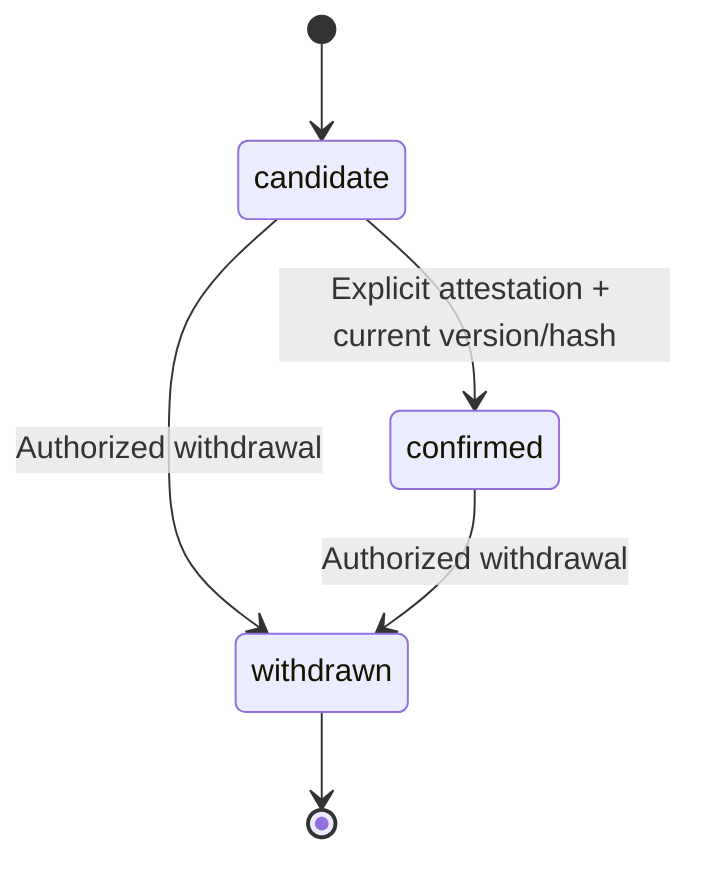
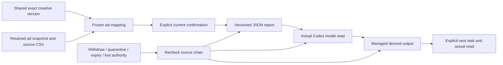

# 已确认素材与广告反馈 / Confirmed creative feedback

状态：当前代码与明确假数据的局部流程已验证；完整业务验收保留。关联 REQ-031、001、004、012、024、043、045、048、090、094、096、097。原 102 REQ/102 TC、NFR 与 G01–G10 不变；本文件不是验收通过声明。

现有营销分析按数据快照计算指标，设计成果按文件版本保存，两者之间没有获用户确认的身份映射。正式 Google Ads/Meta 连接当前只产生活动级事实；活动花费不能用来代表某个 creative 的表现。新流程必须保留这些事实粒度，不能从文件名自动认领广告表现。

选择共享素材的具体版本与已确认口径的广告级快照，指定渠道、活动、广告实体、creative ID 和有效日期。候选固定账户、币种、时区、归因/转化定义、源摘要和素材摘要。用户检查摘要并明确确认后，映射才能用于反馈。候选与撤销映射不参与计算；更正身份须建立新候选，原确认人与历史保留。

反馈冻结所选映射 ID、确认版本、原数据和日期，使用现有精确整数/十进制指标计算。不同账户、平台、币种、时区、归因及转化定义分别展示。相同广告日的重叠快照不能重复计数；冲突身份或事实拒绝，不能把同名素材的表现混合。缺失转化保持未知，相关性不表达为创意造成的提升。

反馈形成可下载、可作为下一轮工作的明确附件的版本化成果。原素材、数据来源、连接授权或映射撤销后，界面、下载及下一轮模型读取/发布均须重新检查来源。后台沿用范围权限、正文权限、审计和内容控制。所有映射/报告创建及确认、撤销使用幂等键与版本检查；重试不能创建两份确认或改写冻结正文。

界面沿用 CopyPaste 蓝色、Fraunces 标题、Manrope 正文与浅深主题。以“素材版本 → 已确认广告身份 → 独立口径反馈”作为视觉结构。Desktop 继续本机 Codex、无边框及无可见纵横滚动条，保留原生滚动与真实进度；Side Panel 继续云端对话/附件，完整营销工作台通过明确入口打开。

验证须包含真实原生数据库与 HTTP、跨企业/项目拒绝、只读用户、源隐藏/过期/删除、连接撤权、并发确认/撤销、幂等冲突、旧版本不漂移、精确指标及重叠事实边界，另以实际界面和原生成果核查流程。业务输入和模型内容继续使用明确模拟数据；真实平台投放、完整业务质量及原 TC 验收分别跟踪。

English: This work closes the missing link between versioned creative assets and campaign evidence. Only an explicitly confirmed ad-level identity mapping contributes to feedback. Freeze exact asset/source versions, account, creative/ad identity and date range; preserve independent metric scopes, exact arithmetic and unknown values. Reject ambiguous overlaps. Revocation must stop new reads, downloads and downstream reuse. Existing authorization, content control and immutable source lineage apply. Bounded implementation and mock-data qualification are linked below; all original complete acceptance gates remain open.

## 实际接口与输入 / Implemented operations and inputs

统一前缀为 `/v1/tenants/:tenant/projects/:project/creative-feedback`，沿用现有登录身份和企业／项目授权，不增加共享密钥或演示账号入口。

| 方法与相对路径 | 使用逻辑 | 主要限制 |
| --- | --- | --- |
| `GET /options` | 查询可用共享素材、广告级快照、指定素材版本或快照中的精确广告身份；返回服务端 `can_write` | 素材／快照各取最近最多 100 项；单素材最多 100 版本；单快照最多 1,000 个身份 |
| `GET /mappings` | 只列出当前可读、未过期的映射，供核对与选择 | UUID 游标；默认 40、最多 100 项 |
| `POST /mappings` | 固定素材版本与快照、渠道、活动、广告、creative、日期和核对说明，建立候选 | 严格字段校验；写权限；幂等键；必须存在精确广告日事实 |
| `POST /mappings/:id/confirm` | 提交当前版本、正文摘要、原因及主动单一创意声明后确认 | `confirm_single_creative_allocation: true`；原因 5–2,000 字符；竞争身份或旧版本返回 409 |
| `POST /mappings/:id/withdraw` | 保留确认历史并撤销候选或已确认映射 | 当前版本／摘要和原因；即使原来源已不可读，也允许有权用户撤销 |
| `POST /reports` | 选择已确认映射，创建指定日期的不可变反馈与实际共享 JSON 文件 | 1–40 个不重复映射；最多处理 100,000 条选中事实；幂等键 |
| `GET /reports` | 返回当前仍可使用的报告及成果版本定位 | UUID 游标；API 默认 40、最多 100 项；界面可明确请求更小页面 |

接口及增量模式见[独立契约](../contracts/creative-feedback-openapi.json)。映射、决定和回执的严格响应验证范围与 options／列表的描述范围分别记录，不将存在契约文件视为所有字段均已通过运行时校验。

候选的 `allocation` 固定为 `single_creative_entire_ad`；`match_source` 仅允许 `manual`、`name_candidate`、`provider_metadata`。后两者也必须经用户确认，不会自动增加平台可信度。广告来源限定 Google Ads／Meta 广告级快照，账户、币种、时区、归因及转化定义须完整。共享素材支持已保留的 PNG、JPEG、SVG、WebP、MP4、PDF 与 PPTX 版本，排除私人素材和已擦除版本。

English: All seven operations use existing user and project authorization. A candidate pins one shared version and one exact daily-ad identity. Confirmation requires an explicit true attestation, expected version/hash and a reason; automated name or metadata matches never become verified platform identity. List pagination and source-choice limits are explicit. The report input has at most 40 distinct confirmed mappings and 100,000 selected facts.

## 状态、事务与权限 / State, transactions and permissions

SQL099 新建 `creative_mappings`、`creative_feedback_reports` 和 `creative_feedback_mappings`。第三张表记录报告实际使用的映射版本，并以企业／项目复合外键约束来源范围。三表强制 RLS；`cp_control` 仅获 SELECT／INSERT／UPDATE，不能直接 DELETE；`cp_app` 仅获前两类当前可读记录的 SELECT。写入经服务端控制事务完成，不向浏览器授予数据库写权限。

写事务先锁定当前用户授权、成员关系与项目，再取得项目级 advisory lock。建立报告时按固定顺序读取并锁定素材、来源与映射；确认使用行锁、预期版本和摘要拒绝竞争更新。来源可读性在处理幂等重放前重新检查，幂等回执只含定位和状态，不保存可绕过当前权限的私人正文。重复提交不会生成两个报告或改写已确认正文。

数据库触发器保护冻结身份、确认人与历史，只允许合法状态转换和单调版本。后台可更改获准元数据或内容状态，不能用元数据操作重写创意身份／广告事实。撤销或隔离映射会隔离依赖报告的成果；恢复映射不自动重新发布旧报告。

| 使用身份 | 可用行为 | 权限约束 |
| --- | --- | --- |
| 项目可读成员 | 查询当前可读候选、报告及成果 | 企业、项目、来源、保留期与文件状态均须有效 |
| 项目可写成员 | 建立、确认、撤销及生成报告 | 当前服务端写权限；撤权后旧会话不能继续写入 |
| 后台元数据管理员 | 在被授予的企业／项目范围查询内容定位和状态 | 元数据读取不隐含正文读取 |
| 后台正文读取者 | 查看获准范围内正文 | 独立 `admin.content.body.read`，操作留审计 |
| 后台内容操作者 | 隔离、恢复、删除或修改获准元数据 | 对应 `admin.content.quarantine`／`restore`／`delete`／`metadata.write` 等既有操作权限，另受审批与范围规则约束 |

English: The three new tables retain forced RLS and composite scope bindings. Controlled writes serialize project decisions and check current authority, source access, expected versions and hashes. Confirmation history is immutable. Admin metadata, body access and content actions remain separate permissions, with scoped audit and existing approval rules.

## 指标和来源继承 / Metrics and source lineage

计算版本为 `confirmed-ad-creative/1.0`。报告按素材版本／摘要、creative ID、平台、账户、币种、时区、归因与转化定义分组。既有精确整数计算输出十进制字符串；不经二进制浮点累加费用。

同口径、同渠道、同广告、同日期构成待去重事实：内容和素材分配一致时只计一次；数值或创意分配冲突返回 409。不能同时选择原快照及其更正链中的版本。日期窗口必须实际包含事实；未知转化保持未知，未观测日期不能补成零。没有足够口径依据时不生成跨账户／跨平台汇总，也不将相关性解释成创意造成的提升。

报告正文的 canonical SHA 与实际格式化 JSON 文件的字节 SHA 各自保存，不能混用。成果通过 `creative_feedback_id` 进入现有来源检查，不伪造旧 `publication_sources`。原 SQL098 来源函数保留其既有 OID 和检查逻辑，外层增加报告、映射、广告快照、原 CSV 及素材版本依赖；原任务成果的来源约束继续生效。

模型实际读取报告后，读取证据及来源链进入后续受管理成果；再次实际读取派生成果时继续继承。仅把文件放入排队任务，不冒充已经被模型消费。下载、模型读、排队续作和新成果发布均检查当前来源。服务已导出到客户本地或其他服务的副本不在撤销控制范围内。

默认保留 90 天。到期后现有保留策略与删除日志先清理报告文件，再清理报告正文及上级映射正文；持久依赖、租约和重试保留原流程。即使正文被清除，允许保留的结构、摘要与审计信息也不能用于恢复已删除的原内容。

English: Exact decimal metrics preserve independent measurement scopes, deduplicate identical ad-days and reject conflicting allocations or correction snapshots. Report-body and file-byte digests have different meanings. Actual model reads and derived managed outputs carry transitive source lineage. Current source checks fence subsequent reads, downloads and queued reuse; exported external copies remain outside service revocation. Existing durable erasure processes retained content in dependency order.

## Desktop 呈现约束 / Desktop presentation constraints

Desktop 保持独立的本机 Codex 执行和客户主动、可撤销的完整权限。原生 shell 注入隐藏滚动条样式，滚动容器仍采用原生滚动；不能以截断内容、禁止滚轮或移除焦点代替。表格、代码、长路径和成果采用换行／重排，主要工作区不依赖横向滚动。自建浏览器只隐藏远程网页的滚动条外观，保留其原有布局与真实网页操作。

无边框标题区占 40px。长页滚动时导航与偏好控件抵消根滚动偏移，弹层仍位于标题区下方；保留滚动定位空间。800×600、1280×800、1440×980 的实际 OS 窗口检查分别覆盖输入、费用、成果、末项焦点与停止／撤权。局部会话 Home／End 与外层页面 End／Ctrl+Home 分别检查真实位置。

上传、任务、流程和生成式视频的真实状态／进度继续显示；上游没有报告百分比时不能凭耗时编造。原生截图和录制从同一串行 Electron surface 捕获，等待真实主题过渡完成，避免 CDP 捕获干扰 OS 窗口尺寸。旧失败尝试及存在视觉问题的帧保留历史范围，不作为当前外观通过依据。

Web 与 Desktop 共享反馈业务流程，但分别构建。Extension 保留原生右侧 Side Panel 的对话／附件和获准文件读取上传，通过明确入口打开完整云端反馈工作台；其 Agent 继续在云端运行。

English: Native Desktop retains local Codex, explicit revocable full permission, its frameless shell and truthful progress. Scrollbar rails are hidden while wheel, keyboard, focus and full content access remain. Native OS-window checks cover the three required sizes; screenshots use serialized Electron capture and settled themes. Extension keeps its independent cloud chat/attachment model in Chrome's native right Side Panel.

当前回执、实际截图和录像见[检查点](../quality/creative-feedback-checkpoint.json)。Published SQL001–098, original OpenAPI bytes and original acceptance definitions remain intact. No campaign-only allocation, provider-verified identity or causal uplift is claimed.

本次完整回归中，部分既有网站变更边界用例的整体耗时高于阶段 81；检查点保留相同用例名称、两次原始 TAP 摘要及实际毫秒值。源码版本、数据与宿主状态不同，不能据此认定具体原因，也不构成受控性能基准。功能检查通过不替代响应时间与容量 NFR 验收。Some legacy website-change cases took longer in this run. Bound raw timings are observational; performance and capacity acceptance remain unproven.
