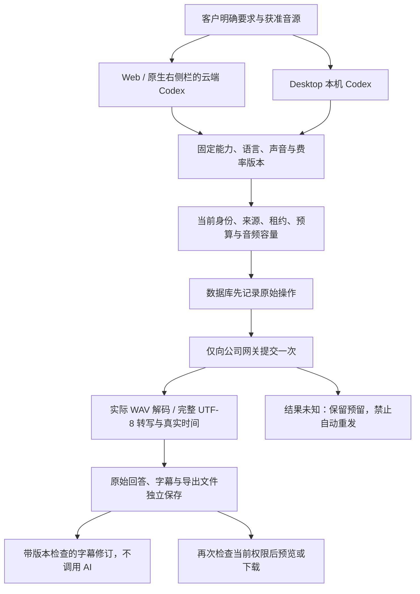

# 内部配音、转写与字幕生产 / Internal speech and transcription

本项记录阶段 84 对原 REQ-021，以及 REQ-018、043、046、049、058、078、090–092 音频依赖的有界修复。独立配音、文件转写、原始回答和字幕版本已通过当时源码下的阶段检查，回执见 [阶段 84 检查点](../quality/audio-production-checkpoint.json)。后续客户独立确认与治理修复见 [阶段 85](85-audio-rights-and-administration.md)；旧回执不自动代表修改后的源码通过。原始 102 项需求、完整验收、NFR 和 G01–G10 保留。

## 接口与能力版本

2026-10-24 核对官方 [Speech API](https://developers.openai.com/api/reference/resources/audio/subresources/speech/methods/create)、[Transcriptions API](https://developers.openai.com/api/reference/resources/audio/subresources/transcriptions/methods/create) 和[文件转写说明](https://developers.openai.com/api/docs/guides/speech-to-text)。配音是 JSON `POST /audio/speech`；转写是 multipart `POST /audio/transcriptions`。两种操作使用独立的公司模型别名、不可变能力和价格版本，不假定一个文本模型别名同时支持音频，不内置或静默选择特定供应商模型。

所有地址与凭证来自公司服务端允许的内部网关；不接受用户或模型返回的替代地址，不跟随重定向。官方兼容请求不等于网关已支持。能力未配置或未验证时准确显示缺口。当前验证使用已授权的明确假服务与实际可解码音频，不构成真实配音质量或粤语准确率的验收。

官方不同转写模型支持的输出与时间戳不同。文字转写、服务商实际返回的逐句时间和用户修订分别保存来源；没有时间戳时不猜测字幕时间。带时间戳的 `verbose_json` 适配需要单独核验，不把任何内部别名冒充为支持所有输出格式的模型。

语言采用独立的 `AI_SPEECH_LOCALES` / `AI_TRANSCRIPTION_LOCALES` 清单，初始仅为 `en`；未验证的 `zh-HK` 或 `yue-HK` 请求在网络前拒绝。声音和语言组合、口音与识别准确率需分别验证。测试服务明确声明其测试语言，不能将合成音调的接口通过当作粤语质量证明。

## 输入、授权与产物

配音固定原文、语言、声音、速度、WAV 输出及能力版本；保留文本和重新生成的具体原因。只开放经过验证的声音；不把客户上传声音自动注册为可克隆声音。工具保存音源/声音用途声明、引用及原任务操作者，并与版本绑定。当前声明来自任务工具参数，没有独立的人类签署授权步骤，不能把模型传参当作声音所有权或用户独立确认的证明；后续仍需落实客户明确确认与权利审核。合成音频明确标为 AI 生成。

转写使用当前有权限的明确音频文件版本、摘要、实际媒体时长及获准用途。上传文件、原始转写、字幕修订、SRT/VTT 和可恢复 JSON 是独立版本。字幕修订不重新请求模型，保留原始回答和时间来源；只改文字时复用原音轨。时间范围和顺序须校验，不悄悄拉伸音轨或丢弃文本。

成功必须有实际有界、可解码文件或验证后的完整转写。返回状态或一段提示词不能作为交付。素材、原始回答、字幕及后续视频都继承来源和当前项目权限、隔离、过期及删除门控；私有任务不自动公开。后台元数据和正文权限分别执行，敏感访问审计保留。

## 执行与费用

Web、Extension 由云端 Codex 调用公司音频工具；Desktop 由客户本机 Codex 调用同一工具与费用通道，不转换为云端 Agent。每次生成或转写在网络前落库不可变意图、原操作者、任务、工具调用键、能力/费率版本、输入版本及预算。未知提交不通过重放 POST 猜测成功；明确的用户重新生成创建独立操作和成本。

音频与文本、图片、视频共用原任务预算以及企业/用户/平台并发和速率边界，音频保留独立类别和单位。金额使用精确整数及一次聚合舍入。公布的公司收费合同与供应商实际成本分别说明；缺少可确认费用的请求保留对账及预留，不填零。停止、撤权、断网与进程崩溃不等于已发送请求免费；只有确证未派发才能释放为零。后台对账需保持现有独立审批及不可变事实。

任务、作业租约与提交状态持久化。Stop、退出和授权撤销阻止新请求并释放本任务拥有的资源；不能自动终止客户其他程序。原音轨、字幕和费用状态在页面、原生侧栏与 Desktop 中一致呈现。Desktop 保持无边框、无默认菜单、无可见纵横滚动条，并保留真实进度、滚轮与键盘访问。

## 验证与交付

需要真实原生 PostgreSQL、Codex、内部模拟 HTTP、WAV 解码与实际页面交互证据。覆盖请求与响应规格、声音和源音授权、无时间戳、繁中/英文、文件损坏、同键重放/参数冲突、并发预算、取消竞争、网络不明、租约丢失、冻结版本、跨项目/私有隔离、来源撤销、正文权限与删除。保留 SQL001–100 和原 OpenAPI 字节，新增迁移及增量契约。原有 968 项平台测试与客户端检查保留；根据实际改动运行必要回归，不能以新增局部检查宣称全部原始验收完成。

更新中英 README、逻辑图、真实截图和交互 GIF/MP4，记录源码与媒体哈希及未完成范围，再按已有授权提交和推送各端分支。浏览器、自建服务和测试夹具均按本轮归属清理，禁止 Docker/WSL/虚拟化。

English: This repair covers internal TTS and file transcription as separate verified capabilities, explicit source/voice-use attestations, exact retained outputs and subtitle revisions, shared task budgets, durable submission/unknown-cost handling, scoped Admin control and source lifecycle. Desktop orchestration remains local Codex; all AI calls use company servers. The bounded implementation and actual client checks are recorded below; synthetic service tests do not establish live professional quality or original complete acceptance.

## 当前候选实现 / Candidate implementation

新增 SQL101 保存 `ai_audio_jobs`、不可变事件与精确产物绑定。SQL001–100、旧版本角色/Skill 和原 OpenAPI 保留。影片角色使用 1.3.0，加载独立的 `speech-production` 1.1.0；旧角色 1.2.0 与 Skill 1.0.0 均保留。音频能力为可选依赖，不使原有视频工作流被未配置的音频阻断。

配音按 Unicode 字符、转写按实际输入毫秒计公司费用。准备、派发、完成、取消和未知状态分别记录；网络前取消有证据支持零费用，派发后未知保留原资金与容量。取消竞争中若原请求实际返回有效结果，保留已经发生的公司收费，并重新检查是否仍允许交付。不会把缺失供应商成本填成零。

音频类型的供应商并发与每分钟提交数初始为 **0**，需后台按既有独立审批流程发布新策略后开放。后台「调用管理 → 配音与转写作业」按范围列出作业；`admin.ai.requests.read`、`admin.ai.cost.read` 与 `admin.content.body.read` 分别控制元数据、费用和原始要求/授权正文。正文读取要求近期 MFA 并审计，原始输入不可覆写。原任务的已确认费用沿用既有独立审批结算。

客户在任务中展开「配音与字幕」，播放/保存 AI WAV，选择历史转写版本，修改文字和实际时间并保存新版本。无服务时间戳时只显示文字；客户可自行填写时间，新字幕明确标为人工修订。首次手动时间为空，不预填猜测值。修订使用开始编辑时的固定版本，后台版本变化时拒绝覆盖；网络重试沿用同一幂等键。

Web 与 Desktop 使用实际保护接口验证字节数和 SHA-256；原生侧栏也验证后生成可释放的 Blob 链接，关闭任务/退出/页面回收时释放。Desktop 音频卡片位于本机工作记录内，保持输入区、原生滚轮和键盘操作；不出现纵横滚动条。

## 仍需证明的范围 / Open verification

1. 当前假服务仅返回可解码合成音调及固定转写，真实声线、粤语口音、识别质量和声音权利审核未验收。
2. 独立音频能力的后台自动验证、发布与回滚尚未完成；当前通过服务端显式验证配置及固定任务版本控制，不能冒充已有文字/图片/影片能力的完整后台发行流程。
3. 未知音频 POST 没有虚构查询协议；外部账单证据的专属录入、独立审批与恢复交付仍需补齐。已确认费用可按现有原任务流程结算，未知费用继续阻止释放预留。
4. 本增量的实际 Web、Admin、原生 Side Panel 与打包 Desktop 截图、交互录制及完整回归已另行保存，见下方精确版本检查点；这些假服务证据不代替真实业务质量与完整客户验收。
5. 声音克隆、长音频分片、实时语音与完整专业营销交付不由本次固定 WAV/MP3 文件协议自动具备。原始需求与总体验收仍逐项跟踪，不以接口存在宣告完整交付。

## 已执行检查 / Recorded checks

当前精确版本的音频/网关 **43**、旧视频/来源/角色/迁移/能力发行兼容 **80**、客户端 **124** 项，以及真实 Web/Admin/原生右侧栏 **10**、打包本机 Desktop **40** 项分别通过。完整平台 **988** 项覆盖 **77** 个测试文件、**20** 个独立原生数据库批次，保留全部原 **968** 个用例。实际回执、原始日志、当前源码和媒体逐项绑定于[检查点](../quality/audio-production-checkpoint.json)。

Desktop 的真实 OS 窗口在 1440×980、1280×800、800×600 下无可见纵横滚动条，保留滚轮/Home/End、末项下载和焦点访问；修正缩放后同一字幕保存按钮的可见性，并实际复核繁中深色主题。原生 Side Panel 通过浏览器工具栏打开真实右侧栏，与 Web/Admin 分别实际操作。四组 GIF/MP4 由真实观察时间录制并完整解码，见[画面复核](../quality/audio-production-visual-review.md)。

失败、过时或录制标签错误的原始回执保留：Desktop 第 49 轮因测试输出路径冲突停止，第 50 轮暴露窗口缩放后焦点可见性问题；第 51 轮音频画面的主题标签与实际画面不一致，已通过真实主题断言和重新录制修正，见[主题修正记录](../quality/audio-capture-correction.md)。第 10 轮兼容用例虽全数通过，但运行期间辅助脚本变化使源码资格失效，保持失败状态；当前采用新的完整兼容回执。此前 Web 定位器和 Admin 审计列名错误也按原失败回执保留，不改写为通过。

完整平台第 35 轮第 17 批发现旧测试仍断言 30 个版本；实际新增配音 Skill 后为 31 个版本、29 类 Skill。仅更新两处总数断言，另加旧、新配音版本共存断言，业务源码和旧功能断言不变。第 36 轮重新执行受影响的完整四文件批次及剩余批次；前 16 批的运行时、实际执行测试和辅助代码字节保持一致，按明确范围复用。客户端和 UI 回执中该未执行测试的旧快照保留，不伪称原始全局指纹相同；见[测试增量复核](../quality/audio-production-skill-expectation-review.json)。失败回执不计入通过覆盖。

旧角色 1.2.0、模板角色 1.1.0 及原始 Skills 保留。完整媒体角色使用有界的 32 项工具上限，继续检查重复名称、规格、总大小和每次调用权限。SQL001–100 与两份原 OpenAPI 保持各自已发布字节；七项音频路由使用增量 OpenAPI。原 102 REQ/102 TC 和 G01–G10 的完整验收状态保持不变。
