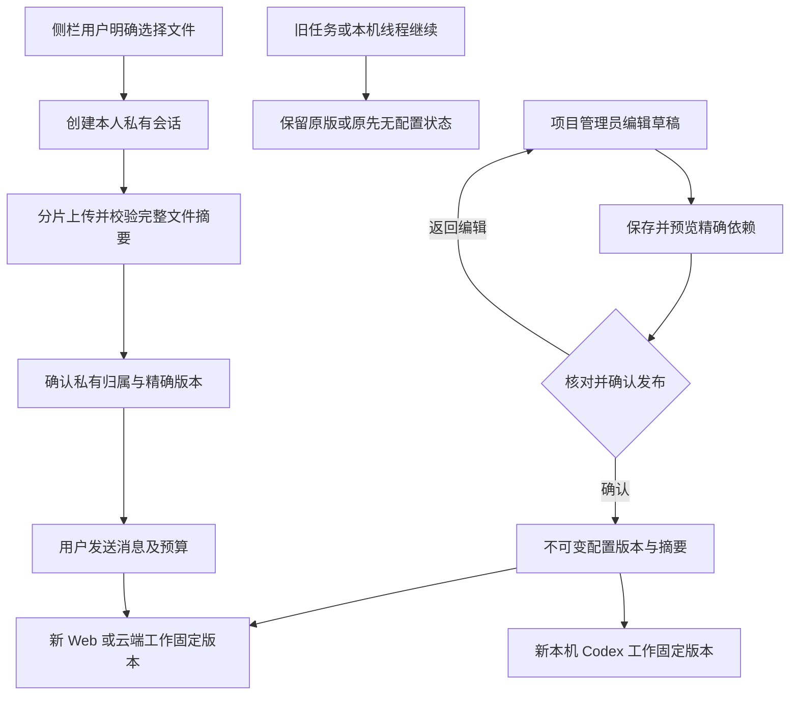

# 86：项目共享配置与私有聊天附件 / Shared project guidance and private chat

状态：已实现并通过下列限定验证。此增量处理 GAP-13，并修复 GAP-03/GAP-20 已复现的侧栏附件范围问题；全部 26 个差异组、原 102 项需求和完整产品验收继续保留。当前结论以本节末尾的实际回执为准，未执行的场景不登记为通过。

## 产品使用流程

项目管理员在「项目 → 共享设置」填写共同目标、交付要求、推荐专业角色、品牌版本、共享文件、获准广告账号和单次预算上限。先保存草稿，再预览将要发布的精确依赖和版本，核对后确认发布。保存、预览和发布均不启动 AI，不创建付费任务，也不授予工具、广告账号、本机权限或更高预算。

Web 和 Desktop 展示相同的项目设置编辑、预览、历史及复制流程；Extension 只读展示当前共享设置或已接收任务的固定设置。选文件支持搜索和分页，已选版本在搜索或翻页后保留。预览是独立步骤，返回编辑保留输入。历史版本只能复制成新草稿并发布新版本，不覆盖旧版本。

新工作由服务端固定当前配置版本、SHA-256、推荐 Agent/Skill 版本、品牌及文件版本。旧工作继续时保留原配置；若它在项目尚未发布配置时开始，继续时仍保留原先「无配置」的状态。新的项目发布不会自动升级旧任务或本机 Codex 线程。每次使用仍检查当前权限、来源状态、能力与费用限制。

在原生 Chrome 右侧栏选择附件时，先以当前用户创建私有会话，文件通过已有分片上传接口绑定到该会话。上传者可以下载原始文件；同项目其他成员不能列出、读取版本、下载或访问它所属的私有会话。共享至项目仍需独立明确操作。普通附件上传不启动模型，不授予 Desktop 权限，也不依赖安装 Desktop。

## 代码与接口

Backend 的 `src/project-configuration.ts` 管理草稿 CAS、预览、发布、固定版本、共享依赖及列表；SQL103 新增配置表、不可变版本与任务绑定守卫、RLS、当前来源门控及范围限定的连接器锁。SQL001–102 保持原字节。

旧库升级验证从 SQL101 的既有本机任务与三类音频状态开始，依次升级至 SQL102、SQL103，再重放迁移。它确认未提交作业取消、未知支出不被当作零、已完成文件与账目保持原值，不追补客户授权或项目配置。旧结构只用于测试夹具，不给当前产品入口添加绕过新结构检查的分支。

任务接收与原线程继续共用 `enqueueTask` 的预算和权限逻辑。参考文件正文通过 `project_reference_read` 读取选定精确版本，校验实际字节摘要并记录来源读取；可读角色仍需原有 `asset.read`。品牌上下文和共享指令属于参考数据，不扩大工具或系统权限。Desktop 继续运行客户本机 Codex，经公司内部 API 使用获准云端资料。

| 方法 | 路径，均位于当前企业/项目范围 | 权限与行为 |
| --- | --- | --- |
| GET | `/project-configuration` | 项目读权限；显示当前发布或无配置，失效正文不返回 |
| GET | `/project-configuration/draft` | 项目管理权限；读取独立草稿与修订号 |
| PUT | `/project-configuration/draft` | 管理权限、CAS、幂等键；不影响已发布版本 |
| POST | `/project-configuration/preview` | 管理权限；解析当前精确依赖、摘要与前后版本 |
| POST | `/project-configuration/publish` | 管理权限、精确预览摘要、CAS 与幂等键；原子发布 |
| GET | `/project-configuration/versions` | 项目读权限；历史正文仍受当前来源门控与删除约束 |
| GET | `/project-configuration/options` | 管理权限；仅列可共享文件和当前获准依赖，文件搜索与稳定游标分页 |
| GET | `/tasks/:task/project-configuration` | 当前任务可见权限；返回该任务固定的配置，私有任务不可越权读取 |

请求的完整前缀为 `/v1/tenants/:tenant/projects/:project`。新增契约为 Backend 的 `contracts/project-configuration-openapi.json`，由 [生成工具](../tools/build_project_configuration_contract.py)维护；它是增量契约，不改写已有契约。专项检查用实际 HTTP 成功请求与响应验证全部八项操作。

配置最多选择 20 个精确共享文件版本、12 个连接器。文件选项默认每页 50、最多 100，游标以名称和资产 ID 稳定排序；历史默认 20、最多 50。Agent、品牌和连接器选项目前各最多 200，不能据此声称所有大目录边界已完成。共享指令最长 8000 字，交付要求最长 4000 字；单次预算为正整数港币微额，发布限制不能扩大实际用户权益。

## 私有附件、恢复和费用

Extension 的 `ConversationState` 在上传前串行保存会话创建回执；并发选文件共用一个私有会话。当前用户、企业、项目、会话或角色不匹配的创建响应不能启动上传。迟到响应不能回写新的范围。创建回包丢失时，重开侧栏或重试沿用原名称、角色和幂等键；创建会话本身没有模型费用。

`PrivateChatUploads` 使用当前 `/uploads` 接口，明确传入 `conversation_id`，按文件内容 SHA-256、名称、类型及用户/企业/项目/会话隔离恢复回执。先持久化创建键，再请求服务器；重试校验服务器现有分片，只补传缺失片段，最后核对完整摘要、字节数、私有所有者与会话元数据。相同文件的并发选择共享一次传输，文件间串行处理以限制预留槽位。

接收响应不确定时不降级到项目共享接口。完成回包丢失后，重试核对原上传并取回同一资产版本；撤权会阻断恢复与完成。过期上传保留明确失败，重新选择后按当前权限处理。恢复回执不保存文件正文或凭据，仍需用户持有所选文件的原始字节；普通未发附件不承诺自动跨侧栏关闭恢复。

当前侧栏仍为每条消息最多 20 个附件、每个非空文件不超过 5 MiB。后端支持的更大文件和可选 Native Host 不等于侧栏已经完成全体大文件、长时间休眠和跨浏览器矩阵。上传成功与消息已接收分别展示；只有确认的不可变版本 ID 能进入用户消息。付费消息继续使用原 canonical delegation、预算预留和幂等键，不新增第二套计费。

## 管理与删除

Admin 内容目录纳入项目共享配置；元数据读取、敏感正文读取、隔离、恢复、永久删除分别使用既有独立权限和项目范围。敏感正文读取继续要求相应身份/MFA。隔离会阻断依赖新调用，恢复不改写历史内容；永久删除擦除草稿、全部版本正文和相关重放正文，留下必要状态/摘要及审计，不允许恢复已删除正文。

即使客户授予 Desktop 完整本机权限，公司云端数据与账号操作仍执行当前服务端权限检查。配置中不存储连接器凭据，选择私有或其他项目文件会拒绝发布。来源被隔离、删除、到期或授权变化后，历史与替换预览也不能泄露旧正文。新增配置不代替各业务工具自己的来源和权限检查。

## 页面状态与本机可访问性

共享摘要在窗口聚焦、页面重新可见、手动重新核对及十五秒轮询时刷新。历史列表独立刷新，失效版本既不显示正文，也不能复制。编辑器和历史弹窗使用不同的 React 标识；此前同级重复标识导致复制并发布后遗留旧历史 DOM，现已修复。实际检查要求历史只有一份、来源隔离后旧正文从 DOM 消失，恢复后原版本摘要不变。

Web 与 Desktop 的生成视频同范围刷新保留原播放器，避免手动刷新卸载播放器和丢失暂停位置；变更企业/项目/任务范围或请求失败仍清除旧数据。本机检查保留原生视频元素引用，核对实际暂停位置、刷新后的元素连接和原始下载字节。

Desktop 的页面滚动区位于无边框标题栏下方，支持明确的键盘焦点、双语区域名称和焦点轮廓。用户可由实际 Tab 顺序到达工作区，再用 End 与 Ctrl+Home 访问最后和最前内容。输入框、对话记录和弹窗保留各自焦点与键盘行为；不通过全局拦截快捷键实现滚动。来源不可用和项目预算超限以双语行动说明展示；保留内部错误状态用于恢复和核查。

原生侧栏使用固定视口的聊天布局：说明、消息、附件与设置在各自区域滚动，输入框、发送和当前页面操作保持可见。附加工具展开时保留可达的收起操作，末项可由键盘访问。实际紧凑 Chrome 窗口检查命中区域，并通过真实鼠标输入点击发送；不以更大的截图替代侧栏内的可用性。

## 当前验证与剩余工作

本次兼容专项选择 `persistent-work.test.ts`、`task-history-sources.test.ts` 和 `skill-lifecycle.test.ts` 三个文件，实际通过 36/36 项。此范围与历史阶段的 80 项专项不同，不复用历史数量；全部历史平台用例另由本次完整清单回归核对。

当前源码的原生 PostgreSQL/HTTP 核心专项 `10` 通过 25/25，兼容专项 `11` 通过 36/36；六组件类型检查和客户端单元 `19` 通过 139 项。完整平台 `40` 通过 1023/1023，79 文件、20 批次，原 1001 个嵌套用例全部保留。每份回执均核对各自未变化源码，拥有的数据库均已关闭。

实际 Web/Admin/原生右侧栏 `14` 通过 14 项，打包本机 Desktop `64` 通过 50 项，错误均为零，浏览器、Electron、API、预览和夹具均按回执关闭。实际本机 Codex 依次执行 v3/v3/v4，读取精确参考字节、写入本地文件并各结算 90 港币微额；未创建云端替代任务。侧栏上传者可下载原字节，同项目另一位独立登录编辑者不能列出、读版本、下载或访问其私有会话。完整原始回执、1510 份当前源码摘要、27 张共享配置截图及五组录制见[阶段 86 检查点](../quality/shared-project-checkpoint.json)。

139 项客户端测试中，Web 8、Admin 3、Desktop 69、Extension 47、Delivery 12。Extension 检查包含私有创建、原回执恢复、真实字节分片与校验、丢响应、范围切换和拒绝共享结果；实际界面验证独立记录。紧凑侧栏设置态仍有多层滚动区的视觉密度问题，完整可访问性、DPI、休眠和大文件矩阵仍未完成。

历史失败保留原回执：专项 `04` 同时接受两项工作触发正确的单活跃限制，已改为完成前项后再接受新任务；Desktop `55–62` 保留来源刷新、重复历史 DOM、夹具初始化、播放器刷新、键盘焦点和紧凑定位失败。平台 `39` 的旧库测试错误调用当前任务入口，已改为构造 SQL101 既有任务并依次验证 SQL102、SQL103 和重放；未放宽产品结构、权限或费用检查。历史通过 `05` 的 24 项仍只说明其原源码范围，当前结果使用上述新回执。

内部 AI 服务继续使用用户授权的假数据。原生数据库、浏览器、文件字节与本机 Codex 进程应分别记录，不能把受控模型回复写成真实供应商质量。至少十二角色资格、其余 GAP-01–26、签名安装、正式账号与客户业务接受仍按[当前差异评估](../quality/2026-10-25-goal-gap-assessment.md)继续推进，不在本增量中关闭全部需求。

## English

Project administrators save a draft, preview exact specialist/Skill, brand, shared-file and authorized-account versions, then explicitly publish immutable guidance. Publication starts no model task and grants no tool, account, OS permission or larger budget. New work pins the server-selected version. Continuing work retains its accepted version, including an explicitly absent configuration for work started before the first publication. Web/Desktop support editing and history; the native Chrome Side Panel shows read-only guidance.

Chat file selection first creates an actor-owned private conversation. Resumable uploads bind that conversation, verify actual bytes and SHA-256, and retain an exact scope/file-specific receipt before mutation. Lost create, part or completion responses can resume the original operation. Current authority remains checked by the server. A shared result is rejected, with no fallback to the shared-asset endpoint. Sharing into the project needs a separate explicit action. No Desktop install or local Agent is required for this cloud flow.

SQL103 and the eight-operation additive contract preserve prior migrations/contracts. Admin metadata, sensitive bodies, quarantine, restore and permanent deletion remain separately authorized. Permanent deletion erases configuration bodies and replay content; recorded digests and necessary audit facts remain. This increment does not qualify complete Admin coverage, all professional roles or production release.

Current exact-source scopes pass 1023 platform cases across 79 files/20 native-database batches, preserving all 1001 earlier cases; 25 focused, 36 compatibility, 139 client tests, 14 actual Web/Admin/native Side Panel checks and 50 packaged Desktop checks. Client counts are Web 8, Admin 3, Desktop 69, Extension 47 and Delivery 12. Real local Codex executes v3/v3/v4, reads exact authorized bytes, writes local files and separately settles three 90-micro-HKD tasks with no cloud replacement. The independently logged-in same-project peer cannot list, download, read versions or open the private upload conversation. Owned resources close. The checkpoint binds 1510 current source files, 27 guidance screenshots and five observed-time recordings.

Historical failures remain unchanged. The SQL101 fixture now constructs already-existing native work before checking SQL102, SQL103 and replay, without weakening product admission or backfilling consent/configuration. Compact Side Panel settings still need visual simplification, and complete accessibility/DPI/large-file/sleep matrices remain open. Synthetic provider data remains authorized; original complete acceptance conditions and all 26 gap groups remain intact.
