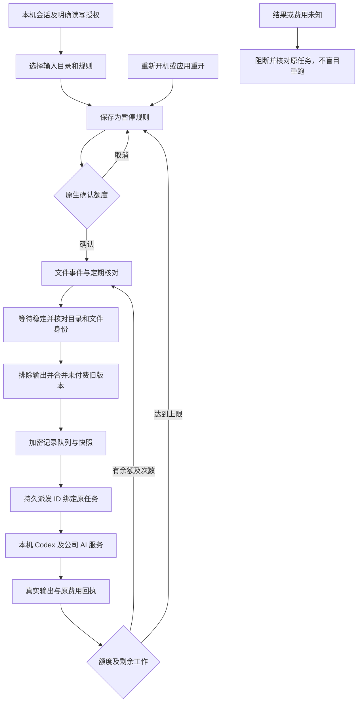

# 87：Desktop 本地目录工作 / Customer-local folder work

状态：当前增量已完成限定原生验证，整体产品验收仍开放。实际打包 Desktop 57 项、Desktop 单元 91 项、客户端单元 161 项通过，绑定 1,530 个当前源码文件，保留原 50 项实际检查及 69 个 Desktop 单元。来源见[精确检查点](../quality/folder-work-checkpoint.json)。原 26 个差异组、102 项需求/完整条件、至少十二个合格角色和 G01–G10 继续保留；REQ-040/042 只增加部分证据。

## 使用流程

客户登录 Desktop，选择企业、项目、专业角色和本机工作目录，主动设置「目录内读写」或「完整本机权限」。在会话内打开「目录工作」，填写每个文件的处理说明、文件扩展名、稳定等待时间、每档预算上限、总授权上限及最多次数，再经原生选择器选择工作目录内的输入目录。已有文件默认不纳入；勾选后才处理建立规则时已存在的匹配文件。

建立规则不启动 AI；规则先保持暂停。点击「确认并启用」另行打开默认取消的原生确认，展示输入目录、角色、完整说明和自动收费上限。客户确认后，本机文件事件及定期核对发现稳定的新文件或新内容，按规则逐个处理。同一规则中相同路径/内容已处理的任务不会自动重跑；未开始的旧版本被最新稳定版本取代。

每档有独立输入快照、输出目录、原任务编号与公司费用回执。结果位于会话工作目录的 `.copypaste-local-jobs/<rule>/<job>/output/`，可以从历史中打开。原始输入由调度器保持原样；任务提示要求专家仅把交付写入对应输出目录。此工作目录约束不缩减客户明确授予 Codex 的本机权限，不能宣传为完整权限下的额外 OS 沙箱。

暂停停止接收新的文件工作，已开始的一档可以完成。撤销规则停止该规则拥有的在途任务并取消未执行项；不删除已有交付或费用回执。会话停止、撤销本机权限、改变授权或退出登录均暂停相关自动规则。本机完整权限仍只能由本机客户授予；平台 Admin 和 Extension 不能代开。

目录工作需要客户回答时，目录页显示待答提醒及「回答问题」，切回原会话对话。选项默认不选，提交前需客户明确选择或填写；回答继续同一任务、线程及轮次，不重复建单或收费。紧凑窗口中的当前问题、回答和停止操作仍可到达。切回目录工作继续查看原项与输出。

应用关闭后不继续监控；重开后规则保持暂停，客户须再次确认。规则预算和次数不随暂停/重启重置。客户端离线或公司权限无法核实时阻断新派发；不会把离线标记为成功。此功能不是关闭客户端仍运行的云端计划。

## 执行、版本与费用

`src/local-schedule.ts` 管理身份/项目/会话归属、规则、候选文件、持久队列、原生 watcher、定期扫描和单任务派发。`src/local-schedule-files.ts` 管理目录身份、受限扫描、稳定句柄读取、快照和产品输出排除。`src/local-agent.ts` 在原生会话账本保存持久派发 ID、请求摘要和最终任务回执。`src/main.ts` 使用现有系统凭据保护的加密存储保存两个账本，通过受信任主页面 IPC 调用；渲染器不能提供通用绝对路径、进程命令、内部凭据或自行授予本机权限。

队列先落盘文件意图，再以相同派发 ID 进入本机 Agent 账本。创建、开始和结算均复用原幂等键。Agent 在同一持久状态中保存终态回执及清除原操作，队列再记录该回执。因此即使执行成功后队列回包/写入丢失，重新核对同一派发 ID 只取原回执，不另建任务。请求正文或预算改变但复用 ID 会被拒绝。

每次真正启动原生工作前重新核对源文件与快照的精确摘要、身份及当前权限。已完成/结算中的回执恢复不需要重新运行文件工具。普通对话「重试连接」不能绕过目录规则对尚未执行项的来源复核；客户须回到目录规则确认恢复。未知 native 操作保持未知及原费用保留，不自动重试。

后端继续使用既有 Desktop execution 和公司推理/媒体入口；本阶段不新增 HTTP 路由、迁移或外部 AI 直连。队列不自己修改钱包。已分配的预算是保守授权上限，实际收费依公司任务账本；原生创建/执行失败并不据此伪造收费。达到任一次数或预算上限后暂停，不能通过重启重新取得额度。

目录规则沿用本机会话已固定的角色、Skill 与项目配置。新会话于首次任务固定；后续文件任务承接原父任务/线程的固定版本，新发布不会静默升级。每次继续仍检查当前权限和来源状态。

## 路径、替换与资源边界

输入目录必须是原工作目录或其中真实子目录。拒绝越界、UNC/设备路径、路径遍历、特殊文件、symlink/junction 和产品输出目录。规范化后持续核对 root 的路径、inode 与可用设备身份。文件读取比较路径与打开句柄的 inode、大小、时间、最终路径及摘要；启动工作前再次核对。Windows 已实际观察到路径 `lstat.dev=0` 而 `fstat.dev` 返回真实卷号，仅在这一不可用值场景做平台归一化；两个句柄仍比较完整真实身份。

扫描排除 `.copypaste-local-jobs`、`.git` 与 `node_modules`，输出事件不成为新的输入。文件系统事件用于快速发现，定期扫描用于补偿遗漏。稳定等待时间下限 500ms，界面默认 1.5 秒。文件被替换、内容冲突、权限变更或结果未知均中断自动后续工作，保留原项供核对。已付费任务结束后仍核对源文件及快照，避免把发生输入冲突的作业标成无条件完成。

当前明确上限：20 个本机规则，每规则 1,000 项历史/200 项待处理、每会话 1,000 个持久派发；每规则一次扫描 2,000 个匹配文件、10,000 项目录条目、12 层深度；每档 20 MiB、单次新读取 64 MiB；每规则最多授权 100 次，本机调度器同时只运行一个目录工作。达到上限后阻断并说明处理方法，不静默截断。历史省略内部持久提示和凭据，分批展开以访问全部已存项目。

目录与句柄核对用于检测受支持的替换场景，不声称可防御拥有同一 OS 用户权限的恶意进程的一切竞争。客户授予完整本机权限后的通用终端/应用能力仍遵守原 Desktop 需求，不能把自然语言输出目录说明当作额外沙箱或通用原子写入保证。

## 验收与剩余范围

当前定向检查已覆盖原生文件事件、快速变化防抖、产品输出排除、未付费版本合并、串行队列、暂停/恢复、重开需确认、丢失原回执、未知结果阻断、目录替换、文件读取竞争、越界/junction、超大文件、授权/账号变化及存储失败。正式计数以本阶段完整客户端回执为准；早期 Windows 设备身份故障及其诊断保留原始结果，不冒充通过。

实际第 69 次打包流程 57 项、0 错误通过，其中目录工作 7 项覆盖独立默认取消确认、真实 watcher→本机 Codex→精确 CSV 摘要→公司账本、原轮次提问/客户回答、实际不同 PID 的应用重开、默认暂停、显式继续同线程、固定角色/项目版本、授权上限与撤销。两项原任务分别结算 90/60 港币微额，没有新增云端 Agent 任务。三种实际 OS 窗口为 1440×980、1280×800、800×600，保留中英和深浅主题、历史末项/输出可达。模型内容、客户事实及部分原生对话框决定为明确夹具。

第 65–68 次失败保持原结果：紧凑问题布局、窗口销毁观察器、Windows ASAR 分隔符及页面 Ctrl+Home 失败均可追溯。第 69 次保留原 50 项检查，并补查聚焦页面的 Home/End、Ctrl+Home/End 和文本框光标导航。窄侧栏摘要将图标/版本与名称分行，实际截图可读，不用「无滚动条」代替完整视觉验收。

全部 14 个运行素材/许可证逐项与源字节匹配。打包清单限定图标、浏览器壳、原生 host 和许可证，排除仓库截图/GIF/MP4；`app.asar` 从第 66 次的 837,577,925 降为 41,487,145 字节。这是 ASAR 大小，不是含 Electron/Codex 的整个应用大小。源码及失败/成功媒体仍保留，不靠删除历史缩小运行包。

六仓库类型/构建和客户端单元检查共 161 项通过，其中 Desktop 91 项；原 Desktop 69 个用例保留。阶段 86 的平台 1023、核心 25、兼容 36、实际 Web/Admin/侧栏 14 项保留历史范围；Backend/Web/Admin/Extension 的 1,085 个已选产品源仍精确一致，本阶段没有宣称重新执行这些完整套件。所有本次自建 Electron、Chrome、API、预览、夹具和原生数据库均关闭，没有使用 Docker/WSL/虚拟化。

待继续补齐完整 DESK-L01–L08、TC-040、所有批准程序/应用操作和角色资格；任意原生步骤的完整检查点、未知动作对账和长时间睡眠/离线矩阵仍按原条件保留。至少十二个正式合格角色、真实专业业务质量、签名安装/升级/卸载、负载/灾备与三类客户各十项任务并未因目录功能而自动验收。

## English

Folder work runs on the customer device with its selected local Codex session. A customer chooses a real input folder inside the workspace, extensions, instructions, a quiet period, per-file and total authorized budgets, and a maximum run count. Existing files are excluded unless explicitly included. Rules start paused. A separate native confirmation defaults to Cancel before automatic paid work becomes active.

Native events and bounded reconciliation scans discover stable input. Product outputs and dependencies are excluded. The queue processes one file at a time, preserves exact local snapshots, records independent original task and cost receipts, and retains the session's pinned role/skills/project versions. Pause finishes the current file; revoke stops the rule's owned work. App closure stops watching. Reopening preserves the encrypted journal and limits but requires fresh confirmation.

A durable dispatch id, exact request digest and terminal receipt live in the native Agent journal. Recovering a lost queue response reuses the original creation/start/finish keys and does not replay a paid native action. Source and snapshot identities are rechecked immediately before actual native startup. Unknown actions remain blocked for original-task review. The OS user's full permission is not replaced by an extra folder sandbox.

Current-source verification passes 57 actual packaged Desktop checks, 91 Desktop unit tests and 161 client unit tests, bound to 1530 source files. All previous 50 native checks and 69 Desktop unit cases remain. The actual journey includes an explicitly answered same-turn question, real file watch/snapshots/CSV output, an actual new-PID app restart, paused recovery, original-thread/version continuity, separate 90/60-micro-HKD settlements, budget caps and revocation, with no cloud replacement task. Provider content/customer facts and selected native-dialog decisions remain explicit fixtures. Failed attempts 65–68 retain their original results.

The narrow session summary and focused-page Home/End/Ctrl+Home/End defects are repaired; text fields retain caret behavior. Runtime packaging byte-matches all 14 assets/licenses while excluding repository media. ASAR size is 41,487,145 bytes versus 837,577,925 in attempt 66; this is not the entire Electron/Codex installation size. Historical stage-86 platform/focused/compatibility/cross-client scopes remain explicitly historical, backed by unchanged product sources. All owned runtime resources close. Original requirements, professional-role goals and release gates remain open until their complete conditions are met.

## 当前媒体与发布

实际截图、双语当前使用说明和目录监听/应用重启 GIF/MP4 见[主 README](../README.md)及 [Desktop README](https://github.com/copypasteltd/workmate/blob/desktop/README.md)。原始媒体完整解码核对见[媒体记录](../quality/folder-work-media-review-01.json)。

发布依次完成当前检查点、媒体/文档核对、七仓库暂存凭据/空白检查，提交六个组件，再在根目录运行 `python -X utf8 docs/tools/finalize_folder_work_manifest.py`，提交主文档，最后在 Delivery 运行 `node scripts/publish-workmate.mjs --push` 并核对八个远程分支。旧阶段工具保持原始回执范围，不能套用新的源码假设；常规同步沿用既有授权，不强推。
