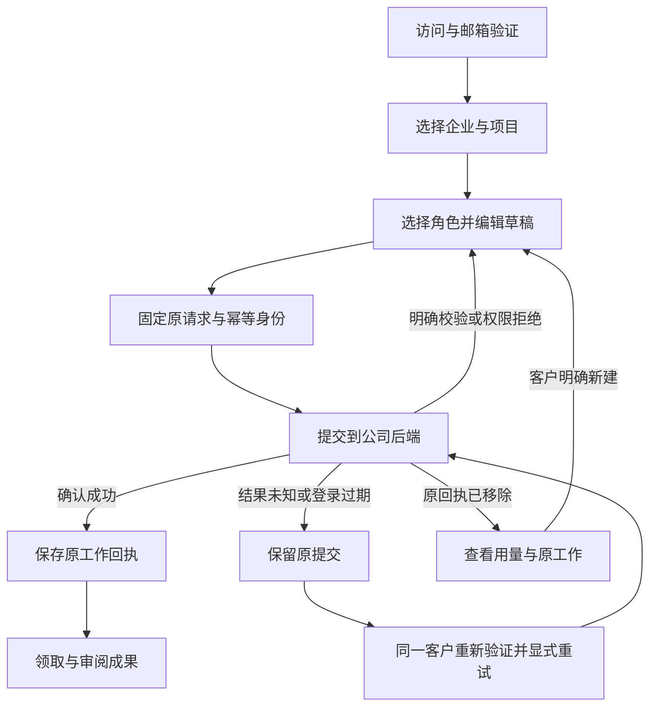

# 首项工作与提交恢复 / First work and submission recovery

本增量覆盖 Web 的首次建项目、角色快捷入口、工作草稿和创建请求恢复。Desktop 仍在客户本机运行 Codex，Extension 仍为独立云端原生右侧栏；本增量不改变这两项执行边界。全部原 102 项需求、26 组差异、至少十二个合格角色和 G01–G10 保持。

状态：14 项实际浏览器检查、195 项客户端单元通过，完整源码/媒体/资源关闭记录见[当前检查点](../quality/work-intake-checkpoint.json)。前阶段证据保留原源码和原测试范围，不能把历史全平台结果当作此次重跑。

## 使用流程

1. 使用工作邮箱验证登录；首次只填写企业和项目名称，品牌资料和广告连接按工作需要补齐。
2. 工作台的品牌视觉、广告分析、开发快捷入口分别选择设计师、营销数据分析师和全栈工程师。已有未提交需求保留；未知提交不会被新快捷入口覆盖。
3. 编辑角色、标题、目标、方式、预算、输入依赖和影片规格。草稿按权威登录用户、企业、项目隔离，在当前浏览器分頁保存；普通未提交正文保存一天，不上传为任务。
4. 初次提交前保存原请求及幂等身份。结果未知时锁定原内容，明确显示「重试原提交」与「查看最近工作」；不把网络错误当作未创建，也不自动重新派发。
5. 确认创建成功后，先保存只含原工作入口的回执，再导航到会话或任务。重新打开可查看原工作；「开始另一项工作」才表示新的创建意图。
6. 原回执已被服务端移除时不重放；明确告知费用仍需查看，并允许客户主动开始另一项工作。

## 身份、内容和费用边界

草稿只是输入恢复，不能提供身份、角色权限、企业成员资格、模型能力或费用准入。后端对每次请求重新检查项目权限并在事务内创建会话、任务及预算预留；幂等重放也先通过当前权限检查。

会话过期保留该用户的分頁草稿，重新验证同一账户后恢复。明确登出会清除草稿正文；登录其他账户时移除其他账户的正文。未确认提交的重试索引仅保留摘要和随机身份，不含邮件、目标、标题或文件正文，不会按时间自动变成新请求。明确完成后新建另一项工作才释放相应旧身份。

如果浏览器禁用会话存储，页面采用内存回退并明确提示重新整理可能失去恢复能力。关闭分頁或浏览器删除会话存储后的恢复、跨浏览器恢复，以及全部未知外部工具动作不在本增量的已证明范围；这些完整目标继续保留。

异步准备若发现草稿已被替换则停止。客户关闭表单、切换项目或更换登录身份后，旧响应不会打开新项目中的旧会话，也不会覆盖新草稿。服务端返回确定的校验或权限拒绝后可修改；网络失败、5xx、登录状态改变和结果不明不会生成新的创建身份。

## 界面和运行验证

沿用 CopyPaste 的蓝色、浅灰底、Manrope/Fraunces 字体及现有组件。新增草稿状态、原提交重试、成功回执和原记录移除状态；说明只包含客户需要做的决定。保留影片规格、输入等待、实际预算及成果入口。

本阶段实际浏览器资格检查覆盖邮箱登录和首个项目、无余额拒绝、真实 Admin MFA 赠额、三种角色快捷入口、完整字段恢复、项目隔离、离线、实际服务端会话过期、已提交后回包丢失、精确重试、真实文件下载、单次结算、旧响应隔离、服务端幂等墓碑，以及繁英和紧凑/手机尺寸。测试使用专属原生 PostgreSQL 和明确假客户数据。

成果内容由明确的受控运行夹具提供，实际 Worker、文件工具、私有文件字节和账本仍需核对。本 UI 夹具没有启动原生 Codex，不能用于证明真实模型质量或十二角色资格。既有原生 Desktop/Codex 证据分别保留。

## 仍需完成

首项入口只是 GAP-01 的一部分。所有邀请/SSO/安装包身份入口、全部客户端和权限异常、复杂资料自动发现、持续会话的完整恢复、专业角色资格、真实 marketing 质量、Admin 全覆盖和正式发布门槛继续按原要求验收。不能据此关闭完整需求或缩小交付目标。

## 本次发现与修复

实际失败记录保持原样：01 暴露过期重登后默认进入其他项目；02 暴露项目加载时点击新建丢失。现在仅从已验证账户恢复偏好，并与当前成员/项目权限取交集；项目尚未加载时禁用新建，事件监听在控件可交互前安装。03/04 分别暴露测试没有结束先前活动任务、取消夹具发出空 JSON 正文；修正夹具后重新检查，未放宽真实方案限制。后续失败记录如有，仍以原回执为准。
