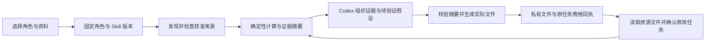

# 营销分析与信息图交付 / Marketing analysis and infographic delivery

本增量让营销分析师和信息图设计师通过 Codex 调用真实的确定性计算与交付工具。它处理获准的数据集或当前私有会话的 CSV/XLSX，生成可以下载、核对和修改的文件。开发继续使用用户已授权的假数据；模拟网关的内容质量不能作为真实模型专业能力验收。

## 用户使用

在专业角色目录选择「营销分析师」或「信息图设计师」，检查可用性并建立专员。提供分析日期、时区、币种、账号、转化和归因定义，以及已导入的数据或当前会话附件。不要把连接账号 ID 当成已经同步的数据集 ID；连接器提供已捕获快照，尚未同步的数据需要客户另行授权并同步。

Codex 读取固定版本资料并调用计算工具。结果按账号、币种、归因、转化定义和实体层级分组，先汇总分子分母再计算比率。未知转化、零分母及无记录日期保留对应缺失原因。图表不会把未知值画成零，不合并不同币种，也不声称跨平台去重、因果关系或统计显著性。

交付包含可编辑 SVG、实际渲染 PNG、自包含交互 HTML、精确指标 CSV、标准化源事实 CSV、创意测试简报 Markdown、可修改的源 JSON、文件清单 JSON，以及包含这些文件的 ZIP。图表最多选择八个口径和四项指标；指标 CSV 保留全部已计算的组。移动宽度使用可读指标卡，桌面保留分组图表；均可按口径筛选证据。页面遵循现有产品的蓝色、浅灰白底和字体层次。

要求修改时，先读取原始源 JSON 的固定版本，再重新计算修改后的日期或口径，用新计算摘要及原版本摘要交付新文件。旧文件保持原样；修改属于客户确认的新任务及其独立费用预留。一个任务内相同绘图输入即使换了调用 ID，也复用原文件；不因重试重复生成或额外调用模型。

## 实现与约束

角色 `marketing-analyst`、`information-design` 使用新版本 `1.1.0`。三个新增 Skill 包为 `dataviz`、`deterministic-metrics`、`ads-analysis` 的 `1.1.0`。[本增量角色目录快照](../contracts/role-preset-catalog-analysis-1.1.0.json)对应当前代码；旧名称 `role-preset-catalog-current.json` 保留为已发布的历史契约。原角色及 Skill 的旧版本定义和全部已发布字节保留。已有专员和任务继续使用固定版本，不因目录升级获得新权限。其他角色仍须完成各自工具与专业交付，至少十二个合格专业角色的总要求不变。

工具为 `analysis_sources`、`analysis_file_inspect`、`connector_read`、`sheet_calculate`、`analysis_source_read`、`chart_render`，按角色已授予的工具 ID 和固定角色版本装配。Ask/Plan 模式不装配写入工具。相同工具描述适用于公司云端和客户本机 Codex 接入；Desktop 的 Agent 继续在本机运行，Extension 的 Agent 继续在云端运行。

CSV/XLSX 直接从固定资产版本检查真实字节和摘要。私有附件不会为了计算而转成项目共享数据集；发现与打开均限定原会话、所有者、租户和项目。XLSX 使用实际工作表及表头，沿用已有解析器的公式、日期、重复列、隐藏行及文件大小限制。来源读取加入任务内容谱系，后续工具调用、重放、下载与交付继续检查来源是否有效。

`sheet_calculate` 返回确定性计算 SHA-256、口径 ID 和分页证据。图表工具重新计算同一规范并核对摘要，拒绝替换来源、伪造数字、越界口径、重复指标和陈旧计算。观察和假设中的数值必须引用实际证据占位符；最终文件代入计算结果。HTML 转义不可信标签，采用自包含脚本摘要 CSP；CSV 防止公式注入。PNG 和 ZIP 来自实际文件字节，清单记录各文件摘要。

SQL104 为 `chart_render` 增加工具回执登记，不改写 SQL001–103。九个输出与回执在一个事务中发布；写入失败不会出现半份可见交付。外部存储的孤立对象沿用既有回收机制。冻结/删除来源会阻断后续使用并隐藏失效衍生文件；历史费用凭据保留。OAuth 断开只停止继续取数，不抹除仍获准保留的历史快照。

## 开发与核查

后端按原生 Windows PostgreSQL 路径应用 SQL104，执行 `npm run db:migrate`。禁止 Docker、WSL 或虚拟机。`node scripts/run-analysis-role-checks.mjs <两位编号> full` 在 Delivery 仓库启动独占原生测试数据库，核对源文件前后摘要并保留原始失败记录，结束后关闭自建服务。浏览器核查另行记录真实页面、下载文件、GIF/MP4、原生 Codex 调用和清理回执。

测试通过只证明相应程序、权限、文件和假数据流程。真实媒体生成质量、客户广告账号覆盖、其他角色专业交付、真实部署和原始完整验收仍按各自证据判定。本增量不改写原 102 项需求及历史失败记录。
