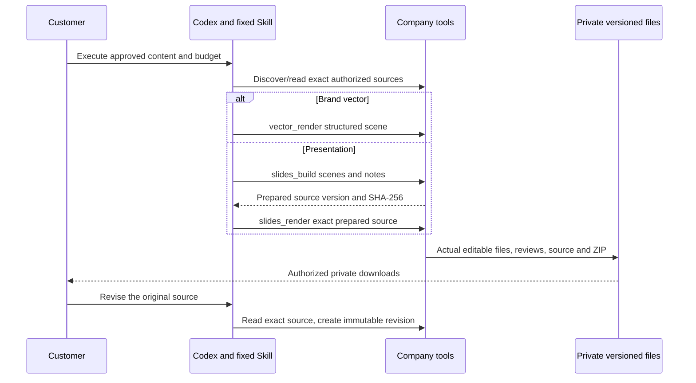

# 可编辑品牌稿与演示文稿 / Editable brand and presentation delivery

品牌视觉设计师新增真实 `vector.render`，演示文稿设计师新增真实 `slides.build`、`slides.render`。两类角色及各自的制作 Skill 使用固定版本 `1.1.0`；既有专员保留旧版本，不能通过更新目录静默改变权限、方法或既有交付。模型仍按已授权方案使用明确假数据，内核为实际 Codex。

## 用户使用 / Customer journey

1. 从角色目录检查并建立品牌视觉或演示文稿专业助手。明确受众、目标、语言、用途、原始内容及品牌约束。需要素材时，在当前私有会话上传或选择已有获准素材。
2. 明确选择 Execute 和任务预算。Ask/Plan 可以读取当前源稿与资料目录，不能生成新文件。Codex 按固定 Skill 调用公司工具，全部模型请求沿用公司内部 OpenAI 兼容网关。
3. 品牌设计交付可编辑 SVG、文字转曲 SVG、PNG、源稿、PDF/HTML 核对稿、清单及 ZIP。演示文稿先保存不可变源稿，再按返回的实际版本和 SHA-256 渲染 PPTX、每页 SVG/PNG、PDF/HTML 核对稿、证据 CSV、源稿、清单及 ZIP。
4. 在 Assets & deliverables 下载实际文件。HTML 可离线逐页查看，支持上一页、下一页及方向键；375/800 像素界面也要检查操作和图稿的实际边界。
5. 修改时读取原源稿，提供原版本与散列，创建新源稿及交付。保留原有字节和任务账本；相同工具输入重试返回原回执，不重复生成文件或调用模型。

Select a fixed role, confirm the content and budget, and explicitly execute. Brand work produces editable and outlined SVG. Presentations require both a prepared immutable source and an actual render. Download real files, review every page, then request a precise source-bound revision. Original versions and financial receipts remain intact.

## 文件实现 / File implementation

- 输入是严格结构化的画布与图层，不接收任意 SVG、脚本、HTML、外部图片 URL 或本地路径。支持原生文字、矩形、椭圆、规范化 M/L/Q/C/Z 路径、固定 PNG 和有来源的图表。
- 每个画布 256–1920 像素，每页最多 80 层，演示文稿最多 20 页且画布一致。图层及描边必须完整位于画布内；固定字体按实际字形测量，溢出拒绝，不裁掉正文或自动缩到不可读大小。
- `@napi-rs/canvas` 使用固定 Noto Sans TC 来源派生的 CopyPaste Sans TC 常规/粗体静态字形测量及转曲，`resvg` 产生 PNG，`pdf-lib` 产生逐页核对 PDF，固定 `pptxgenjs@4.0.1` 生成 Open XML PPTX。实际解析 ZIP/XML 检查页数、结构、外部关系和合法 XML。
- PPTX 的文字、形状、自定义路径及图表条形/标签是原生可编辑对象；图片保留真实 PNG 字节。图表源值保存在精确 CSV 和固定分析源中，当前不生成内嵌 Excel 图表。PPTX 附讲者备注。
- ZIP 包含实际源稿、所有交付、清单，以及固定 Noto Sans TC 原字节、CopyPaste Sans TC 常规/粗体静态字形和 OFL 许可证；清单记录文件散列、字节数、页数、来源、数据模式及限制。

PPTX text, primitive shapes, paths and evidence bars are native editable objects. Raster inputs remain raster. PDF, PNG and HTML reviews are generated from the same fixed source; **they are not renders of the PPTX by Microsoft PowerPoint**. Install the supplied CopyPaste Sans TC Regular/Bold faces derived from the fixed Noto Sans TC source under OFL and inspect the file in the target editor before final publication. Fonts are supplied in ZIP, not embedded in PPTX. This distinction remains visible in the actual review and delivery notes.

## 证据与品牌 / Evidence and brand

演示文稿角色可使用既有数据工具：发现及检查真实 CSV/XLSX 或已捕获数据，`sheet_calculate` 计算，再由 `chart_render` 保存确定性分析源。`design_chart_read` 分页读取真实证据 UUID；图表输入只选择实际证据，不能传入自造数值数组。未知值保持 N/A，不能变成零。币种、账户、指标、单位、归因、转化定义及日期范围不兼容时拒绝同图。跨页同名图层按完整图表定义区分，避免后一页覆盖前一页数据。

有品牌绑定时，服务端要求输入与角色固定的品牌 ID、版本完全一致；不能通过遗漏品牌字段或更换版本绕过。演示文稿最终渲染也再次核对源稿绑定。继续验证真实品牌版本、渠道、语言、字体权利和字形覆盖；无权渠道不会保存半成品。源稿语言 zh-HK 对应品牌库的 zh-Hant-HK 繁中绑定，品牌许可仍按原始 zh-Hant-HK 检查。撤回品牌后阻断衍生下载。当前可编辑导出器支持品牌默认 Noto Sans TC；其他有授权自定义字体继续使用既有品牌排版渲染器，不能静默替换字体。没有品牌绑定的提案不能声称已获品牌或商标批准。

A brand-bound specialist must supply its exact frozen brand ID and version. Both preparation and final presentation rendering enforce the binding, channel, language and declared font rights on the server. Omitting or replacing the binding is rejected before saving files; withdrawing the brand blocks derived downloads.

## 授权、重试与计费 / Authority, retries and billing

所有源文件读取按真实租户、项目、用户和私有会话重新授权；检查保留期、隔离状态、衍生来源及原始字节散列。PNG 检查签名、尺寸、完整分块、CRC、实际解码，并拒绝动画和附加尾部内容。另一用户即使是同项目编辑者，也不能发现或下载私有交付；同一用户的另一会话不能通过 Agent 绕过会话范围读取私有源。

通用 `project_assets`、`asset_text_read` 和 `image2_edit` 使用同样的私有范围校验，不能绕过设计工具的限制。目录及文本读取重新核查当前权限；文本及图片编辑源校验实际字节数与 SHA-256。未获准图片在调用内部图片能力之前即拒绝，因此不产生图片请求或对应费用。已有项目共享文件与同一本机会话的获准文件保持可用，来源撤回、历史续接及明确发布的既有用例纳入回归。

设计工具沿用任务锁、幂等请求与数据库回执。保存源稿表示 prepared，只有实际文件生成及事务保存成功才返回 delivered。渲染不新增模型调用或 AI 费用；Codex 推理按原任务实际用量结算，一项任务一份预留。修改任务具有自己的真实预留。撤回源稿或分析数据会阻断其衍生下载，不删除既有财务事实。

每份实际交付及预备源稿均保存独立的固定来源版本集合，涵盖实际图片、分析源、原修改稿和预备源稿；同一任务内刚生成的素材也纳入。临时选用的品牌以精确 brand_reference 保存，不能只依赖角色本身的品牌配置。来源或品牌隔离后，SVG、PPTX、清单、审阅稿和 ZIP 全部受现有数据库来源遍历约束；已知文件元数据与财务事实不被清空。

Web/Extension 仍由云端 Codex 使用公司工具；Desktop 核心仍在客户本机，调用同一公司文件工具不改变本机执行位置或本机权限控制。云端流程允许这两个已接通工具的子角色，仍受固定版本、实际可用性、客户确认及预算约束。

Desktop 额外使用固定版本的工具白名单：只对 brand-visual/presentation 1.1.0 开启新设计工具，对 marketing-analyst/information-design/presentation 1.1.0 开启确定性分析工具；旧任务固定的版本与描述符保留。公司工具服务在当前原生授权、执行租约与预算下运行，不将 Agent 移到云端。旧私有源稿读取必须满足相同租户、项目、拥有者、设备、原生登录授权、local_session_id、workspace_hash 和内核字节绑定；另一会话或 Web 调用不能借助文件 ID 获得该范围。Web 的会话隔离保持原规则。

Desktop source revisions require the same real device, authenticated native family, local session, workspace and pinned runtime binding, in addition to current tenant/project/owner authorization and source availability. Versioned company-tool descriptors do not silently upgrade existing 1.0 tasks. The backend checks exercise actual native authorization and tool dispatch; the current added recordings exercise Web and downloaded fixed-source reviews. They do not establish new Desktop UI or professional role qualification.

## 部署与验证 / Deployment and verification

依次应用 SQL001–105 后新增 **SQL106**，扩充已有工具回执的限定名称；再应用 **SQL107**，为私有设计稿建立不可变的精确来源版本集合，在现有来源遍历与明确发布快照中保留关联，数据库同时检查租户、项目、拥有者及会话范围。私有交付不使用明确发布操作的专用字段或改变该操作的权限。旧迁移、历史 HTTP 契约和已安装 Skill 字节保留；本增量不增加公网接口。执行 `npm ci`、`npm run skills:build` 和原生数据库迁移后启动后端。新角色安装版本由 `scripts/upgrade-editable-design-roles.ts` 幂等追加。

实际核查及媒体记录见 [源码绑定证据](../quality/editable-design-checkpoint.json)。检查范围包含实际文件、原生 Codex、私有下载、修改版本、来源隔离、Ask/Plan、重复调用和账本。原有 102 项验收记录不因该增量改成完成，至少十二个角色的专业质量与真实客户验收仍需逐一落实。

PptxGenJS primary references: [saving](https://gitbrent.github.io/PptxGenJS/docs/usage-saving/), [text](https://gitbrent.github.io/PptxGenJS/docs/api-text/), [shapes](https://gitbrent.github.io/PptxGenJS/docs/api-shapes/), [images](https://gitbrent.github.io/PptxGenJS/docs/api-images/), [release source](https://github.com/gitbrent/PptxGenJS/releases).

实际截图发现原转曲器忽略可变字重，将 400/700 均渲染为默认 Thin。新增构建时脚本使用固定 FontTools 4.62.1 派生并重命名常规、粗体静态字形；运行时不依赖 Python，校验内置字节并按字重使用独立注册名称。像素测试要求同一文字的 700 字重实际墨量高于 400，防止源稿声明与预览失配。先前记录保持原始字节及历史范围。

浏览器第 03–05 次的八项业务流程通过，但录制各出现一次采集错误，因此整体记录不作为最终通过证据。录屏采集改用独立 Chrome DevTools 会话直接获取实际合成画面，并将录屏画面、验收截图和整页导航串行协调，避免截图临时调整视口或字体等待时同时采集；仍要求零采集错误并核查真实时序和全文件解码。产品源代码不变，浏览器核查脚本按其新字节单独执行。原始失败回执及媒体保留，最终选用的零采集错误录制由上述源码绑定检查明确指定。
