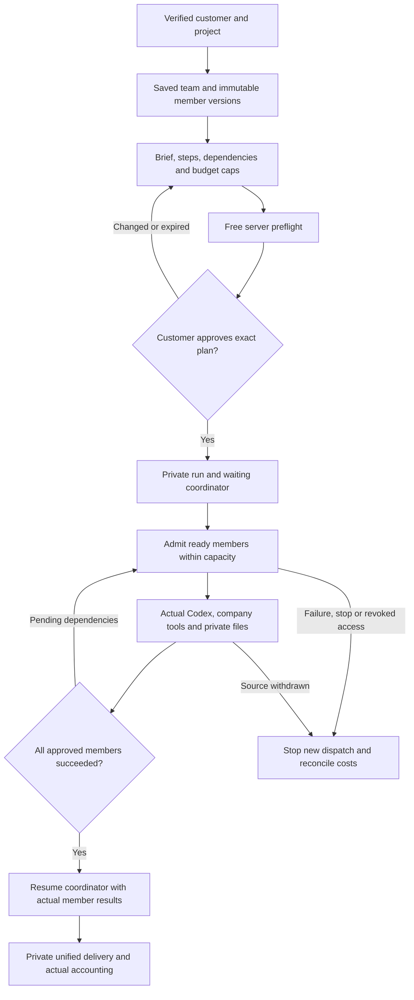

# 持久专业团队与受控执行 / Persistent professional teams

本次实现对应 REQ-066：把已经安装的专业 Agent 组成可复用、有版本的团队，由客户确认分工、依赖与最高预算后执行。团队设置在项目内共享，运行、对话及交付文件对发起客户私有。团队成员使用 Codex 和各自已获准的 Skill、工具；模型没有创建成员、批准费用或递归派单的工具。

This implementation addresses REQ-066 with persistent, versioned teams of installed specialists. A customer reviews responsibilities, dependencies and the maximum budget before execution. Project members share team settings; each customer's runs, conversations and deliverables remain private. Codex uses each specialist's admitted Skills and tools. Models cannot expand the team, approve charges or recursively delegate work.

本阶段的云端团队入口位于 Web 的 **Your teams / 我的团队**。Desktop 继续在客户本机执行 Codex；该入口在原生 Desktop 内隐藏，直接访问也解释云端与本机执行的边界。Extension 保持原生右侧栏、获准文件上传及云端对话。本阶段不声称已交付 Desktop 本机团队界面或 Extension 团队编辑器。

The new cloud-team entry is Web **Your teams**. Desktop continues to run Codex on the customer's computer; this cloud-team entry is hidden inside the native client, and a direct route explains the execution boundary. Extension retains its native right Side Panel, authorized uploads and cloud conversation. This stage does not qualify a native Desktop team interface or an Extension team editor.

## 客户流程 / Customer workflow

1. 完成邮箱验证并进入公司工作区与项目，在 **Your specialists** 建立实际专业助手。团队协调员选择通用助手，成员选择已经具备云端工具的专业助手，填写分工并保存。
2. 保存建立新的不可变团队版本，固定 Agent 版本、角色、Skill、工作空间及分工。修改设置不替换已有运行的版本。仅改名或封存不会偷偷升级成员版本；主动重新选择成员才采用其当前版本。
3. 填写总体 Brief，添加步骤、交付要求、前置依赖、各步预算、协调员预算及并行上限。先后关系显示为真实步骤，不能给协调员提前分配执行权。
4. 点击 **Review team & budget**。服务端先检查完整依赖图、权限、角色、安装能力、上下文及套餐容量，生成 15 分钟有效的固定计划。此时不创建任务、不预留费用。
5. 在确认窗口核对原始 Brief、每步要求、依赖、固定成员版本及预算总额，再由当前客户点击 **Approve & start**。输入或团队版本发生变化必须重新审阅；模型和管理员不能替客户点击批准。
6. 运行面板显示实际成员任务、依赖、状态、批准上限、当前预留及实际消耗。点击 **View task** 查看原任务及文件。协调员只在所有成员实际成功后开始读取成果并统一交付。
7. 停止运行会阻止新增派发，取消已建立的任务，并释放已经确定未消耗的预留。未知外部费用继续对账；停止、恢复内容或网络重试不能凭空抹除费用或重新执行收费步骤。

Sign in, select a project, create actual specialists, then save a coordinator and distinct members. Build a brief and dependency graph with per-step caps. Review the exact fixed plan without charges, explicitly approve it, and follow actual task states and private deliverables. The coordinator starts only after all actual member tasks succeed. Stopping prevents further dispatch, cancels admitted work, releases known unused holds and preserves unknown-cost reconciliation.

## 规模、版本和费用 / Bounds, versions and accounting

| 控制项 / Control | 实现 / Implementation |
| --- | --- |
| 持久成员 / Persistent membership | 一个协调员，加最多七个不同成员；同一 Agent 不重复占位。One coordinator and up to seven distinct members. |
| 执行步骤 / Run graph | 每次 1–16 步，不允许重复键、缺失/自身依赖、重复依赖或环路；协调员为保留键。One to sixteen acyclic steps with validated references. |
| 并行 / Parallelism | 1–3 个成员步骤，同时受当前套餐和其他任务的实际占用限制；不是申请无限并发。One to three members, further limited by actual plan capacity. |
| 最小容量 / Admission capacity | 至少两个活跃任务槽：等待中的协调员及一个工作成员。Two slots minimum: the waiting coordinator and a working member. |
| 固定上下文 / Frozen context | 保存准确 Agent/角色版本、角色摘要、批准的输入、项目方法和记忆引用；重新派发不自动采用新配置。Exact approved bindings and source references. |
| 预算 / Budget | 使用整数微单位；每步及总额校验，上限为 `1,000,000,000,000` 微单位。No floating-point accumulation or per-member reuse of the whole team cap. |
| 费用预留 / Reservation | 批准时只预留协调员自己的额度；成员实际准入时分别预留自己的额度。The displayed aggregate cap is not an additional charge or a repeated full-cap hold. |
| 回执 / Receipts | 同一审阅只使用一次；相同幂等键重放原结果，不建立第二个任务或预留。One consumed review and one original reservation per actual task. |
| 时间 / Time | 审阅 15 分钟有效；每次运行最多两小时。15-minute review expiry and two-hour run deadline. |
| 保留 / Retention | 未使用且到期超过 24 小时的审阅清除正文；终态运行内容默认保留 90 天，财务事实独立保留。Unused expired review bodies and terminal run content follow separate retention. |

并行调度先锁定当前运行，再检查依赖成功、权限、容量和资金。独立调度器竞争同一运行使用跳过已锁定行；真实任务绑定有数据库唯一性约束。临时容量不足等待下一次调度，权限撤销、固定来源不可用或资金不足则停止进一步派发。成员失败不会自动扩组、自动加预算或重复请求结果未知的外部操作。

Dispatch locks the actual run and admits only dependency-ready steps within present permissions, capacity and available funds. Competing schedulers skip locked runs; unique database task bindings prevent duplicate admission. Temporary capacity pressure waits for a later tick. Revoked permission, unavailable frozen sources or insufficient funds stop further admission. Failed members cannot expand the team, raise budgets or replay uncertain external effects.

普通对话的单一活跃任务约束继续生效。团队使用专门绑定的私有对话，只有属于该运行的实际成员任务能并行进入；普通消息不能向团队对话插入另一条不受计划约束的任务。提前恢复协调员、单独重试团队任务，以及在绑定任务尚未成功时伪造节点完成都会被拒绝；重新执行需要新的客户审阅。

Ordinary conversations retain single-active-task admission. A team uses its own private conversation with exact run/node bindings. Ordinary message execution cannot bypass the plan inside that conversation. Early coordinator resume, independent team-task retry and node completion without its actual completed task are rejected; a new execution requires a new review.

## 权限与来源 / Authorization and provenance

- 团队设置按项目权限共享。创建和修改要求公司 owner/admin 或拥有项目编辑权的成员；读取仍须具有当前有效的公司和项目关系。
- 审阅、运行及节点由当前发起客户私有，API 与强制 RLS 同时限制。另一个项目 editor 可以看到团队设置，但不能读取客户运行、对话或文件。
- `group_results` 是只读公司工具，只返回已批准且实际成功的前置步骤结果、有限正文及真实文件版本、大小和 SHA-256。成员不能读取无依赖的兄弟任务；协调员只有在全部成员成功后才读取全部成果。
- 来源清单连接团队、运行及实际依赖任务。每次使用和下载重新检查授权与来源；隔离或删除前置任务会立即阻断其私有衍生成果，保留历史收费事实。
- 云端成员角色只开放实际已具备工具的能力：通用助手、设计师、广告创意、电商、社交内容、插画/IP、字体排版、信息设计、营销分析、品牌视觉及演示文稿。不能借团队成员身份启用尚未支持的云端工程工具或递归流程工具。
- 所有 AI 调用继续走公司内部 OpenAI-compatible 服务。UI 验收使用获准的模拟模型与账户容量，实际 Codex 进程、登录、工具、文件和账本按真实代码运行。

Project permission controls shared settings; private ownership and forced RLS control review/run/node data. The read-only `group_results` tool exposes only approved, successful predecessors and actual file versions. Source manifests bind private derivatives to the group, run and actual dependencies. Authorization and source state are checked again at use/download time. Membership does not grant new cloud tools, filesystem authority, recursive workflows or model spending approval. All AI requests still use the company gateway.

## Admin 与删除 / Administration and erasure

团队及团队运行纳入已有 **Content** 管理面板，作为 `agent_groups`、`agent_group_runs` 两种资源；不是另一个可以绕过既有范围的管理入口。列表需要 `admin.content.read`，读取正文另需 `admin.content.body.read`，隔离、恢复和删除分别需要相应权限及匹配的公司/项目范围。实际读取正文和敏感操作记入审计日志。

The existing Admin **Content** dashboard includes `agent_groups` and `agent_group_runs`. Metadata listing, body reading, quarantine, restore and delete retain their separate permissions and tenant/project scope. Sensitive actions and actual body reads are audited.

隔离团队会隔离其运行并停止尚在运行的任务，释放确定可释放的预留。恢复团队设置不会自动恢复已隔离运行，也不会重新启动已经取消的任务；恢复历史运行正文仍需单独获授权的恢复操作。直接更改名称或指令的 metadata 操作被拒绝，必须通过建立新团队版本更新。永久删除进入现有删除作业，清除团队历史正文、分工、审阅、运行定义、私有对话和任务在线内容，保留财务与审计事实；已删除内容不可恢复。

Quarantine propagates to runs and cancels admitted work. Restoring settings neither restores quarantined run bodies nor restarts cancelled tasks. Restoring historical run access is a separate authorized action. Unversioned metadata rename/instruction changes are rejected. Permanent deletion journals existing erasure jobs and removes online team, review, run, conversation and task content while retaining financial/audit facts. Deleted content cannot be restored.

## 数据、API 与部署 / Data, API and deployment

新增 **SQL108 `108-persistent-agent-groups.sql`**，在 SQL001–107 后应用。已发布迁移、原有契约和 Skill 包保持原字节。迁移包含六张表、不可变历史、防伪造绑定、强制 RLS、来源追溯、删除日志及普通对话/团队执行的独立准入约束。该部署使用原生 PostgreSQL，不依赖本地 Docker、WSL 或其他虚拟化环境。

Apply additive **SQL108** after SQL001–107. Published migration, contract and Skill bytes remain unchanged. Six new tables hold settings, immutable versions/members, reviews, private runs and nodes. Database guards enforce actual task binding and completion, immutable approvals, source relationships and RLS. Development and verification use native PostgreSQL without local virtualization.

| 方法与路径 / Method and path | 用途 / Purpose |
| --- | --- |
| `GET /v1/agent-groups` | 项目范围列表，`project_id`、`cursor`、`limit`。Scoped list with cursor pagination. |
| `POST /v1/agent-groups` | 保存真实协调员、成员及分工，返回既有标准 AgentGroup 结构。Create a versioned team. |
| `GET /v1/agent-groups/:group` | 当前版本及成员。Current team. |
| `PATCH /v1/agent-groups/:group` | 使用 `expected_version` 更新或封存，建立新版本。Version-checked edit/archive. |
| `GET /v1/agent-groups/:group/versions` | 不可变版本历史，`before`、`limit`。Immutable version history. |
| `POST /v1/agent-groups/:group/preflight` | 检查 DAG、权限及预算，返回固定计划、摘要与有效期，不收费。Free exact-plan review. |
| `GET /v1/agent-groups/:group/runs` | 仅本人运行，`before`、`limit`。Private run history. |
| `POST /v1/agent-groups/:group/runs` | 当前客户确认 `preflight_id`、`expected_version`、`definition_hash`、`approved_budget_micros` 与 `confirm: true`。Explicit approval. |
| `GET /v1/agent-groups/:group/runs/:run` | 私有状态、成员任务、费用与固定定义。Actual private run details. |
| `POST /v1/agent-groups/:group/runs/:run/cancel` | `expected_revision` 控制停止，保留实际费用回执。Revision-checked cancellation. |

上述接口要求实际用户登录及 `X-Tenant-ID`；写入要求原有 CSRF/Origin 检查和 `Idempotency-Key`。新增契约位于 backend 分支 `contracts/agent-groups-openapi.json`。用户确认结果的标准输出保留原有 AgentGroup 形状，扩展接口与严格输入单独发布，未修改既有契约。

Requests require an actual user session and `X-Tenant-ID`; mutations retain CSRF/Origin checks and `Idempotency-Key`. The additive backend contract is `contracts/agent-groups-openapi.json`. Canonical AgentGroup responses retain their original shape; extension inputs are strict and versioned separately.

Web 当前面板显示每项目首批 100 个团队、选中团队最近 8 次运行及最近 20 个版本；服务端为完整历史提供游标接口。当前 UI 对旧历史的连续翻页尚未包含在本阶段交付中。生产调度要求启用原有工作队列和业务轮询；测试脚本的手动推进用于确定性验收，不是生产运行方式。

The current Web panel shows the first 100 project teams, eight selected-team runs and twenty versions. Server cursor APIs expose further history; continuous history paging in this UI is outside this stage. Production execution uses the existing enabled queue/business dispatcher. Manual advancement in qualification is a deterministic test mechanism, not a production operating procedure.

## 证据与验收边界 / Evidence and acceptance boundary

实际源码绑定检查、失败尝试、原始日志及清理结果统一记录于 [团队协作检查点](../quality/agent-groups-checkpoint.json)。中英双语 README 随当前组件提交同步，引用实际页面截图与交互 GIF/MP4。原始失败尝试保留，不用成功回执覆盖。

The [team checkpoint](../quality/agent-groups-checkpoint.json) binds exact sources, actual checks, unsuccessful attempts and cleanup receipts. Component READMEs provide Chinese/English usage and actual screenshots/interaction media. Earlier failed attempts remain intact.

本阶段证明限定范围的代码行为，不把模拟营销文案当成专业质量，也不把 Web 团队认作 Desktop 本机团队或完整产品验收。原始 102 项 REQ/TC、原有判定和 G01–G10 门槛保持原记录，新增证据作为增量附加；真实模型业务质量、真实外部平台账户及生产运维负载未由本阶段模拟样例证明。

Scoped technical evidence does not establish professional copy quality, native Desktop teams, live provider integration or full product acceptance. Original 102 REQ/TC records, assessments and G01–G10 gates remain unchanged; this is additional implementation evidence. Synthetic examples do not establish production load or live customer quality.
