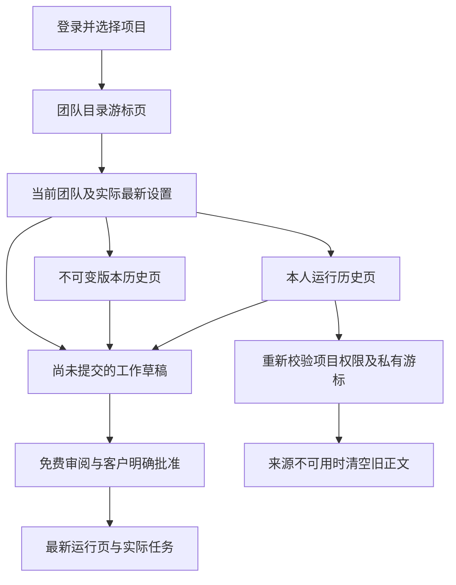

# 团队历史记录与完整翻页 / Team history and pagination

团队运行现在按实际创建时间从新到旧显示。随机 UUID 不再用于决定哪次运行是“最近运行”。用户可以分别浏览团队目录、不可变版本和本人运行记录，浏览历史时保留尚未提交的工作目标与步骤。

## 使用方式

1. 在 Web 的「我的团队」选择项目团队。目录每页 100 个团队，通过前后翻页访问其余团队。刷新会重新校验所选团队；刚保存的团队即使落在当前目录页之外，也保留一个实际重新获取的选项。
2. 展开「固定成员版本与历史」。版本每页 20 条，旧版本页不改变当前团队或当前固定成员名称。
3. 「我的团队执行」每页 8 条，按创建时间倒序，显示实际创建日期。运行历史和版本历史可以独立翻页，浏览历史不清空 Brief、步骤内容或预算。
4. 从旧运行页批准一个新计划后，页面回到最新运行。仍需由当前客户审阅完整计划并明确批准，翻页不会启动、重试或自动续费。
5. 旧页会定期重新请求当前权限下的数据。游标记录被隔离、删除、过期或不可访问时，请求返回 404，页面清空旧运行正文。使用「较新执行」返回可用页面，不回放缓存正文。
6. 切换账号、企业或项目会重新建立页面状态，旧页面的迟到响应不能写回新上下文。

## 后端约束

`GET /v1/agent-groups/:group/runs` 保持原有 UUID `before` 和 `next_before` 形状。排序使用 `(created_at DESC, id DESC)`。游标先在当前团队、本人、有效内容和未过期范围内核验，并在事务中持有共享行锁；实际边界比较留在 PostgreSQL 内完成，不把时间戳转换成 JavaScript Date 后再传回。

这保留了数据库微秒精度，并使相同创建时间的记录使用 ID 稳定排序。新增 SQL109 只添加匹配私有团队历史查询的索引，不修改已发布的 SQL001–108、契约、角色目录或 Skill。团队目录继续使用原来的 UUID 升序游标；版本继续使用版本号倒序游标，二者不声称按团队最近编辑时间排序。

每一页的运行、步骤和费用继续在本人权限下获取。其他项目、其他发起人、已撤回或已过期运行均不能用作游标锚点。新插入的运行不会混入已经开始向前浏览的旧页。列表中的预留和消耗来自原任务及原费用预留，翻页不创建任务或账目。

## 客户端实现

页面将目录选择和三个游标栈分开管理。草稿只在切换团队时重置；运行、版本翻页与后台轮询不再触发草稿重置。当前成员名来自当前团队版本的固定绑定，不从用户正在查看的旧版本推断。

保存后重新获取当前目录和所选团队，兼容新团队落在当前页之外的情况。所有历史页均替换为最新获准响应，保留的游标只包含定位信息。请求序列和组件存活检查丢弃迟到响应；组件按用户、企业及项目建立独立状态。页码及前后按钮有独立可访问名称，支持键盘、浅色/深色样式和窄屏换行。

Desktop 继续在客户本机运行 Codex，云端团队入口保持隔离。Extension 仍通过原生右侧栏读取获准文件并使用云端 Agent。本次没有新增原生团队执行方式。

## 验证与交付

相关团队回归保留原有 15 项案例，新增实际创建时间、数据库微秒与相同时间、连续游标、插入新记录、私有游标边界，以及超过 100 个团队和 20 个版本的案例。隔离测试使用实际原生 PostgreSQL；精确时间相同的样本是明确的控制侧测试夹具，不改变产品中的不可变创建时间约束。

浏览器检查继续运行真实邮件登录、三次原生 Codex、公司工具、三个私有文件下载和原费用结算，并实际操作超过一页的团队、版本与运行。另检查历史页轮询、草稿保留、从旧页批准新运行、取消释放费用、保存页外团队、来源撤回、迟到响应及 375/800px 控件。截图、GIF、MP4 来自实际构建页面，媒体完整解码后同步到 README。

模型与账户容量按用户要求使用假数据，不代表真实付费、真实模型专业质量或完整产品验收。旧阶段回执保持其原始范围；当前精确源码、通过案例与媒体数量以[本次检查点](../quality/agent-group-history-checkpoint.json)为准，先前团队能力见[阶段 93](93-persistent-agent-groups.md)。

## English

Private team runs now use actual creation time rather than random UUID order. The run API preserves its UUID cursor shape, validates the anchor against the current team/customer/retention/content boundary and compares the exact `(created_at, id)` pair inside PostgreSQL. JavaScript timestamp rounding cannot skip runs sharing a millisecond. SQL109 adds an index; published migrations, contracts, role catalogs and Skills remain unchanged.

The Web directory, immutable versions and private runs have independent cursor pages: 100 teams, 20 versions and eight runs per page. History navigation and polling preserve the customer's draft. A saved team remains selected even when outside the current directory page, using freshly authorized detail rather than an assumed page membership. Viewing an old version does not change the current pinned member names.

Approving from an older run page returns to the newest actual run. Approval, task admission, individual caps, cancellation and settlement retain the original rules. A withdrawn, expired or unauthorized cursor returns 404 and clears cached run bodies. Previous pages remain available for recovery. Switching user, tenant or project remounts scoped state; a delayed response cannot repopulate the new project.

Qualification preserves the original team cases and adds chronological, microsecond/tie, insertion, privacy and large-directory/version traversal cases. The real browser journey repeats actual sign-in, three native Codex processes, private predecessor files and task settlement, then exercises independent history pages, draft retention, source withdrawal, approval/cancellation, an actually saved team outside its directory page, delayed-response fencing and responsive keyboard controls. Actual captures and fully decoded GIF/MP4 recordings are included in the bilingual repository documentation.

The model and account capacity are explicitly synthetic. Desktop remains local Codex with customer-controlled permission; Extension remains a cloud-agent side panel. No native team interface, live professional model quality or complete acceptance is claimed. [Current exact-source evidence](../quality/agent-group-history-checkpoint.json) records final counts; [stage 93](93-persistent-agent-groups.md) retains its historical scope.
