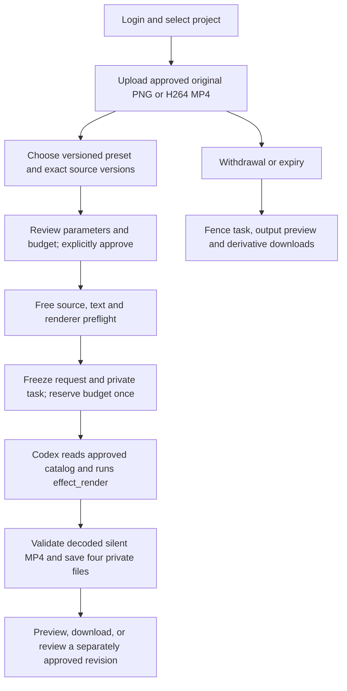

# 经审阅的媒体特效 / Reviewed media effects

此模块补齐营销场景中的可执行特效目录：登录后选择项目、固定版本素材和特效，审阅参数与费用上限，主动确认后由云端 Codex 调用原生 FFmpeg，交付真实文件。AI 模型及账户额度继续使用明确标记的假数据；Codex 进程、素材读取、渲染、文件权限和费用账本实际执行。

This module supplies an executable marketing effects directory. An authenticated customer selects a project, fixed source versions and a preset, reviews parameters and the budget, and explicitly approves the task. Cloud Codex invokes native FFmpeg and produces actual files. Model responses and account capacity remain explicitly synthetic; Codex processes, source reads, rendering, authorization and accounting run for real.



## 客户使用 / Customer workflow

进入 Web 的 Motion studio，从十个真实示例中选择效果。素材来自当前项目的已获准资产，按固定版本与 SHA-256 绑定。上传入口沿用现有文件中心；目录分页不会丢失已选择且位于页外的素材。预览示例为程序绘制的原创几何图形，没有调用生图模型，也没有使用客户素材。

Choose Motion studio in Web and inspect one of ten actual rendered examples. Inputs are authorized project assets pinned to version IDs and SHA-256. Uploads use the existing file center. Source pagination retains a selection outside the current page. Examples use original procedural geometric artwork, with no image-model request or customer material.

客户选择输出尺寸、时长和效果参数，确认预算后勾选授权并提交。浏览器先持久保存本次请求和幂等键。提交结果因网络中断而未知时，刷新后可以重放原请求；更改参数必须开始新的审阅。服务端在预留费用前检查实际文件、时长、字体、文字排版及编码器；每个幂等请求只创建一个任务和一笔预留。退出登录清理本机保存的请求，切换账户、企业或项目会阻断旧页面响应。

Review output size, duration, effect settings and budget, then explicitly consent and submit. The browser saves the exact request and idempotency key before dispatch. An unknown network outcome can be retried unchanged after reload; changed settings require a new review. Before reserving funds the server checks actual media, duration, font coverage, text layout and encoder availability. A request creates one task and one reservation. Sign-out clears saved requests; changing user, tenant or project fences late responses.

每次交付包含 `effect.mp4`、`preview.png`、`effect.source.json` 和 `effect.delivery.zip`。JSON 记录原始参数、素材版本与摘要、目录及定义摘要、编码环境配置、探测结果和文件摘要；ZIP 内包含前三个文件。结果以任务所有者私有方式保存。修改参数产生新的、独立审阅和计费的任务，不覆盖旧交付。已完成的同参数操作复用原文件；被隔离或撤回的结果不能自动重新生成。模型只返回文字但没有有效渲染回执时，任务明确失败。

Each delivery contains the actual silent MP4, PNG preview, immutable source JSON and a ZIP containing those three files. The JSON records parameters, source versions and hashes, catalog and definition digests, renderer profile, probe and output hashes. Files remain private to the task owner. A revision requires a separately reviewed and funded task and retains the old delivery. Repeated completed operations reuse original files; unavailable outputs cannot silently regenerate. A model response without a valid rendering receipt fails the task.

## 效果与边界 / Presets and limits

| 固定 ID / Preset ID | 实际处理 / Actual processing |
| --- | --- |
| `transition.crossfade` | 两段素材透明交叉溶解 / Timed crossfade |
| `transition.slide-left` | 第二段从右向左滑入 / Slide left |
| `transition.wipe-right` | 从左向右擦除切换 / Wipe right |
| `transition.dip-black` | 第一段淡出到全黑，再淡入第二段 / Explicit fade to black, then fade in |
| `text.fade-in` | 固定授权字体的文字透明淡入 / Licensed text fade-in |
| `text.slide-up` | 文字从安全区下方进入 / Text entrance from below |
| `key.chroma` | 有界色键抠像与纯色背景 / Bounded chroma key and solid background |
| `cleanup.denoise` | 原生时空降噪 / Native spatial and temporal denoising |
| `cleanup.sharpen` | 有界锐化 / Bounded unsharp filter |
| `cleanup.exposure` | 亮度、对比度和 gamma / Brightness, contrast and gamma |

输出为 24 fps、H.264、yuv420p、2–12 秒的无声 MP4。六种尺寸为 640×360、360×640、640×640、1280×720、720×1280、720×720。输入每个不超过 32 MiB，支持 PNG 或 H.264 MP4，单边不超过 1920 像素；MP4 不超过 60 秒、60 fps，允许 AAC 输入但明确丢弃音轨。转场需要两段素材，并验证足够时长。文字最多 80 个可打印字符、两行，使用随仓库提供许可证和摘要的 Noto TC 字体，超出安全区或缺字会拒绝。

Outputs are silent 24 fps H.264/yuv420p MP4s lasting 2–12 seconds in six fixed landscape, portrait or square sizes listed above. Inputs are PNG or H.264 MP4, at most 32 MiB each and 1920 pixels per side. MP4 is limited to 60 seconds and 60 fps; optional AAC input is discarded. Transitions require two inputs with sufficient duration. Text is limited to 80 printable characters and two measured lines using the bundled licensed Noto TC font. Missing glyphs or unsafe overflow are rejected.

效果名称、版本、参数 schema 和定义摘要独立固定。用户不能注入任意 FFmpeg 滤镜、命令、字体路径、外部 URL 或文件系统路径。降噪等为确定性原生滤镜，不声称 AI 修复或专业母版级质量。特效渲染本身不发出额外模型请求、不收取额外 AI 费用；Codex 任务仍按实际记录用量结算。演示模型费率不能代表生产报价。

Preset IDs, versions, parameter schemas and definition hashes are fixed. Arbitrary filters, commands, font paths, remote media URLs and filesystem paths are rejected. Cleanup uses native deterministic filters and does not claim AI restoration or professional mastering quality. Rendering adds no model request or AI fee; normal recorded Codex task usage is still settled. Synthetic demonstration rates are not production prices.

## 实现及权限 / Implementation and authorization

后端新增 `media-effects-model`、`media-effects-render`、`media-effects-tools`、`media-effects` 和原创演示素材模块。正式审阅任务仅暴露 `effects_catalog` 与 `effect_render` 两个工具；后者采用根对象 `{ request: ... }` 契约，参数必须与已冻结审批完全一致。目录工具仅返回当前批准的效果及紧凑描述，避免原生工具结果截断；完整严格 schema 仍由渲染工具声明提供。普通新版视频角色同时支持获准素材发现。Ask/Plan 模式不开放渲染。原生进程使用受限参数、超时、文件/管道协议和独立临时目录，取消时等待实际子进程关闭后再清理。

The backend adds separate model, native rendering, tool, API and procedural demo modules. A formally reviewed task exposes only `effects_catalog` and `effect_render`; rendering uses the root-object `{ request: ... }` contract and must exactly match frozen approval. The catalog tool returns the approved preset with compact descriptors to avoid native tool-output truncation; the render declaration retains the complete strict schema. Ordinary new-version video-role tasks can also discover authorized sources. Ask/Plan modes cannot render. Native processes use bounded arguments, deadlines, file/pipe protocols and owned temporary directories. Cancellation waits for the actual child process to close before cleanup.

`video-motion@1.5.0` 通过新 overlay 及 `media-effects@1.0.0` Skill 发布。旧 `1.4.0` 角色的摘要和历史 Skill 保留，不自动获得新权限。当前总计仍为 18 个候选角色，增加到 40 个 Skill 包；不因此声称这些角色已通过真实专业业务验收。Admin 可在现有内容目录中起草并发布 `navigation/effects`，控制入口的中英标签、排序和显示；隐藏入口属于展示控制，执行权限由角色和 Skill 独立约束。角色停用在素材探测和费用预留前拒绝新任务。现有资产隔离、保留和擦除权限同样适用；尚无独立的逐特效发布编辑器。

`video-motion@1.5.0` ships through an additive overlay and `media-effects@1.0.0` Skill. Old role digests and Skills remain available and do not inherit rendering permission. There are still 18 candidate roles, now with 40 Skill packages; this does not qualify them for live professional use. Admin can draft and publish `navigation/effects` through the existing catalog to control bilingual labels, ordering and visibility. Menu visibility is presentation; role and Skill permissions govern execution separately. A disabled role rejects new work before media inspection or budget reservation. Existing asset moderation, retention and erasure controls apply. An independent per-preset publication editor is not provided by this increment.

菜单配置示例如下，在 Admin 内容目录创建草稿，预览后发布。操作分别需要 `admin.catalog.draft`、`admin.catalog.publish` 权限，发布要求近期 MFA，服务端记录操作者和对象。将 `enabled` 改为 `false` 会隐藏入口；停用 `video-motion` 角色或所需 Skill 才会阻断新任务执行。

Create this draft in the Admin catalog, preview it, then publish. Drafting and publishing require the corresponding catalog permissions; publication requires recent MFA and records the operator and object. Setting menu `enabled` to `false` hides its entry. Disabling the role or a required Skill blocks new execution.

```json
{
  "kind": "navigation",
  "key": "effects",
  "body": {
    "path": "effects",
    "label": "特效工作室",
    "label_en": "Motion studio",
    "enabled": true,
    "order": 25
  }
}
```

SQL110 冻结审批内容，并将批准素材加入任务和衍生资产的来源追踪，防止执行前撤回及发布副本绕过检查；审批不伪装成模型读取。SQL111 保留已有工具回执类型并新增特效回执。SQL001–109、此前发布的契约、Skill 和角色目录保持原字节。所有结果查询在数据库事务中传递当前用户身份，沿用私有资产和回执的行级权限。任务创建、工具执行、结果查询和下载均检查当前来源状态。

SQL110 freezes approval and includes approved inputs in task and derivative lineage before execution. Approval is not fabricated as a model read. SQL111 preserves existing receipt names and adds effect rendering. Published SQL001–109, prior contracts, Skills and catalogs retain their exact bytes. Result queries pass the current user into database transactions for private receipt and asset row policies. Admission, tools, delivery queries and downloads all recheck current source availability.

| API | 用途 / Purpose |
| --- | --- |
| `GET /v1/tenants/:tenant/projects/:project/effects/catalog` | 固定目录与当前角色可用性 / Catalog and current role availability |
| `GET .../effects/sources` | 当前获准素材的分页 / Current authorized source pages |
| `POST .../effects/tasks` | 预检查、固定审批和幂等任务创建 / Preflight, frozen approval and idempotent admission |
| `GET .../effects/tasks/:task` | 当前有效的私有交付 / Fresh private delivery |

Desktop 继续在客户本机运行 Codex，客户选择本机权限；它可调用版本化公司业务工具。Web 的本次云端专用审批表在原生 Desktop 中禁用，不以云端任务替代本机 Agent。Extension 继续以原生右侧栏提供云端对话和主动选择的文件上传。此处页面截图及交互录像来自 Web，不能作为 Desktop/Extension 原生界面验收素材。

Desktop continues to run local Codex with customer-selected local permissions and can invoke versioned company tools. This Web-specific cloud approval form is disabled inside native Desktop and does not replace local execution. Extension retains its native right side panel, cloud conversation and customer-selected file uploads. Captures here are Web evidence and do not establish native Desktop or Extension interface acceptance.

## 验证与运行 / Verification and operation

在 Platform 安装现有 Node 依赖，确保原生 FFmpeg/ffprobe 位于 PATH，使用现有数据库配置、迁移和启动脚本。Web 按原有方式启动，登录、创建项目并上传素材后进入 Motion studio。无需 Docker/WSL。正式内部模型网关仍按现有配置接入；演示模式使用用户已授权的假模型数据。

Install the existing Node dependencies in Platform, put native FFmpeg/ffprobe on PATH, and use existing native database configuration, migrations and launch scripts. Start Web normally, sign in, create a project, upload sources and open Motion studio. Docker/WSL is not required. Production uses the existing internal model gateway configuration; demonstration mode uses the authorized synthetic model.

核查入口位于 Delivery：`node scripts/run-media-effects-checks.mjs NN full`、`node scripts/run-media-effects-ui.mjs NN`，每次使用未占用的两位编号。记录保留失败尝试、实际源码摘要、像素断言、文件摘要、账本结算、原生 Codex 和自建资源清理状态。浏览器核查不接管用户已有服务或页面。专项证据与整体验收分开；原 102 项需求和 G01–G10 的验收记录保持原判定。

Delivery qualification uses the two commands above with a new two-digit attempt ID. Reports retain failures, exact source hashes, pixel assertions, file digests, accounting, native Codex and owned-resource cleanup. Browser checks preserve existing user services and tabs. Scoped evidence does not change the original 102 requirement or G01–G10 acceptance assessments.

[精确源码检查点 / Exact-source checkpoint](../quality/media-effects-checkpoint.json) · [媒体完整解码 / Full media review](../quality/media-effects-media-review-01.json) · [交付文档同步 / Documentation refresh](../quality/media-effects-documentation-refresh.json)
