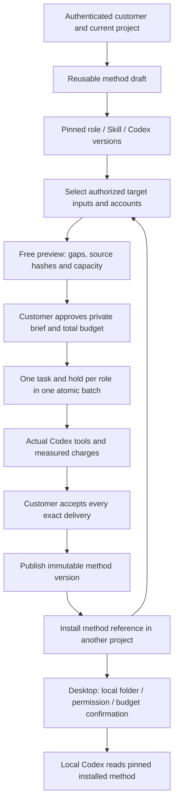

# 业务方案的版本、试运行与复制 / Versioned business solutions

本次实现对应 REQ-070、TC-070。客户可以把可分享的方法指引、预设角色、固定 Skill 版本、资料要求与报表连接要求组合成方案，完成预览、真实执行、验收、发布和跨项目安装。模型及账号数据按当前授权使用假数据；Codex 进程、数据库事务、原始文件读取、权限与费用记账使用实际程序流程。证据索引见 [方案包检查点](../quality/solution-packages-checkpoint.json)。这项专项实现不将原始 102 项需求或专业角色的完整验收改为已完成。

This implementation addresses REQ-070 and TC-070: reusable instructions, preset roles, pinned Skill versions, input requirements and reporting connections form a previewable, trialable, publishable package. Customers explicitly accept actual deliveries before sharing a method. Model/account data remain synthetic as authorized; Codex processes, transactions, source reads, access controls and accounting execute normally. See the [scoped checkpoint](../quality/solution-packages-checkpoint.json). Original full-product and professional-role acceptance retains its existing status.

## 客户操作与产品边界 / Customer workflow

1. Web 登录并选择项目，在 **Business methods / 业务方案** 创建草稿。输入方案名称、可公开给同企业成员的方法说明，选择最多六个预设角色，并填写最多十二项资料标签及四类报表连接。未指定角色时使用预设助手。保存时固定实际模板版本、角色摘要、Codex runtime profile 与绑定 Skill ID。新版本始终保留旧版本定义，不能沿用旧版本的验收。
2. 免费预览列出缺失资料、角色依赖、固定文件摘要、报表账号、已擷取快照和可用并发额度。当前支持 Google Ads、GA4、Search Console、Meta Ads。账号必须在当前目标项目中获准、可读、非管理账号；未擷取的数据会显示缺口。预览不建立任务或费用预留。
3. 客户填写**本次私有简报**和所有角色的总预算，并主动确认。总预算按角色平均分配，余数放入首个角色，各角色分别建任务、预留、执行、结算。全部任务在同一事务提交；任务额度不足时整批拒绝。该版本未定义角色执行依赖，因此每个角色独立完成自己的交付，不把多角色列表冒充有依赖编排的团队。
4. 实际工具读取获准的固定版本。`solution_source_read` 读取 UTF-8 文本、CSV、JSON 或 SVG 的实际字节并验证摘要；其他类型要使用所选角色已有的对应读取工具。报表使用 `connector_read` 读取固定快照。只把输入列在简报中或浏览文件、素材、快照目录，都不能取得内容读取凭证。每个必需版本及摘要都必须具有试运行中实际读取内容的独立记录，否则不能验收或发布。
5. 客户核对每个角色实际输出、文件与当前交付摘要，再接受全部交付。发布必须引用该方法版本、该源项目和该客户的已验收试运行；每项任务必须成功，且当前交付仍与验收时一致。未完成、漏读资料、未验收、旧交付、无关任务或失效账号均不能发布。
6. 发布后同企业有权限的客户可以把方法安装到自己的项目。安装仅保存方法版本参照和缺失要求，**不复制原客户文件、私有简报、试运行结果、对话、记忆、账号授权或密钥**。安装属于安装者本人；目标项目管理员仍须重新绑定当前获准资料与账号。保存采用 `expected_revision` 防止覆盖他人的新配置，再次试运行独立确认和计费。
7. Desktop 保持本机 Codex。方案库和配置请求经过受限 IPC；通用桥接明确拒绝创建云端方案试运行。已发布并安装的方法可以选择固定角色进入本机工作台，客户仍须选择本机目录、权限和预算，再主动发送。`solution_read` 只返回该角色可用的固定方法，不能赋予另一个角色的工具、复制本机权限或启动额外工作。预设助手的云端模板不是本机角色；需要选择已有本机支持的专业角色。
8. Extension 保持 ChatGPT 式对话、附件和原生右侧 Side Panel。其任务在云端运行，获准上传的资料按当前私有文件策略处理。适配角色可通过受控 `solution_list`、`solution_read` 访问本人在该项目安装的方法，不因此获得本机终端或 Desktop 权限。

1. Sign in on Web, select a project and create a method. Choose up to six roles, twelve input labels and four reporting providers. Saving freezes actual template, role, Codex-profile and Skill versions. Every revision requires its own trial and acceptance.
2. Preview dependencies without a fee hold: current source hashes, approved reporting accounts, captured snapshots and task capacity. Missing or stale dependencies remain visible.
3. Explicitly approve a private brief and total budget. The batch creates one separately metered task per role atomically. Capacity failure leaves no partial tasks or reservations. Roles work independently; this package does not invent a dependency graph.
4. Actual tools must read approved fixed sources. UTF-8 source reading verifies stored bytes; specialized readers handle other formats, and reporting tools read captured snapshots. Declaring an input or browsing file, design or snapshot metadata does not qualify it as consumed. Each required version and hash needs its own actual content-read fact from a task in this trial.
5. Inspect and accept every exact delivery before publication. Publication rechecks task status, method identity, account authority, source availability and current delivery hashes.
6. Install only a published method reference in a new authorized project, then bind that project's own inputs and accounts. Installation is personal, copies no private source content or credentials and does not execute work. Configuration uses optimistic revisions; subsequent paid trials require new approval.
7. Desktop uses local Codex and explicit folder, permission and budget controls. The renderer bridge rejects cloud-trial admission. Pinned local roles can read an installed method without inheriting permissions. The cloud default assistant is not a native Desktop role.
8. Extension remains a native right-side cloud chat with approved file upload. Controlled method tools respect its current project, role, owner and cloud execution boundaries.

## 数据与接口 / Data and API

新增迁移 `112-versioned-solution-packages.sql`；001–111 的已发布字节保持原样。新增 `solution_versions`、`solution_installations`、`solution_trials`、`solution_trial_tasks`、`solution_method_reads` 和 `solution_content_reads`。方法定义、角色冻结、试运行输入与任务关联不可变；安装只能递增修订修改目标绑定，试运行只能记录一次完整验收。所有表限定企业，安装及试运行额外限定客户本人。私有附件只在同一用户、同一项目的明确批准清单中向该试运行开放。

Migration 112 adds immutable method versions, personal installations, private trials, exact task associations, method-read provenance and separate content-read facts. Existing migrations remain unchanged. Tenant RLS and owner restrictions apply; approved private attachments are available only to the same user's authorized trial in the same project. A narrow definer function locks authorized connector rows without granting application users update access to encrypted profiles.

来源目录的 `task_source_reads` 仍用于撤回与依赖追踪；验收另查 `solution_content_reads`，不把元数据浏览升级为正文读取。内容凭证只允许在运行中的已批准任务读取并校验指定版本后插入，不能修改、删除或在任务完成后补造。数据库触发器在验收冻结及方法发布时再次核对全部必需版本和摘要。CSV 目录浏览、广告快照列表、实际 CSV 检查、快照正文读取及事后造证的正反向案例均纳入回归。

Directory lineage in `task_source_reads` remains useful for withdrawal fences. Acceptance separately checks `solution_content_reads`; metadata browsing never becomes a content read. Proofs are inserted only for exact approved versions during a running task, cannot be edited or deleted, and cannot be added after completion. Database triggers recheck every required version and hash before freezing acceptance or publishing. Regression cases distinguish CSV/snapshot listings from actual content reads and reject fabricated late proof.

| 接口 / Endpoint | 行为 / Behavior |
| --- | --- |
| `GET /v1/solution-access?project_id=` | 当前用户的读写、管理、验收及执行位置 / Current project actions and execution location |
| `GET/POST /v1/solution-versions` | 已发布库、项目版本；创建严格契约草稿 / Published library, project versions, strict draft creation |
| `GET /v1/solution-versions/:id/details` | 获准方法和实际固定模板 / Authorized method and pinned templates |
| `POST /v1/solution-versions/:id/revisions` | 同家族不可变新版本 / New immutable family revision |
| `GET /v1/solution-targets?project_id=&kind=` | 可绑定的当前文件、账号元数据 / Current bindable files and account metadata |
| `POST /v1/solution-versions/:id/previews` | 免费重新核对依赖和摘要 / Free dependency and hash recheck |
| `GET/POST /v1/solution-versions/:id/trials` | 本人试运行历史；主动确认后创建整批任务 / Personal history; approved atomic paid trial |
| `GET /v1/solution-trials/:id` | 实际任务、费用、当前交付和未读资料 / Actual tasks, charges, deliveries and unread inputs |
| `POST /v1/solution-trials/:id/reviews` | 每项当前交付的明确验收 / Explicit acceptance of every current delivery |
| `POST /v1/solution-versions/:id/publications` | 依据已验收试运行发布 / Publish from an accepted exact-version trial |
| `POST /v1/solution-versions/:id/installations` | 仅复制已发布方法参照 / Install a published reference only |
| `GET /v1/solution-installations[/:id]` | 本人目标项目安装 / Personal target-project installations |
| `POST /v1/solution-installations/:id/configurations` | 修订保护的新项目资料绑定 / Revision-safe target rebinding |
| `POST /v1/solution-versions/:id/disable` | 项目管理员停用版本 / Project administrator disables a version |
| `GET /v1/admin/solutions` | 管理员权限范围内的元数据 / Scoped Admin metadata |
| `GET /v1/admin/solutions/:id/body` | 独立正文权限、记录查阅审计 / Separate body permission and read audit |
| `POST /v1/admin/solutions/:id/disable` | 当前权限、近期 MFA、原因与审计 / Current scoped permission, recent MFA, reason and audit |

原始 OpenAPI 的 SolutionCreate / SolutionVersion / SolutionPublish / SolutionInstall / SolutionInstallation / SolutionVersionList 保持不变；新增仓库契约 `contracts/solution-packages-v1.schema.json` 提取并绑定原始文档摘要，用严格 JSON Schema 验证响应。写操作需要当前会话、CSRF（浏览器）、企业上下文和幂等键。网络结果未知时保留原正文与键，刷新后按原请求重试；不会按新键自动补跑付费任务。

Canonical Solution schemas remain unchanged; the extracted repository schema binds the original OpenAPI hash and validates strict responses. Mutations require current authentication, browser CSRF, tenant context and idempotency keys. An unknown response retains the exact saved request across reload, preventing a second paid admission.

## 内容控制与撤回 / Control and withdrawal

Admin 列表只读取方法元数据；正文需 `admin.content.body.read`，停用需 `admin.content.quarantine` 和当前近期 MFA，分别做项目范围检查。Admin 不替用户验收结果或直接修改实际用量费用。版本停用、项目归档、原资料失效、账号撤销、授权版本变化会阻断后续执行和依赖内容访问。来源函数追踪方法读取及试运行的实际输入，不能依靠旧预览或已完成状态复活失效内容。

Admin metadata, body access and disablement are separately scoped and audited. Operators do not accept customer work or rewrite measured fees. Disabled methods, archived projects, withdrawn inputs and revoked/rebound accounts fence execution and dependent content. Old previews and completed status cannot revive unavailable sources.

运行中的方法版本及源项目进入统一的来源行锁清单；执行器按固定顺序获取共享锁，并在取得锁后重新检查状态。并发停用或源项目归档持有写锁时，工具返回可识别的忙碌状态，不越过校验继续读取或写入。普通方案查询使用共享锁，管理更改才使用排他锁。跨项目复用不会因此授予目标用户读取源项目其他内容的权限。

Method versions and their source projects join the common source-lock manifest. The executor takes shared locks in a fixed order and rechecks availability afterward. Concurrent disablement or source-project changes cause a recognizable busy result before tool access; ordinary method queries use shared locks and management changes take exclusive locks. Cross-project reuse grants no access to unrelated source-project content.

真实供应商账号、生产模型效果、复杂业务结果的专业质量及全部角色验收仍需后续真实服务测试。现阶段读取记录证明工具接触了指定字节或快照；它不单独证明模型理解了事实或交付具有专业质量。

Live providers, production model quality and full professional-role acceptance still require real-service tests. A source-read record proves access to specified bytes or snapshots; it does not by itself prove comprehension or professional quality.
