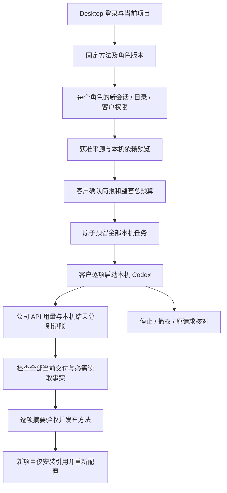

# Desktop 本机方案试运行与发布 / Native method trials and publication

本文件补充第 96 阶段业务方案设计。Desktop 的首次方案试运行、验收和发布现在接入本机任务流程；Web 和 Extension 的 Agent 继续在云端执行。验证报告与本阶段交付记录是验收范围的依据，不以本文件声明整个产品完成。

## 客户流程

1. 登录 Desktop 并选择当前项目，打开「业务方案」，创建或选中一个固定版本的方法。方法固定角色模板、角色摘要、Skill 和资料要求。
2. 为每个固定角色选取一个新的本机会话。客户选择实际电脑目录，并通过主进程的原生确认授予唯读、目录读写或完整本机权限。同一个方法可使用不同目录，但必须来自同一台设备、同一位用户和当前项目。
3. 选择获准的项目文件及当前报表账号，免费预览依赖。Desktop 预览摘要包含本机执行位置，云端预览摘要不能替代本机预览。
4. 填写本次私有简报与整套方案总预算，明确确认资料、目录和权限后，一次性准备全部角色的本机任务。准备会预留整批额度，不启动 Codex。额度、并发名额或任一依赖不足时整批失败。
5. 逐项点击「在本机启动」。主进程使用原加密日志中的任务绑定启动客户电脑上的固定 Codex，通过公司内部 OpenAI 兼容入口请求模型。每项可单独停止；也可到本机工作台回答问题、查看过程或撤回权限。
6. 查看每个角色的实际结果与费用，全部任务成功、必需来源有真实读取事实后，客户可验收全部当前交付摘要，再发布方法。未执行、已取消、待核对或缺少资料读取凭证的任务不能用于发布。
7. 在新项目安装时仍仅复制方法引用。客户本地文件、目录授权、私人简报、试运行结果、账号和密钥不会随方法分发。

## 接口及职责

| 入口 | 职责 | 授权及边界 |
| --- | --- | --- |
| `POST /v1/solution-versions/:id/previews` | 返回当前位置的免费预览 | 当前 Desktop 登录得到本机摘要；不建立任务或费用 |
| 主进程 `solution.prepare` IPC | 将全部本机会话与完整请求持久化，再申请整批任务 | 仅应用主框架；严格的顶层字段；校验当前用户、登录 epoch、项目、空闲新会话和有效本机许可 |
| `POST /v1/solution-versions/:id/desktop-trials` | 一次性建立整套本机方案任务 | 当前 Desktop refresh family；固定角色顺序；同设备；未使用的会话；当前依赖、摘要、权限、预算和名额 |
| 主进程 `retry` IPC | 启动已准备本机任务，或核对原结果 | 执行状态来自加密日志；已有原任务时不再调用普通建任务入口 |
| `desktop-executions/:task/start`、`heartbeat`、`tools`、`finish`、`cancel` | 沿用现有本机任务生命周期 | 当前设备、用户、登录 family、项目、目录摘要、固定运行时、任务栅栏和公司 API 凭证 |
| `solution-trials/:id/reviews` 与 `solution-versions/:id/publications` | 验收全部精确交付，再发布 | 当前客户权限；全部成功和当前摘要；正向实际费用；必需来源读取；Admin 不能代客户越权验收 |

通用 renderer API 不暴露 `desktop-trials`、本机执行凭证或推理入口。Desktop 登录调用云端 `trials` 会被服务端拒绝；Extension 授权不能调用本机入口。本机目录的完整路径保留在客户电脑，公司端仅保存目录摘要及必要的会话绑定。

## 状态、计费和失败恢复

- 总预算上限沿用方法的 100,000,000 micro-HKD；每个本机角色至少 10,000 micro-HKD。预算平均分配，整数余数分给第一项。一次批准只创建一套任务和预算预留。
- 加密本机日志先保存完整正文、会话顺序及幂等键，再发送请求。未知网络结果保留原请求；刷新或主进程重启后，恢复会核对同一批任务。不会转换为普通任务、使用新幂等键重复申请或自动转云端。
- 已收到明确拒绝且尚无任务绑定时，可释放本地准备状态供客户修改。传输错误、超时或服务端结果未知时保留核对状态。
- 已经进入本机执行的任务在崩溃后沿用既有未知结果处理。重新启动应用不能将其当作未运行任务再执行。
- 停止已准备任务释放该项额度；撤回操作系统访问权限后仍可核对和取消原预留。停止与撤权本身不会授予新的本机许可。
- 公司推理入口记录真实调用用量和价格，任务结果注明来自客户 Desktop 的报告。模型回答、目录列举或输出文本本身不能替代精确的必需云端来源读取事实。

## 数据库和实现约束

迁移 `113-native-solution-trials.sql` 为试运行增加不可变的执行位置和私有本机绑定。迁移 112 与既有交付、读取事实及发布守卫保留。数据库校验方案任务与试运行执行位置一致；本机任务链接必须对应相同用户、项目、设备、会话、目录摘要、运行时摘要、角色及登录 family。方案的角色顺序和引用版本不能借本机入口替换。

本机预览校验角色、Skill、套餐与公司模型能力；本机固定运行时由本机准备和启动流程校验。云端可执行文件的安装状态不再成为本机方案的运行前提。只读方法及精确来源读取工具提供给已接入的本机角色。

原型、合成模型、合成余额和自动回应的原生对话框只用于隔离的开发验收。真实公司模型、真实付款、人工原生对话框操作、签名安装包、所有角色的完整业务质量和整个产品的最终验收，需要独立证据。

## English

This addendum connects first-time Desktop method trials, acceptance and publication to the customer's local Codex lifecycle. Web and Extension agents retain cloud execution. The stage evidence defines the verified scope; this document does not declare complete product acceptance.

Customers select a pinned method and a fresh local session for every specialist. Each session has an explicitly chosen folder and a native permission confirmation, including optional full local access. The sessions belong to the same customer, current project and device. A free native preview checks approved project inputs, reporting accounts, frozen roles, Skills and company capabilities. Its digest distinguishes native work from cloud work.

After the customer approves the private brief and total budget, one atomic request reserves all specialist tasks. Preparation starts no agent. Insufficient capacity, credit, required inputs or current authority rejects the complete batch. The customer starts or cancels each local task separately. Actual Codex processes use the pinned local executable, the customer's current grant and the company's scoped OpenAI-compatible inference service.

Every required role must deliver successfully. Acceptance records the current hash of every actual delivery, observed positive charges and the required exact source-read facts. An unstarted, cancelled, reconciling or incomplete task cannot qualify the method. Customer acceptance precedes publication; administrators retain scoped metadata, audited content access and disablement controls without replacing customer acceptance.

The main-process `solution.prepare` IPC persists the complete request and original idempotency key before network admission. `POST /v1/solution-versions/:id/desktop-trials` accepts only a current Desktop login family. It validates the fixed role order, same device, unused local sessions, exact preview, project access, inputs, budget and quota. Each specialist receives an independent native task and hold. The total is split evenly, with the integer remainder on the first task; native specialists require at least 10,000 micro-HKD each and the method total remains capped at 100,000,000 micro-HKD.

Uncertain admission responses remain in the encrypted local journal. Reconciliation after renderer reload or main-process restart reuses the same body and key. It never creates ordinary replacement tasks or silently switches execution to the cloud. A definitive rejection can release local preparation state. A task that already reached native execution retains the existing unknown-outcome handling and cannot automatically restart after a crash. Withdrawing OS permission still allows reconciling and cancelling an original reservation, without granting access again.

The generic renderer bridge exposes neither native trial admission nor inference credentials. The server rejects Desktop login attempts at the cloud trial endpoint, and Extension authorization cannot access the native endpoint. Full local paths stay on the customer device; the server stores workspace hashes and the required device/session binding. Migration 113 adds immutable execution locations and private native bindings and extends the database scope checks; previously published migrations and content-read/publication guards remain intact.

Native previews no longer require an installed cloud Codex executable. They retain role, Skill, subscription and company capability checks, while native preparation/start independently validate the pinned device runtime. The shared read-only method and exact approved-source tools are available to connected native specialists. Installing a method in another project still copies a reference only: no customer files, private briefs, results, local permission, accounts or credentials are distributed.

Synthetic models, fixture credit and bounded automated native-dialog responses support isolated development verification. Live company models, real payment, human native-dialog interaction, signed installers, complete professional role quality and final product acceptance require their own evidence.
