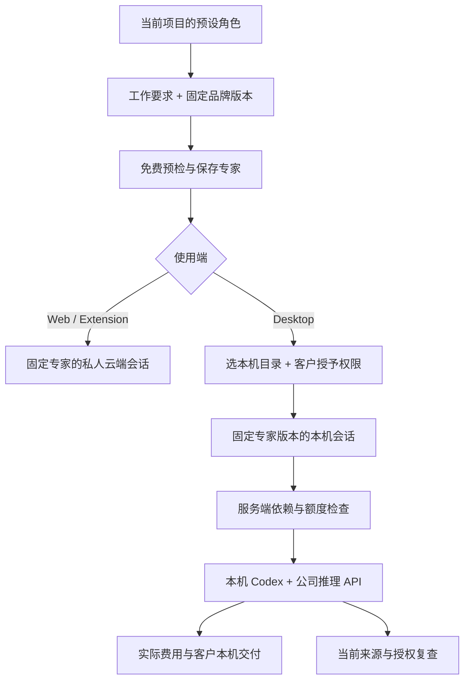

# 预设专家、本机执行与固定品牌版本 / Preset specialists, native execution and pinned brands

本补充落实角色模板中既有的 `brand_version_id`，并连接 Desktop「我的专家」到本机 Codex。它延续第 97 阶段的本机执行、权限、推理与费用生命周期。十八种预设专家与默认助手的接入不等于十八种专业业务已经全部通过最终质量验收。

## 客户使用

1. 在当前企业及项目的角色目录选择模板，填写专家名称、长期工作要求、语言，并可选择一份固定品牌版本。品牌选项来自当前项目，支持翻页；翻页不更换已选版本。
2. 免费预检检查当前角色、套餐、Skill、公司模型能力和品牌来源。Desktop 以本机工具能力判断开发类模板，不要求云端安装 Codex。Web 和 Extension 保留云端能力边界。
3. 保存专家时绑定模板、角色、Skill、公司能力、运行配置和品牌版本。品牌的新发布不会悄悄更换这位专家原有的品牌资料。
4. Web 从专家开始云端会话；Desktop 从「我的专家」选择本机目录，建立携带专家 ID 及版本的本机会话，再由客户主动授予唯读、目录读写或完整权限。
5. Desktop 发送前向服务端提交固定专家引用。服务端核对当前项目、用户、角色、依赖、固定上下文与额度；随后在客户电脑启动 Codex。保存的工作要求、品牌资料和获准记忆进入实际请求上下文。
6. 同一本机会话保留原专家版本。修改专家产生新版本后，客户应建立新的本机会话选用它；已有会话不会自行切换。未知准入回执仍用原请求与幂等键核对，重启不产生替代任务。
   Desktop 旧的「会话」列表入口也进入本机工作区；历史云端会话详情提供前往 Web 的入口，避免在 Desktop 展示无法本机执行的云端委派表单。
7. 内容来源被撤销后，后续启动、心跳、公司工具和推理会重新核对当前权限。用户仍可停止原任务。品牌绑定约束专家上下文与公司的设计输出工具；客户授予的完整本机权限仍由客户电脑决定。

## 实现与边界

- 迁移 `114-preset-specialist-brand-bindings.sql` 为既有品牌版本增加不透明且唯一的 UUID；原有品牌 ID、版本号、内容、摘要与来源谱系保留。既有不可变守卫同时保护该 UUID，受控删除继续沿用现有清除流程。
- `GET /v1/brand-version-options` 是带企业头、项目和分页游标的只读元数据入口，不返回品牌正文、文件字节、内部账号或凭证。模板预检和实例化都按当前权限重新解析 UUID，拒绝跨项目、隔离、删除及失去来源的版本。
- `agentInput.brand_version_id` 可用于保存固定版本。`brand_id` 同时存在时必须指向该版本的品牌。普通工作要求编辑和绑定采纳预览在未明确更换品牌时保留原固定引用；采纳时复查该确切版本，而不是强制换成品牌最新版本。
- Desktop 模板目录、预检和实例化只为当前 Desktop 登录启用本机工具。普通 Web 幂等请求保留原摘要；Desktop 请求另绑定执行位置，不能重用云端回执。
- 本机主进程新增严格的 `specialist.create` IPC。renderer 不能直接调用 `desktop-executions`、专家准入元数据或推理接口。主进程先核对服务端专家元数据及当前账号，再显示目录选择；选目录后再次复查账号。
- 本机任务提交的 `agent_id` 和 `agent_version` 必须成对出现。首次任务冻结专家、获准记忆和角色摘要；后续同会话沿用原上下文。数据库校验同项目、同角色及有效专家，并保护本机上下文与会话的专家引用不被替换。
- 启动会向真实本机 Codex 传入保存的专家指令和固定品牌上下文。公司工具按该专家的工具子集提供；固定品牌的设计输出继续使用既有 `design_render` 精确品牌检查、字体与商品事实规则。OS 文件、命令及完整权限不由模板或服务器代客户授权。
- 本机专家的自定义指令不混入第 97 阶段只固定模板的方法试运行。该流程选择新的模板会话；保存专家仍有独立的本机执行入口，避免方法预览遗漏额外专家配置。
- 默认助手可从 Desktop「我的专家」进入本机执行，十八种预设专家仍保留各自方法。音频生产工具已实现，因此视频模板不再以过期的工具清单将它判为未实现；公司媒体能力、费率、套餐及来源检查仍然有效。
- 路由清单保留已发布基线，并用 `preset-specialist-route-additions.json` 明确补录 40 个入口，其中 38 个来自此前已实现的模块，本次新增品牌版本选项与本机专家元数据两个入口。测试先核对基线摘要，再将明确声明的清单与实际 Fastify 注册入口逐项比较，不自动放行未知接口。

## 验证要求

本阶段保留每次运行的原始日志、精确源码和失败回执。必须分别检查真实 PostgreSQL/RLS 与 HTTP、Desktop 控制器的恢复和账号切换、固定本机 Codex 协议，以及实际打包客户端的品牌选择、保存专家、本机授权、执行及费用流程。源文件在每个验证范围内须前后一致；截图和录屏来自实际运行界面。

测试模型、账户额度和自动回应的原生对话框用于隔离验收。真实公司模型、实际付款、人工原生对话框操作、签名安装包和各角色的完整专业业务质量仍需其独立证据。原始 102 项需求、全部验收条件和门槛不因本补充被改写。

## English

This addendum implements the existing template `brand_version_id` override and connects saved Desktop specialists to the customer's local Codex. It retains the native execution, customer permissions, inference and billing lifecycle from stage 97. Eighteen connected presets and a default helper do not establish final professional qualification for every role.

Customers select a project template, name, lasting instructions and optional fixed brand revision, then run a free preflight and save the specialist. Brand choices are project-scoped and paged; paging preserves the chosen revision. Desktop evaluates its native development tools, while Web and Extension retain cloud execution. Required company models, subscriptions, Skills and source availability remain enforced.

Web starts a private cloud conversation. Desktop selects a customer folder, creates a local session with the exact saved specialist ID and version, and asks the customer for a read-only, workspace-write or full local grant. The main process validates specialist metadata and current identity before opening the folder chooser and rechecks identity afterwards. The server cannot grant OS access.

Desktop's legacy conversations entry also opens the local workspace. Historical cloud-conversation details offer a Web entry rather than a cloud delegation form that cannot run locally.

The first paid native task freezes the specialist, authorized memories and role hash. Continuations preserve that context and version. Editing a specialist does not silently update an existing native session; customers create a new session to adopt the new version. Unknown admission responses and process restarts retain the original durable request and key, without replacement reservations. Current source and user authority are rechecked on native start, heartbeat, inference and company tools.

Migration 114 gives existing composite brand revisions stable opaque UUIDs without replacing their content, hashes or lineage. Existing immutability guards also protect these UUIDs. `GET /v1/brand-version-options` exposes scoped metadata only. Preflight and instantiation independently resolve the exact UUID under current project authority and reject missing, quarantined, erased or unavailable-source revisions. Publishing a newer brand leaves existing pinned specialists unchanged. Instruction edits and adoption previews preserve a fixed reference unless the customer explicitly changes the binding; acceptance rechecks the selected revision rather than substituting the latest brand.

Desktop's strict `specialist.create` IPC is owned by the trusted main process. The generic renderer bridge cannot access native admission, specialist metadata or inference. Native task requests require both specialist ID and version. Database guards enforce project and role consistency and preserve the native context and session binding. Saved instructions and fixed brand guidance reach the real local Codex prompt, and the configured specialist tool subset controls company tools. Existing design rendering still enforces the fixed brand, font and product-fact rules. Arbitrary OS work remains subject to the customer's local grant and review.

Stage 97 method trials retain their exact template-based scope. They use fresh template sessions rather than silently adding a saved specialist's extra instructions. Saved specialists have their own native entry. The default helper also has a local entry, and the implemented speech tool is recognized by video template readiness without bypassing company capability or price checks.

The published route inventory stays intact. An explicit supplement records 40 operations: 38 from previously implemented modules and two new brand-option/native-specialist metadata endpoints. Tests verify the baseline digest and compare the declared union against actual Fastify routes; unknown operations are not accepted automatically.

Verification must retain exact sources, raw logs and failed attempts; cover real PostgreSQL/RLS and HTTP, native-controller recovery and identity changes, pinned local Codex protocols and the actual packaged customer journey; and capture real screenshots and recordings. Synthetic model responses, fixture credit and bounded automated native-dialog decisions support development verification. Live models, real payments, human native dialogs, signed installers and complete professional role quality require separate evidence. The original 102 requirements and acceptance gates remain intact.
