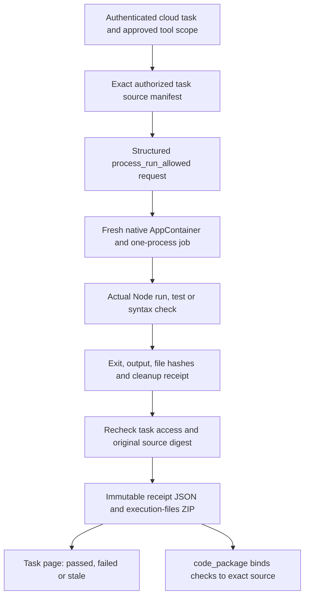

# 云端程序执行与可追溯的软件检查 / Cloud program execution

本次实现让云端 Codex 实际运行当前任务的 JavaScript / TypeScript 程序及 Node 内置测试，并将真实结果与确切源码一起交付。它接入既有公司工具、租户权限、私有会话、来源撤销和费用生命周期。Desktop 仍在客户电脑运行 Codex；本补充只定义云端公司工具及其检查记录展示。

## 客户使用与结果含义

在具有 `process.run.allowed` 工具授权的云端软件任务中，Codex 可写入任务源码，调用 `process_run_allowed`，根据实际错误修改源码、重新执行，再调用 `code_package` 交付。任务页的「软件检查记录」显示指令、入口、退出码、耗时、输出和下载入口。早期失败保留；源码发生变化时，旧记录明确显示不适用于当前版本。通过只代表该次指令成功，不代表整个软件、所有测试或所有预设角色已验收。

预设目录仍检查每个角色的全部依赖。尚未实现的 `api.test`、`browser.preview`、`database.test.native` 会继续阻止依赖它们的云端模板宣称就绪；本次没有绕过该检查。登录、企业/项目、套餐、模型、Skill、来源、预算及工具子集的既有准入要求继续生效。开发验收经实际云端 Codex 及公司工具链运行，模型响应和额度采用用户已授权的假数据。



## 固定运行配置与调用协议

运行配置在 `copypaste-platform/contracts/cloud-program-runtime.json`。当前唯一实现为 Windows x64、Node **v22.14.0**，执行文件 SHA-256 固定为 `33b1bc1a8aca11fd5a4f2699e51019c63c0af30cf437701d07af69be7706771b`。该摘要来自 [Node 官方校验表](https://nodejs.org/dist/v22.14.0/SHASUMS256.txt)。服务启动使用的 Node 版本及二进制都必须匹配，原生守护程序的源码和执行文件也须匹配构建清单；缺失或不匹配时拒绝执行。

工具输入为严格对象，例如：

```json
{
  "program": "node_test",
  "entry": "pricing.test.cjs",
  "args": [],
  "timeout_ms": 15000
}
```

`program` 只允许 `node`、`node_test`、`node_check`。`entry` 必须指向任务内已有且路径合法的 JS / TS 源码；普通执行最多接受 32 个字面参数，测试及语法检查不接受额外参数。调用方不能选择可执行文件、注入环境变量或传入 shell 命令。默认 15 秒，调用上限 30 秒。TypeScript 使用固定 Node 的类型剥离能力；Node 内置测试使用单进程模式。本配置不执行 npm 安装、不下载依赖、不提供任意框架构建或多进程服务。

## 原生执行边界与清理

`cloud-program-host.cs` 使用 Windows AppContainer 原生访问令牌和 Job Object，不使用 Docker、WSL 或虚拟机。每次调用创建独立 GUID 目录、临时 AppContainer 配置以及单进程 Job。程序暂停创建，先加入 Job 和进程约束，再恢复执行。它没有网络 capabilities，也不继承公司密钥、服务环境或标准输入；只继承显式指定的三个输入/输出句柄。

任务目录只包含获准源码、固定 Node 文件及任务临时文件。AppContainer 对任务根和 runtime 只有读取/执行权限，对 `work` 目录有修改权限；不更改用户或服务器其他目录的 ACL。原生边界阻止创建子进程，限制进程和 Job 内存为 512 MiB，Job 关闭即终止所属进程。Node 使用保留符号路径选项，避免通过扩大宿主盘符权限解决运行路径问题。

stdout 与 stderr 合计最多保存 128 KiB。任务工作区最多 500 个文件、合计 20 MB，单个输入源码最多 1 MB；输出单文件还有 4 MB 检查。执行器每 200 ms 检查工作区，包括临时目录；该检查是检测并终止超限任务，并不是磁盘硬配额。拒绝符号链接、重解析点、硬链接、非法文件名、过深目录及变化后摘要不符的源码。输出超限、超时、取消、守护程序异常、清理失败均不能产生成功检查。

守护程序在正常退出和停止时写入可信回执，记录实际 PID、退出、超时/取消、隔离参数以及配置删除结果。执行器核对回执、收集文件后删除自身 GUID 工作区和 runtime 副本，仅在删除完成后写入 `workspace_deleted: true`。若守护程序被意外终止，清理模式只接受自己目录内的 owner 文件及严格格式的配置名，并拒绝删除仍有原宿主进程的配置。失败回执不会冒充成功。

AppContainer 的能力和访问语义参考 [Microsoft isolation 文档](https://learn.microsoft.com/en-us/windows/win32/secauthz/appcontainer-isolation)及[实现说明](https://learn.microsoft.com/en-us/windows/win32/secauthz/implementing-an-appcontainer)。这些机制与本轮边界测试不构成整个服务的安全认证。

## 源码绑定、权限与幂等

1. 私有会话从当前获准的云端源码版本导出文件；旧任务使用其现有代码工作区。形成按路径排序的清单，包含每个文件的字节数及 SHA-256；实际读取的资产版本登记来源谱系。
2. 执行使用该清单的文件副本，不挂载宿主用户目录。结果持久化前重新检查任务权限、来源状态以及原清单是否仍然相同。中途撤权或修改源码不能保存为当前成功交付。
3. `task_tool_receipts` 保存工具调用的幂等结果；重放相同调用不会重复执行。重放上下文包含当前源码清单。打包上下文还包括当前执行回执 ID 和输入摘要，防止沿用检查前生成的 ZIP。
4. JSON 回执资产和执行文件 ZIP 沿用项目、私有所有者、版本、保留期和来源可用性约束。删除、隔离或撤销原来源后，记录 API 与文件下载同时受限。
5. `code_package` 只绑定与当前完整源码摘要相同的回执。无匹配记录时明确标记 `not_executed`；有记录时标记 `checks_recorded`，并分别保留成功和失败，附上 `copypaste-checks/<execution_id>.json`。失败或旧版本检查不能升级为代码已通过验证。

新增迁移 **115** 只扩展既有工具回执允许清单，保留所有已发布迁移字节。迁移测试现在比较全部文件名、版本及摘要与数据库实际应用历史，替代已经过期的固定末尾版本 103 断言。

## API 与页面

新增只读入口：

```text
GET /v1/tenants/:tenant/projects/:project/tasks/:task/software-checks
GET /v1/tasks/:task_id/software-checks  (x-tenant-id required)
```

支持 `limit`（默认 10、最大 20）与 `before` 游标，按创建时间及 ID 稳定倒序分页。请求必须先完成登录、企业、项目、任务私有权限及当前来源检查。读取状态不会伪造 Agent 已消费来源的事实。返回确切资产版本下载引用，客户端沿用已有授权下载接口。

Web 任务对话在交付评价前展示检查记录；中英切换、深浅主题、输出折叠、分批加载及下载均可用。检查组件使用独立的 React 标识，避免与相邻交付评价重复标识后在刷新时重复插入。浏览器流程跨越自动刷新周期，检查只有一个面板、两项真实记录且已展开输出仍然保留。390 像素中文页面已检查无横向溢出。Desktop 内置 renderer 同步组件并完成独立构建；本次截图和浏览器流程实际来自 Web，不作为本轮 Desktop 本机执行的截图或新验收。

## 构建、核查和交付

在平台仓库使用固定 Node，运行 `npm ci`、`npm run build:cloud-program-host`、现有数据库迁移及平台构建/启动脚本。原生编译器为 Windows .NET Framework 4 的 x64 `csc.exe`。部署账户必须能创建/删除其独立 AppContainer 配置及工作区；禁止替换为宿主权限下直接启动用户程序。其他操作系统当前会返回运行配置不可用。

本轮选定证据为 [83 项相关测试](../quality/cloud-program-checkpoint.json)，覆盖真实原生程序、Node 测试、文件/网络拒绝、子进程约束、取消/超时/守护程序中断清理、租户及私有来源、撤权、幂等、打包与完整迁移历史；另有 4 项实际登录 Web 流程、3 张未修图截图及真实时长 GIF/MP4。原始失败尝试和精确源码副本一并保留。

83 项是十个相关测试文件的本轮结果，不冒充全平台回归。真实生产模型质量、付款、签名安装包、其他三个云端开发工具及全角色专业验收仍未由本轮证明。完整需求的原有验收判定继续保留。

## English implementation contract

Cloud Codex now calls a structured company tool that actually runs pinned Node programs, built-in tests or syntax checks. A fresh native Windows AppContainer has no network capabilities, no ambient company credentials and a single-process, memory-limited Job. Only the copied task workspace is writable. Cancellation, timeout, guardian interruption and resource violations fail closed; successful receipts require profile and workspace cleanup.

Each receipt binds an exact authorized source manifest to actual exit status, bounded output and generated files. Source changes make old checks stale. Packaging includes only matching-source receipts and preserves failures explicitly. Tenant, project, private-owner, retention and source-withdrawal rules apply to both record reads and downloads. Repeated tool calls use existing idempotency receipts rather than rerunning customer code.

The Web task page exposes actual checks, expandable output and exact-version downloads in English and Chinese. Desktop retains customer-local Codex execution; the shared renderer was built and packaged, while this stage's browser evidence comes from Web. The Windows-only Node profile does not support arbitrary npm dependencies, child processes or all professional development tools. The selected 83 related tests and four actual Web journey checks use synthetic model responses and credit, with real Codex, PostgreSQL and native program execution.
